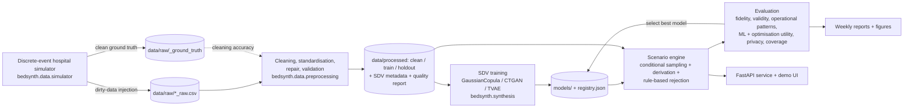

# BedSynth AI — Design & Implementation Specification

> Authoritative technical specification for the BedSynth AI project. Code contracts live in
> `bedsynth/schema.py`, `bedsynth/scenarios.py`, `bedsynth/config.py`, `config/settings.yaml`
> and the modules referenced below; this document explains them and specifies the
> behaviour every module must implement.
>
> Measured values that describe the submitted system come from the final full run of 2026-11-15
> (`reports/results/`, `models/`, `reports/api_demo/`, `data/`) or from the evidence file named next to
> them. Figures about earlier code - what a removed variant or a fixed bug "used to" do, earlier A/B
> tests, quick-mode runs during development, the integration-round timings - are *development
> measurements* (the main ones are marked as such): their evidence is not part of the submission and
> the current code does not reproduce them.

---

## 1. Goal and grading map

Hospital administrators want to test bed-occupancy and scheduling optimisation models, but
operational data cannot be shared across facilities (privacy, competition). BedSynth AI learns
the joint distribution of non-clinical hospital operations data with **SDV** and generates
realistic synthetic records on demand — including targeted **scenarios** — through a
**FastAPI** service that validates every record and returns it with metadata.

| Rubric item (weight) | Where it is satisfied |
|---|---|
| Requirements & dataset preparation (15%) | §5 data model, §6 simulation/cleaning/validation, SDV metadata files, Week-1 report |
| SDV synthetic data pipeline (25%) | §1.1 background and design rationale, §7 metadata/constraint groups/models/registry/training + ablation, §8 generation engine |
| Quality & statistical evaluation (20%) | §9.1–9.3 SDV QualityReport + KS/TV/correlation + rule validity, §9.10 real-holdout ceiling and no-learning floor |
| Occupancy, scheduling & scenario coverage (15%) | §9.4 calibrated operational checks, §9.7 optimisation utility, §9.8 scenario coverage, 26 scenarios (§8.5) |
| FastAPI development & integration (15%) | §10 API |
| Documentation, testing & presentation (10%) | §11 scripts/reports, §12 tests (JUnit evidence in the Week-4 report), README, `docs/` (API reference, demo runbook, Q&A, deliverables index, team plan, slide deck), demo UI |

### 1.1 Background and design rationale

**How the three SDV synthesizers learn and sample.** All three are single-table models: they learn
the joint distribution of one table's columns and sample new rows independently of each other.

* **GaussianCopula** (`GaussianCopulaSynthesizer`). Each column is mapped to a standard-normal
  score: a numeric column through the CDF of its fitted marginal (a parametric family such as
  truncnorm, beta, gamma or norm), a categorical column through its encoder (each category becomes
  an interval of [0, 1]; `OrderedUniformEncoder` lets us choose the order). The dependence between
  columns is one correlation matrix of these scores - a multivariate normal, the *copula*. Sampling
  draws a multivariate-normal vector and maps every coordinate back through the normal CDF and the
  inverse marginal. It fits in seconds on a CPU, is stable on a few thousand rows and is easy to
  inspect, but one linear correlation matrix cannot represent interactions, point masses or modular
  arithmetic (the discharge weekday is admission weekday + nights mod 7). BedSynth therefore fits
  one copula per segment (§7.3) and adds programmable constraints (§7.2).
* **CTGAN** (`CTGANSynthesizer`). Numeric columns get mode-specific normalisation (a Gaussian
  mixture per column: a value becomes its mode and a scaled offset), categoricals are one-hot
  encoded. A generator network turns random noise plus a *conditional vector* (one category of a
  discrete column, drawn so that rare categories are seen during training) into a row, and a
  discriminator learns to tell real rows from generated ones; the two are trained against each
  other for a number of epochs (200 here). Sampling feeds fresh noise through the generator. It can
  learn non-linear and multimodal structure but needs many epochs and rows: the 200-epoch fits took
  218 s on the 7,016 ward-days and 338 s on 20,000 stays (Week-2 report section 4).
* **TVAE** (`TVAESynthesizer`). Same data transformation; an encoder maps each row to a Gaussian
  latent distribution and a decoder reconstructs the row, trained on reconstruction error plus a
  penalty that keeps the latent space close to N(0, I). Sampling decodes latent vectors drawn from
  N(0, I). It trains faster and more stably than CTGAN (76 s and 160 s here) but tends to smooth rare
  modes.

**Fidelity, utility and privacy.** A synthetic dataset is judged on *fidelity* (distributions and
relationships match the real data), *utility* (models and decisions built on it behave as they
would on real data) and *privacy* (no real record, or real frequency, can be recovered). They pull
against each other: copying the training rows maximises fidelity and utility and fails privacy,
while sampling every column independently (the no-learning floor, §9.10) is private but loses every
relationship. The use case here - testing bed-management and scheduling optimisation code - puts
fidelity, validity and operational patterns first (composite weights 0.30 / 0.20 / 0.25, utility
0.15, privacy 0.10; §9.9). Two design choices trade some privacy for fidelity on purpose and are
reported, not hidden: `conditional_marginals` only generates values observed in a group (§7.2), and
the allocation strata reproduce exact training frequencies (aggregate disclosure, §9.5, §13). Privacy
is measured record by record (exact matches, distance to closest record) and is methodological,
because the reference data is simulated.

**Why two single-table synthesizers rather than SDV's multi-table or sequential models.**

* *Multi-table (HMA, `HMASynthesizer`)* models parent and child tables linked by a primary key and a
  foreign key, each a single column. The natural link here is the composite ward × date, and a stay
  spans several ward-days (from admission to discharge), so a stay is not the child of one ward-day:
  keying stays to their admission day would tie each stay to one row while the census of every later
  day of the stay also counts it. The two tables also serve different optimisation models
  (ward-level capacity and scheduling versus patient-level flow), and each is useful on its own.
  They are therefore synthesised independently (no cross-table linkage, §13).
* *Sequential (PAR, `PARSynthesizer`)* models ordered sequences per entity (here: per ward, ordered by
  date) and could learn day-to-day continuity - `census_end` of one day becoming `census_start` of the
  next. The cost is the constraint machinery: BedSynth's validity and scenario control rest on
  single-table synthesizers (programmable constraints fitted per segment, exact per-group marginals,
  pooled conditional sampling, allocation strata and rejection per row, §7-§8); a sequence model would
  need all of it rebuilt at sequence level, scenario conditions on individual days would need
  rejection of whole sequences, and the data holds only eight ward sequences, split at random rather
  than by time. Calendar context is explicit instead (month, weekday, calendar mode, §8.4), and
  continuity is a documented limitation and future work (§13).

## 2. Architecture



## 3. Repository layout and ownership

```
config/settings.yaml            all tunables (paths, simulation, experiments, generation, API)
bedsynth/
  config.py  schema.py  scenarios.py           shared contracts (do not change signatures)
  validation.py                                 operational rules (§6.4)
  data/  io.py fixtures.py                      shared helpers
         simulator.py quality_issues.py         source simulation + dirty-data injection (§6.1-6.2)
         preprocessing.py                       Week-1 cleaning pipeline (§6.3)
  synthesis/ metadata.py                        SDV metadata (§7.1)
             constraints.py models.py registry.py training.py generator.py   (§7-§8)
  evaluation/ statistical validity operational privacy utility optimization coverage
              references scoring (+ __init__ re-exports)                            (§9)
  reporting/ week1..week4.py _common.py         figures + markdown reports (§11)
  api/ main.py schemas.py service.py static/    FastAPI app + demo UI (§10)
scripts/01..05, run_pipeline.py                 pipeline entry points (§11)
scripts/package_submission.py                   submission zip with a scan for machine identifiers (§11)
tests/                                          pytest suite (§12)
README.md                                       quick start, pipeline, API usage, results
docs/                                           DESIGN.md (this file), API.md, DEMO_SCRIPT.md, QA_PREP.md,
                                                DELIVERABLES.md, TEAM_PLAN.md, presentation/ (slide deck)
data/ models/ reports/                          generated artefacts (git-ignored except reports)
```

## 4. Environment, conventions, SDV 2.2 notes

* Python 3.13 virtualenv at `.venv`. Run everything with `.venv\Scripts\python.exe` (Windows) /
  `.venv/bin/python`. **No new dependencies, no network access.** Installed: sdv 2.2.0,
  sdmetrics 0.33.0, rdt 2.1.0, ctgan 0.13.0, copulas 0.15.0, torch 2.15 (CPU), pandas 2.3,
  numpy 2.5, scipy 1.18, scikit-learn 1.9, fastapi 0.162, pydantic 2.14, uvicorn, matplotlib, pyyaml, pytest, httpx.
* `import bedsynth` first: it sets `TQDM_DISABLE=1` (SDV prints progress bars otherwise).
* Paths come from `bedsynth.config.get_path(key)`; tests redirect them with `BEDSYNTH_*_DIR`
  env vars (fixture `isolated_paths`). Never hard-code `data/` or `models/`. Paths written into
  artefacts (data-quality report, registry and model cards, pickled training annotations, evidence
  files) go through `bedsynth.config.project_relative` (project-relative, or `~/...` outside the
  project), so no artefact records the home directory or the user name; `resolve_project_path`
  turns a stored value back into a usable path.
* All public functions: type hints + docstrings. JSON outputs must be serialisable
  (convert numpy scalars, NaN → `None`).
* **SDV 2.2 API (verified, differs from SDV 1.x tutorials):**
  * `from sdv.metadata import Metadata`; columns via `metadata.add_column(name, table_name=t, sdtype=..., **kw)`.
    Numerical kwargs: `range_min, range_max, range_is_nullable, decimal_places` (**no** `computer_representation`).
    Categorical: `range_values, high_cardinality`. New sdtype `ordinal` with ordered `range_values` (auto `OrderedUniformEncoder`).
  * Synthesizers: `from sdv.single_table import GaussianCopulaSynthesizer, CTGANSynthesizer, TVAESynthesizer, CopulaGANSynthesizer`.
    GaussianCopula default distribution is `'beta'`; others: `'norm','truncnorm','gamma','uniform','gaussian_kde'` (avoid KDE: slow sampling).
  * **Data is passed as a dict:** `synth.fit({table: df})`; `synth.sample(n)` → `{table: df}`;
    `synth.sample_from_conditions([Condition(column_values={...}, num_rows=k)])` → `{table: df}`
    (raises `ValueError` when no rows can be produced); `sample_remaining_columns(known_df)` likewise.
  * Constraints (CAG): `from sdv.cag import Inequality, FixedCombinations, Range, FixedIncrements, OneHotEncoding, ProgrammableConstraint`;
    `synth.add_constraints([...])` **before** `fit`. `Inequality(low_column_name=, high_column_name=, strict_boundaries=False)`,
    `FixedCombinations(column_names=[...])`. Constraint-merged columns appear in transformers as `a#b`.
  * Programmable constraints (verified against `sdv/single_table/base.py`): subclass
    `from sdv.cag import SingleTableProgrammableConstraint` and implement `fit`, `transform`,
    `get_updated_metadata`, `reverse_transform`, `is_valid`. Every `__init__` argument must be stored on
    `self` under the same name (`get_constraint_dict`), and the classes must live at module level
    (cloudpickle). SDV transforms in `add_constraints` order and reverse-transforms in **reverse** order,
    *after* its data processor has rounded and clipped the numerics, so a re-parameterised column is
    clipped to its transformed training range. `Inequality` replaces its high column by `low#high` and
    `FixedCombinations` merges its columns, so programmable constraints that read or write those columns
    are listed first. After each `reverse_transform` SDV **silently drops** rows whose `is_valid` is
    False: BedSynth's constraints return True for rows they deliberately leave to rejection, so raw
    validity numbers are not inflated. Condition frames pass through the transforms too; a transform that
    fails on a partial frame falls back to the data processor. Constraints are fitted once (during
    `auto_assign_transformers`), not refitted by `fit`.
  * Per-column marginals: `GaussianCopulaSynthesizer(numerical_distributions={column: family})` overrides
    `default_distribution` per column (columns of an applied `Inequality` are excluded: SDV models
    their difference column).
  * Transformers: `synth.auto_assign_transformers({table: df})`, `synth.update_transformers({col: transformer})`
    (`from rdt.transformers import OrderedUniformEncoder` - it lives in `rdt.transformers.ordinal`;
    `rdt.transformers.categorical` raises ImportError in rdt 2.1). Any category listed in the encoder
    order (or in ordinal metadata) but absent from the data receives ~10 % of the latent mass, so
    orders are restricted to the categories observed in each segment.
  * Reproducible sampling: `synth.reset_sampling(); synth._set_random_state(seed)` (numpy seeding has no effect).
    CTGAN/TVAE `_set_random_state` only accepts a Python `int` (not a numpy integer).
  * Public `sample()` forces a tqdm progress bar whenever constraints exist (ignores `TQDM_DISABLE`);
    the wrapper calls `_sample_with_progress_bar(..., show_progress_bar=False)` instead.
  * Every SDV sampling call has a fixed cost of ~0.2-0.3 s (reverse transforms) whatever the row
    count, and `sample_from_conditions` maps a categorical condition to one fixed latent point, which
    narrows conditional distributions; the wrapper therefore serves conditions by pooled rejection
    from one unconditional draw per segment (§7.3). Impossible conditions raise only after
    `max_tries_per_batch` (default 100, ~20 s): the wrapper detects infeasible conditions up front and
    lowers it to 20. `sdv.cag._errors.ConstraintNotMetError` is not a `ValueError`.
  * Persistence: `synth.save(path)`; load with `from sdv.utils import load_synthesizer` (`Synthesizer.load` no longer exists).
  * Evaluation: `from sdv.evaluation import evaluate_quality, run_diagnostic` (accept DataFrames + Metadata;
    `QualityReport.get_score()/get_properties()/get_details('Column Shapes'|'Column Pair Trends')`).
  * Private SDV 2.2 attributes the wrapper reads (guarded where possible): `_set_random_state`,
    `_sample_with_progress_bar`, `_validate_fit_before_sample`, `GaussianCopulaSynthesizer._DISTRIBUTIONS`,
    and `FixedCombinations._joint_column` / `_ids_to_combinations` (ordering of the merged outcome
    column; without them SDV's default encoding is kept). Hence the pin `sdv==2.2.0`.
  * Cost on this machine (final run of 2026-11-15, Week-2 report section 4): a plain GaussianCopula
    fit takes seconds (`gc_baseline` 1.9 s / 6.3 s), but `gc_tuned` compares four candidate marginals
    per segment (beta/gamma MLE fits dominate), so a `gc_tuned` fit takes about half a minute per table
    (33.9 s ward_daily, 28.8 s patient_stays); the 200-epoch CTGAN / TVAE fits took 218 s / 76 s on the
    7,016 ward-days and 338 s / 160 s on 20,000 stays (GAN/VAE training is subsampled to
    `synthesis.max_training_rows`).
    Quick mode only shortens the GAN/VAE epochs (10).

## 5. Data model (summary — `bedsynth/schema.py` is authoritative)

Two tables, both **non-clinical** (no diagnoses, procedures, ages or personal identifiers).
Column roles: `key` (assigned id), `time` (timestamps: source data only — SDV cannot learn
seasonality from timestamps, so calendar context is explicit), `train` (learned by SDV),
`derived` (recomputed by `schema.derive(table, df)`, guaranteeing identities).

**Wards** (194 beds): AMU 28 (acute, emergency only), GMED 32, ELDC 30 (no electives), CARD 20,
GSUR 30, ORTH 24, ICU 12 (1.5 pts/nurse), PAED 18 (no transfers in). Each ward has an escalation
limit, nurse ratios (→ `required_nurses_day/night`) and allowed admission sources.

**ward_daily** — one row per ward per day. 22 train columns: `ward_id, month, day_of_week,
escalation_beds_open, beds_closed, staffing_level, nurses_day_shift, nurses_night_shift,
census_start, elective_scheduled, elective_cancelled, admissions_emergency, transfers_in,
transfers_out, discharges, discharges_before_noon, delayed_discharges, emergency_boarders,
avg_bed_wait_hours, avg_bed_turnaround_min, avg_los_days, occupancy_level`. Derived:
`ward_type, season, is_weekend, bed_capacity, available_beds, admissions_elective, census_end
(flow balance), occupancy_rate, bed_turnover_rate, patients_per_nurse, delayed_discharge_rate,
elective_cancellation_rate`.

**patient_stays** — one row per ward stay. 15 train columns: `ward_id, admission_source,
admission_month, admission_day_of_week, admission_hour, booking_lead_days, times_rescheduled,
bed_wait_hours, los_nights, discharge_hour, separation_type, discharge_destination,
delay_reason, discharge_delay_hours, bed_turnaround_minutes`. Derived: `ward_type,
admission_season, discharge_day_of_week, los_hours, los_days, is_delayed_discharge,
discharged_before_noon, is_weekend_discharge`.

Bands (shared helpers, always computed from counts): occupancy `low <0.75 ≤ normal <0.90 ≤ high
<0.97 ≤ critical` (`occupancy_levels`); staffing `short` if day nurses < requirement, `adequate`
up to requirement + slack (max(1, round(0.15·req))), else `surplus` (`staffing_levels`).

Shared operational constants (used by the simulator, the rules, the scenarios and the cleaning
pipeline alike): `DELAY_THRESHOLD_HOURS = 4.0` (a discharge counts as delayed only when the patient
leaves more than 4 h after being ready, so `discharge_delay_hours` is 0 or ≥ 4) and
`REBOOK_MIN_DAYS = 7` (`min_rebooked_lead_days(r) = 1 + 7·r`: a cancelled elective is rebooked at
least 7 days later).

## 6. Week 1 — source data, cleaning, validation

### 6.1 Reference data simulator (`bedsynth/data/simulator.py`)

No real data is shared (that is the problem statement), so a seeded **discrete-event
simulation** of the 194-bed hospital produces the reference extract. It must be operationally
coherent because every downstream metric is judged against it.

Public API:
```python
@dataclass
class SimulationResult:
    ward_daily: pd.DataFrame      # RAW_COLUMNS[ward_daily], clean, sorted by date, ward_id
    patient_stays: pd.DataFrame   # RAW_COLUMNS[patient_stays], clean, sorted by admission_datetime
    calibration: dict             # calibration_summary(...)
def simulate(start_date: str | None = None, end_date: str | None = None, seed: int | None = None,
             settings: dict | None = None) -> SimulationResult
def calibration_summary(ward_daily: pd.DataFrame, patient_stays: pd.DataFrame) -> dict
def generate_source_data(raw_dir: Path | None = None, seed: int | None = None,
                         inject_issues: bool = True) -> dict   # writes files, returns manifest
```
Mechanics (parameters in `settings.simulation`):
* Event queue (`heapq`) in continuous time (hours); warm-up (`warmup_days`) before `start_date`
  starting from ~80 % census with random remaining LOS; cool-down after `end_date` so every stay
  admitted in the window completes. Output only stays admitted in `[start_date, end_date]` and
  ward-days in that window. Runtime target: **< 120 s** for 2022-2024.
* **Emergency arrivals**: non-homogeneous Poisson per ward: `emergency_per_day × emergency_seasonality[month]
  × emergency_dow[dow] × (1+annual_demand_growth)^years × surge` (winter flu surge episodes,
  `paediatric_winter_boost`), hour-of-day from `emergency_hour_weights`.
* **Electives**: daily bookings ~ Poisson(`elective_per_weekday × elective_dow × elective_month`)
  for wards that accept electives; arrival 07:00–10:59; `booking_lead_days` lognormal (median ≈ 30 d,
  ORTH ≈ 60 d, ≥ 1). At the 07:00 bed meeting cancel electives that cannot be bedded (projected free
  beds after reserving 1–2 for emergencies), ~20 % extra on short-staffing days, ~3 % patient
  cancellations. Cancelled electives are rebooked 7–28 days later on a weekday
  (`times_rescheduled` += 1, max 3). `elective_scheduled`/`elective_cancelled` count bookings for the day.
* **Bed allocation**: a patient is bedded only if `occupied + beds_in_turnaround < available_beds`,
  so **midnight census ≤ available_beds always holds**. Otherwise the patient waits in a FIFO
  queue for that ward (ED boarding / awaiting transfer). `bed_wait_hours` = admission − bed request
  (emergencies include a 0.5–3 h decision-to-admit lag drawn from a *truncated* lognormal - out-of-range
  draws are redrawn, so the bounds carry no point mass; electives ≈ 0–1.5 h). Queue length at 24:00 =
  `emergency_boarders` (emergency requests only).
* **Length of stay**: clinical LOS (until ready to leave) lognormal per ward/source so that
  *total* mean LOS ≈ `los_mean_days`; electives tighter variance. Disposition: transfer with
  `transfer_out_prob` (target from `transfer_targets`, queue in target ward, waiting extends the
  stay with reason `awaiting_downstream_bed`) else discharge with destination mix by ward
  (ELDC/GMED more `care_facility`/`home_with_support`; PAED all `home`/rarely `other_hospital`).
* **Departure and delays**: ready time → departure after destination-specific delays
  (home: 25 % small transport/medication delays; home_with_support: ~50 %, lognormal ≈ 24 h;
  care_facility: ~80 %, 1–10 days; other_hospital: ~50 %, ≈ 12 h). The service-delay probability
  is scaled per ward (`_WARD_DELAY_FACTOR`: PAED 0.2, GSUR 0.7, ORTH and CARD 0.8), so delayed
  discharges concentrate on the medical and elderly-care wards as in real hospitals (PAED was
  delayed as often as GMED before). **Weekend model**: separate Saturday / Sunday discharge
  capacities (`weekend_discharge_capacity` `{Sat: 0.85, Sun: 0.68}`: the probability that a patient
  ready that day also leaves at the weekend); readiness that the weekend cannot confirm is reviewed
  on Monday/Tuesday/Wednesday (50/30/20 %) and weekend service gaps resume on Monday, so Saturday's
  backlog never inflates Sunday; a Friday pre-weekend push (`friday_discharge_push` `{Sat: 0.20,
  Sun: 0.10}`, patients in hospital ≥ 1 day) brings weekend readiness forward to Friday afternoon
  (included in the LOS calibration). Departure hour drawn from `discharge_hour_weights` (≥ ready
  hour, else next day). A stay is **delayed** if departure − ready > 4 h (`DELAY_THRESHOLD_HOURS`):
  then `discharge_delay_hours` = that gap (1 dp) and `delay_reason` ∈
  `ALLOWED_DELAY_REASONS[destination]` (non-'none'); otherwise 0 and `'none'`. `delayed_discharges`
  (ward_daily) = patients present at 00:00 whose ready time + 4 h ≤ 00:00.
* **Bed turnaround**: lognormal median ≈ 70 min (σ≈0.45); ×1.6 night (20:00–07:00), ×1.25 weekend,
  ×1.3 short staffing; 5 % deep cleans 180–360 min; clip [15, 900]. Bed unavailable until ready.
* **Staffing**: daily Markov state {short, adequate, surplus} per ward (short ≈ 12 % of days,
  ≈ 22 % in winter; surplus ≈ 6 %); `nurses_day_shift` drawn so `staffing_level_for()` returns the
  state; night ≈ requirement (−1 on short days, ≥ 1).
* **Capacity changes**: closures only of *free* beds — short-staffing (0–2 beds), infection
  outbreaks (winter-weighted, medical/AMU/PAED, 3–6 beds, 3–7 days, ~8/yr), maintenance (summer,
  2–4 beds, 2–5 days, ~3/yr). Escalation beds (≤ ward `max_escalation_beds`) open on AMU/GMED/ELDC
  (others ≤ 2) when hospital medical occupancy > 95 % for 2 consecutive mornings, close (only when
  free) after 3 mornings < 88 %. `census_start ≤ bed_capacity + escalation_beds_open` must hold, and
  because only free beds close, `census_start ≤ available_beds` too (hard rule WD-H15).
* Daily aggregates: flows by ward/day from events; `avg_bed_wait_hours` = mean wait of the day's
  emergency admissions (0 if none); `avg_bed_turnaround_min` and `avg_los_days` = trailing 7-day
  means of departures (carry forward when none; initial 75 min / ward target LOS).
  `occupancy_level = occupancy_level_for(census_end, available_beds)`;
  `staffing_level = staffing_level_for(nurses_day_shift, ward_id)`; `census_end(d) = census_start(d+1)`.
* Hour-resolution consistency for stays: derived `los_hours ≥ 1` (if a same-day stay would floor to
  the same hour, move departure into the next hour), `discharge_delay_hours ≤ los_hours`.
* **Calibration targets** (report them in `calibration_summary`): ward mean occupancy within ±0.04
  of `target_occupancy`; ward-day occupancy mix ≈ low 10–25 %, normal 25–45 %, high 25–45 %,
  critical 5–20 %; boarders > 0 on 5–20 % of AMU/GMED/ELDC winter days; delayed discharge rate ELDC
  10–25 %, GMED 5–15 %, surgical 2–8 %; discharges before noon 15–30 %; weekend discharges ≈ 50–70 %
  of weekday level; elective cancellation 3–10 % (higher in winter); short staffing 10–20 % of days;
  emergency bed wait median 1–3 h, p90 4–12 h in winter. Four realism targets were added after the
  Week-3 data review (27 in total): Monday discharges 0.85–1.25 × the Tuesday–Friday mean, Sunday
  0.6–1.0 × Saturday (no weekend backlog spike), PAED delayed-discharge rate ≤ 0.06, and no single
  bed-wait value holding more than 5 % of any ward × source group (`bed_wait_point_mass`). Tune ward
  `emergency_per_day` in settings.yaml if needed (document changes).
* **Mechanisms added during calibration** (all documented in the module docstring; needed to run
  the medical bed base at 0.92–0.95 mean occupancy without exploding queues):
  * *Occupancy-elastic discharging*: 09:00 and 14:00 board rounds bring forward patients due within
    24 h when the queue plus headroom exceeds free beds; under pressure the service-delay probability
    and social-care waits are ×0.6 ("discharge to assess"); on a non-pressured ward below 92 %
    occupancy a ready non-elective patient may stay until the next ward round (p = 0.6, "quiet-ward
    stretch"; included in the LOS calibration for wards planned at ≤ 75 % occupancy).
  * *Medical outliers*: an emergency/transfer patient waiting longer than a per-patient threshold of
    3 h + U(0, 90 min) (the bed manager acts on each 3-hour breach within 90 minutes) may be bedded on
    another general medical ward (AMU→GMED/ELDC, GMED↔ELDC, CARD→GMED) with > 2 free beds and no queue.
    (A fixed 3-hour timer used to put 54 % of GMED/ELDC emergency waits at exactly 3.00 h.)
  * *Ambulance divert*: when a ward's ED queue reaches 25 % of its beds, half of new arrivals go to
    another hospital (363 diverted arrivals in the seed-42 run, warm-up included, about 0.3 per day:
    counter `ambulance_diverts` in `data/raw/simulation_manifest.json`; they are not in the data);
    safety valves divert ED patients after 48 h and abandon a transfer (discharge instead) after 60 h.
  * *Electives*: the bed-meeting projection is unoccupied beds + departures planned by 15:00 +
    patients due ready by 14:00 (+0.5 per patient awaiting transfer) − reserve (1, or 2 with a queue)
    + 2 risk beds; electives unbedded by **14:59** are cancelled; cancelled bookings are rebooked into
    the **least-loaded weekday** 7–28 days later (≤ 3 times). "~20 % extra on short-staffing days" is
    implemented as 20 % lower elective capacity on short days (plus 0–2 closed free beds).
  * Escalation: AMU/GMED/ELDC open +2 beds per morning while hospital medical occupancy (AMU, GMED,
    ELDC, CARD) > 95 % for 2 mornings; other wards flex ≤ 2 beds on their own pressure.
* **Settings calibrated in Week 1** (originals kept as YAML comments): `emergency_per_day` AMU 17.8,
  GMED 0.42, ELDC 0.16, CARD 2.2, GSUR 2.4, ORTH 1.75, ICU 1.4, PAED 5.3 (GMED/ELDC are filled mainly
  by AMU transfers and outliers); `winter_flu_surge.extra_multiplier_range` [0.05, 0.15]. The
  Week-3 realism fixes (weekend model, outlier timing, truncated lag, ward delay factors) replaced
  the single `weekend_discharge_capacity` 0.55 by `{Sat: 0.85, Sun: 0.68}` plus the Friday push.
  With seed 42 all 27 calibration targets are met (development checks: also for seeds 1, 7, 11, 31,
  123, 777 and 2024; seeds 99 and 5 miss one or two thin-margin targets); margins stay thin for AMU occupancy (≈ 0.886
  vs ≥ 0.88), the critical-band share (≈ 0.19 vs ≤ 0.20) and the cancellation rate (≈ 0.09 vs
  ≤ 0.10), so simulator code changes must re-check calibration (`tests/test_simulator.py`, slow).
  The simulator also re-checks its own invariants on every run: no occupied bed is closed
  (`census_start ≤ available_beds`) and every rebooked elective keeps `lead ≥ 1 + 7·reschedules`.

### 6.2 Dirty-data injection (`bedsynth/data/quality_issues.py`)

`inject_quality_issues(df, table, config, rng) -> (dirty_df, log_df)` applied to copies of the
clean raw-format tables (rates in `settings.simulation.data_quality`):
* ward_daily: category variants for `ward_id`/`staffing_level`/`occupancy_level` (aliases from
  `CATEGORY_ALIASES` plus case/whitespace noise); dates as `DD/MM/YYYY`; missing values in
  `missing_columns`; exact duplicate rows; invalid values (`census_start=-1`, `discharges=999`,
  `nurses_day_shift=0`, `avg_bed_turnaround_min=0`, `beds_closed=-2`).
* patient_stays: category variants for `ward_id`, `admission_source`, `separation_type`,
  `discharge_destination`, `delay_reason`; datetimes as `DD/MM/YYYY HH:MM`; missing values;
  duplicates (same `stay_id`); invalid values (`bed_wait_hours=-1`, `bed_turnaround_minutes=99999`,
  admission/discharge timestamps swapped, `booking_lead_days=-5`).
* `log_df` columns: `table, row_key, column, issue_type, original_value, injected_value`
  (`row_key` = `stay_id` or `"<ward_id>|<YYYY-MM-DD>"`). Issue types: `category_variant`,
  `alt_date_format` (both tables), `missing_value`, `invalid_value`, `timestamp_swap` (column
  `admission_datetime|discharge_datetime`, values `a|b`), `duplicate_row` (empty column). Half of the
  patient_stays duplicates are re-entered copies with one category spelled as an alias, so
  de-duplication needs the `stay_id` key pass after the exact-duplicate pass; copies follow their
  original, so "keep first" restores the ground truth. A cell is never modified twice.

Files written by `generate_source_data`: `data/raw/{table}_raw.csv` (dirty),
`data/raw/_ground_truth/{table}_true.csv` (clean), `data/raw/_ground_truth/injection_log.csv`,
`data/raw/simulation_manifest.json` (seed, period, row counts, injected issue counts,
calibration summary, settings snapshot).

### 6.3 Preprocessing (`bedsynth/data/preprocessing.py`)

`prepare_datasets(raw_dir=None, processed_dir=None, seed=None) -> dict` (the data-quality
report, also written to `data/processed/data_quality_report.json`). Steps per table:
1. Read with `io.read_csv_raw` (alias strings preserved). Profile: rows, duplicates, missing per
   column, unknown categories, unparseable dates, provisional rule violations. The provisional
   validation runs after normalising spellings and both date formats (recorded as its `basis`), so the
   "violations in the raw extract" measure operational defects, not parsing gaps.
2. Standardise strings and categories (`schema.normalize_category_series`; unknown → missing).
3. Parse dates: ISO first, then day-first (`%d/%m/%Y[ %H:%M]`); unparseable → drop row.
4. Remove exact duplicates, then key duplicates (`ward_id+date`, `stay_id`), keep first.
5. Coerce numerics; physically impossible values (negative counts, sentinels such as 999 above the
   physical maximum, out-of-range metrics, discharge before admission) → missing (counted).
   Timestamp swaps are repaired by swapping back.
6. Repair/impute, most-principled first:
   *ward_daily*: temporal continuity (`census_start(d)=census_end(d-1)` per ward); solve the flow
   identity for a single missing term; trailing metrics interpolated within the ward series;
   remaining gaps → ward × day_of_week median (rounded for counts); `staffing_level` and
   `occupancy_level` recomputed from counts (report how many raw labels disagreed).
   *patient_stays*: missing `delay_reason` → `'none'` if delay = 0 else most common non-none reason
   for the destination; missing destination → `internal_ward` for transfers else ward mode;
   `bed_wait_hours`, `bed_turnaround_minutes` and `discharge_delay_hours` → seeded **hot-deck**
   imputation (a random observed donor from the same ward × source / ward × departure period /
   destination × reason group, with fallback levels and the same bounds; a group median used to put
   a point mass at the median that SDV then learned as a mode); invalid `booking_lead_days` → ward
   elective median for electives (at least `1 + 7·times_rescheduled`) else 0; imputed delays are
   ≥ 4 h. Count columns keep median imputation.
7. Derive: `add_calendar_features` + `derive_ward_daily`; `add_stay_time_features` + `derive_patient_stays`.
8. Validate (`validation.validate_table`); drop rows still hard-invalid (counted per rule).
9. Dataset checks: ward_daily continuity rate; cross-table admissions match (stays admitted per
   ward/day/source vs ward_daily counts).
10. Assign ids chronologically (`schema.assign_ids`), split train/holdout (`holdout_fraction`,
    stratified by `ward_id`, seeded).
11. Write `{table}_clean.csv`, `{table}_train.csv`, `{table}_holdout.csv` (all canonical columns incl.
    key/time), the SDV metadata (`write_metadata`): `metadata.json` describes the CSVs exactly (two
    tables, key as primary key, time columns as datetimes with their formats, train and derived
    columns; `Metadata.validate_data` accepts every clean/train/holdout pair) and
    `metadata_<table>.json` is the single-table metadata of the training columns that the
    synthesizers fit (accepted by `GaussianCopulaSynthesizer`); `schema_catalog.json` (`schema_as_dict`,
    `sdv_metadata` {files, fit columns, never-learned key/time/derived columns}, `constraints` from
    `describe_constraints`, `rejection_enforced_rules`, rules catalogue); `data_quality_report.json`.
12. If ground truth exists: cleaning accuracy = per-column agreement with ground truth on raw
    columns (aligned by key) and the share of logged injected issues resolved, reported twice:
    "no longer defective" (`resolved_rate`, any plausible repair) and "exactly recovered"
    (`exact_recovery_rate`, the repaired value equals the original; headline
    `injected_issues_exact_recovery_rate`).

### 6.4 Validation rules (`bedsynth/validation.py`)

Rules run on fully derived tables; NaN/unknown values fail the rule (never raise); boolean cells are
never valid category codes or counts (`True == 1` would otherwise pass `month ∈ 1..12`). 15 hard +
6 soft ward_daily rules, 14 hard + 5 soft patient_stays rules. WD-H15, PS-H13 and PS-H14 were added
after the Week-3 data review: the simulator guaranteed these invariants but no rule checked them,
so "100 % hard-valid" output contained delays under 4 h, closed occupied beds and rebookings
without the 7-day gap.

| id | name | hard rule (ward_daily) |
|---|---|---|
| WD-H01 | valid_categories | `ward_id, month, day_of_week, staffing_level, occupancy_level` in vocabularies |
| WD-H02 | non_negative_integer_counts | all integer count columns (train + derived) non-null, integral, ≥ 0 |
| WD-H03 | cancellations_within_bookings | `elective_cancelled ≤ elective_scheduled` |
| WD-H04 | noon_discharges_within_discharges | `discharges_before_noon ≤ discharges` |
| WD-H05 | delayed_within_census | `delayed_discharges ≤ census_start` |
| WD-H06 | census_within_available_beds | `0 ≤ census_end ≤ available_beds` |
| WD-H07 | census_start_within_physical_beds | `census_start ≤ bed_capacity + escalation_beds_open` |
| WD-H08 | capacity_limits | `escalation_beds_open ≤ ward max`, `beds_closed ≥ 0`, `available_beds ≥ 1` |
| WD-H09 | staffing_present | `nurses_day_shift ≥ 1`, `nurses_night_shift ≥ 1` |
| WD-H10 | occupancy_level_consistent | `occupancy_level == occupancy_levels(census_end, available_beds)` |
| WD-H11 | staffing_level_consistent | `staffing_level == staffing_levels(nurses_day_shift, ward_id)` |
| WD-H12 | ward_admission_profile | no electives where the ward takes none; no transfers in where it takes none |
| WD-H13 | metric_ranges | `avg_bed_wait_hours∈[0,96]`, `avg_bed_turnaround_min∈[10,1440]`, `avg_los_days∈[0.04,90]` |
| WD-H14 | wait_definition | `admissions_emergency == 0 ⇒ avg_bed_wait_hours == 0` |
| WD-H15 | closures_only_free_beds | `census_start ≤ available_beds` (only free beds are closed) |

Soft (ward_daily): WD-S01 `night_staffing_within_day` night nurses ≤ day nurses; WD-S02
`nurse_workload_plausible` `patients_per_nurse ≤ 2×` ward day ratio; WD-S03 `boarding_under_pressure`
boarders only when `occupancy_rate ≥ 0.90`; WD-S04 `escalation_under_pressure` escalation beds only
when `occupancy_rate ≥ 0.80`; WD-S05 `few_weekend_electives` weekend `elective_scheduled ≤ 2`;
WD-S06 `noon_discharge_share_plausible` with ≥ 4 discharges, before-noon share ≤ 0.8.

| id | name | hard rule (patient_stays) |
|---|---|---|
| PS-H01 | valid_categories | all categorical train columns in vocabularies |
| PS-H02 | hours_in_range | `admission_hour, discharge_hour` integers in [0, 23] |
| PS-H03 | non_negative_values | counts integral ≥ 0; `bed_wait_hours, discharge_delay_hours ≥ 0`; non-null |
| PS-H04 | positive_length_of_stay | `los_hours ≥ 1` |
| PS-H05 | elective_booking_lead | elective ⇒ `booking_lead_days ≥ 1` |
| PS-H06 | non_elective_unbooked | non-elective ⇒ `booking_lead_days == 0` and `times_rescheduled == 0` |
| PS-H07 | delay_reason_consistent | `delay_reason == 'none'` ⇔ `discharge_delay_hours == 0` |
| PS-H08 | delay_within_stay | `discharge_delay_hours ≤ los_hours` |
| PS-H09 | separation_destination_consistent | `transfer_out` ⇔ `internal_ward` |
| PS-H10 | delay_reason_allowed | `delay_reason ∈ ALLOWED_DELAY_REASONS[discharge_destination]` |
| PS-H11 | ward_admission_profile | `admission_source ∈ WARDS[ward_id].admission_sources` |
| PS-H12 | metric_ranges | turnaround ∈ [10,1440]; wait ≤ 96; `los_nights ≤ 180`; lead ≤ 365; rescheduled ≤ 10 |
| PS-H13 | delay_threshold | `discharge_delay_hours == 0` or `≥ 4` (`DELAY_THRESHOLD_HOURS`) |
| PS-H14 | rebooking_lead | elective ⇒ `booking_lead_days ≥ 1 + 7 × times_rescheduled` |

Soft (patient_stays): PS-S01 `elective_admission_hours` electives admitted 06:00–14:59; PS-S02
`daytime_departures` departures 07:00–22:59; PS-S03 `short_elective_wait` elective wait ≤ 4 h;
PS-S04 `no_paediatric_transfers_out` no transfers out of PAED; PS-S05
`long_delays_for_complex_discharges` delays > 72 h only for `care_facility`/`home_with_support`.

Category spellings are normalised by `schema.normalize_category` (aliases, case, surrounding
whitespace, and as a fallback collapsed internal whitespace / underscores, e.g.
`"general   medicine"` → `GMED`, `"Transfer_Out"` → `transfer_out`); the injector, the cleaning
pipeline, the generator and the API all share it. Reference-data soft-rule rates (seed 42, clean
data after the Week-3 simulator fixes): WD-S04 5.6 % (escalation is a hospital-level decision),
PS-S03 2.1 %, PS-S02 1.0 %, WD-S06 0.3 %, others ≤ 0.1 %.

## 7. Weeks 2–3 — SDV synthesis

### 7.1 Metadata — `synthesis/metadata.py`
`build_metadata(table, columns='training'|'evaluation'|'full', ordinal=True, exclude=())` (single
table; segments exclude their constant columns; the evaluation metadata leaves out the single-column
relabellings, §9.1) and `build_project_metadata` (both tables, no relationships). The Week-1 step
writes both kinds as files (§6.3).

### 7.2 Constraints — `synthesis/constraints.py`
Validity of every *returned* record comes from three mechanisms: constraints inside the SDV
synthesizer (this module), derivation (`schema.derive`: flow balance, rates, LOS hours...) and
rejection sampling against the hard rules (§8.3). Constraints are organised in six **groups**,
declared once in `CONSTRAINT_SPECS` (`ConstraintSpec`: group, columns, operational wording, rule ids,
inputs/anchor/group_by) and switched on per experiment with `constraints: true | false | <group> |
[groups]` (`normalise_constraints_setting`; `'none'` → no group, `'all'` → every group), which makes
their effect measurable as an ablation:

| group | implementation | declared for | rules |
|---|---|---|---|
| `inequality` | SDV `Inequality` | `elective_cancelled ≤ elective_scheduled`, `discharges_before_noon ≤ discharges`, `delayed_discharges ≤ census_start` | WD-H03/H04/H05 |
| `fixed_combinations` | SDV `FixedCombinations` | `(separation_type, discharge_destination, delay_reason)`, `(ward_id, admission_source)` | PS-H09/H10/H11 |
| `regime_labels` | `BandLabelConstraint` | `occupancy_level`, `staffing_level` recomputed in `reverse_transform` from the counts (`occupancy_levels(census_end, available_beds)` derived exactly like `schema.derive_ward_daily`; `staffing_levels(nurses_day_shift, ward)`); identity transform, so the labels stay latent regime variables and conditioning on them stays efficient | WD-H10/H11 |
| `structural_zeros` | `StructuralZerosConstraint` | `fit` learns category values whose numeric columns are *always* 0 (≥ 30 rows) and `reverse_transform` forces the zeros: no electives/transfers in on wards that take none (global models), no electives on Sundays, no booking lead or reschedules for emergencies/transfers; linked inequality pairs are zeroed together | WD-H12, PS-H06 |
| `capacity` | `EscalationCoverConstraint` | `escalation_beds_open` re-parameterised as the *cover* the day needs, `max(0, max(census_start, census_end) − beds + beds_closed)`, plus a learned extra ≥ 0, capped at the ward's training maximum (census values beyond the ward's observed escalation range are left to rejection) | WD-H06/H07/H15 |
| `conditional_marginals` | `ConditionalQuantileConstraint` | the distributional transform: within groups, a numeric column is replaced by a standard-normal score of its randomised empirical CDF and mapped back with the group's empirical quantile function, so each group's marginal (point masses included) is reproduced exactly while the copula keeps modelling the dependence of the scores. Declared for `discharge_delay_hours` per `delay_reason` (exactly 0 without a reason, the reason's own range otherwise); `elective_scheduled` / `elective_cancelled` per `ward_id × day_of_week` (it restores `cancelled ≤ scheduled` itself and replaces that `Inequality`); `emergency_boarders` and `avg_bed_wait_hours` per `ward_id` × occupancy band and `beds_closed` per `ward_id` × staffing band (`band_groups`: the band is recomputed from the counts like the band labels, never read from the sampled label); the escalation *extra* per `ward_id`; `nurses_day_shift` per `ward_id × month`; `los_nights` per `admission_day_of_week` (the discharge weekday is admission weekday + nights mod 7, which a linear copula cannot learn); `admission_hour`, `bed_wait_hours`, `discharge_hour`, `bed_turnaround_minutes` per `ward_id × admission_source` (exact hour-of-day profiles and right-skewed waits) | PS-H07, PS-H13, WD-H03 |

Groups of `conditional_marginals` need 30 training rows; all-zero groups of ≥ 10 rows keep their
zeros, other small groups share a pooled non-zero marginal. Only values observed in a group are
generated (exact marginals; individual records are not copied). The two patient_stays specs for
length of stay per admission weekday and for the hour/wait/turnaround marginals were added by the
integration round after an A/B on the reference data (development measurements: quick `gc_tuned`,
same seeds, 2,000-row evaluation sample, only the specs changed; no evidence file is kept):
weekend discharges 29.2 % → 23.0 % (reference 22.4 %), composite 0.930 → 0.964,
operational checks passed 11/16 → 16/16, fidelity 0.947 → 0.977, raw hard-valid rate 0.941 →
0.959; ML utility 0.913 → 0.940 (0.991 with the LOS spec alone - the
exact hour marginals cost some LOS predictability but fix the hour profiles and bed waits). The
same idea for ward_daily (discharges per ward × weekday, nurses per ward) was tried and **not**
adopted: it fixed the weekend/weekday discharge ratio but weakened the seasonal pressure contrast
(development measurement, quick evaluation: composite 0.938 → 0.944, within noise).

**A/B log, ward_daily band-grouped specs (adopted).** Evidence:
`reports/experiments/ward_daily_band_groups_ab.json` (variants, adoption bar, the official run and
the seed re-scores). Only the adopted variant x7 is in the current code (it is the ward_daily part
of `gc_tuned`, retrained by the pipeline); the control and the variants x1-x6 are kept in neither
`config/settings.yaml` nor `constraints.py`, so their figures can be checked only against that
archived evidence file. The previous ward_daily `gc_tuned` spec (composite 0.942 in the 2026-11-14 full
run) failed three operational checks: `relationship_occupancy_boarders` (Spearman of occupancy and
ED boarders 0.10 against 0.44 in the real data), `boarding_prevalence_by_occupancy_band` (boarders on
7-9 % of low and normal days) and `short_staffing_share_by_season` (short-staffed share 0.15-0.17 in
every season; these check values come from the 2026-11-14 run, whose results are not part of the
submission), because boarders, closed beds and nurses had per-ward marginals that ignored the
bands. Seven spec variants and the control were trained in full mode on the same training split and
evaluated with `scripts/03_evaluate.py` in one run (7,016 rows per model, evaluation seed 42, 400
rows per scenario, sdmetrics on), so they shared the operational noise calibration; only the specs
changed. Four variants were evaluated in full; three were screened on the same sample without
scenario coverage (privacy not computed and set to 1.0 in their composite). Adoption bar: at least
one of the three failing target checks newly passes and none of the 14 passing checks fails;
composite ≥ 0.9440; raw hard-valid ≥ 0.935; scenario coverage, fidelity and privacy each ≥ the
control's − 0.005; operational score above the control's; a clean modelling spec (no holdout data,
no hard-coded targets).

| variant | evaluation | spec change | composite | fidelity | raw hard-valid | operational checks passed (failing) | scenario coverage | privacy | utility | optimisation | decision |
|---|---|---|---|---|---|---|---|---|---|---|---|
| control | full | previous spec: per-ward exact marginals for the mostly-zero counts (closed beds, boarders, escalation extra), parametric nurse marginal | 0.942 | 0.965 | 0.944 | 14/17 (`relationship_occupancy_boarders`, `short_staffing_share_by_season`, `boarding_prevalence_by_occupancy_band`) | 0.948 | 1.0000 | 0.934 | 0.921 | baseline |
| x1 | full | boarders per ward × recomputed occupancy band, listed before the escalation cover | 0.950 | 0.965 | 0.939 | 16/17 (`short_staffing_share_by_season`) | 0.947 | 0.9949 | 0.932 | 0.931 | rejected: privacy below the bar |
| x2 | screen | x1 + day-shift nurses per ward × month | 0.954 | 0.966 | 0.942 | 15/17 (`seasonal_pressure_contrast`, `relationship_bed_pressure_cancellations`) | - | - | 0.932 | 0.921 | rejected: two passing checks regress |
| x3 | screen | x1 + day-shift nurses per ward × sampled staffing label | 0.950 | 0.965 | 0.941 | 15/17 (`seasonal_pressure_contrast`, `relationship_bed_pressure_cancellations`) | - | - | 0.933 | 0.925 | rejected: two passing checks regress |
| x4 | full | x2 + closed beds per ward × recomputed staffing band (escalation extra split out) | 0.954 | 0.964 | 0.941 | 17/17 | 0.948 | 0.9900 | 0.926 | 0.921 | rejected: privacy below the bar, utility below the control |
| x5 | full | x2 + the mean bed wait in the band-grouped boarder spec | 0.959 | 0.971 | 0.942 | 16/17 (`relationship_bed_pressure_cancellations`) | 0.949 | 0.9944 | 0.947 | 0.931 | rejected: a passing check regresses, privacy below the bar |
| x6 | screen | day-shift nurses per ward × month only (attribution) | 0.944 | 0.964 | 0.944 | 14/17 (`weekend_weekday_discharge_ratio`, `relationship_occupancy_boarders`, `boarding_prevalence_by_occupancy_band`) | - | - | 0.929 | 0.918 | rejected: `weekend_weekday_discharge_ratio` regresses |
| x7 | full | x4 + the mean bed wait in the band-grouped boarder spec: boarders and bed wait per ward × occupancy band, closed beds per ward × staffing band (bands recomputed), escalation extra per ward, day-shift nurses per ward × month | 0.958 | 0.968 | 0.938 | 17/17 | 0.949 | 0.9970 | 0.960 | 0.955 | **adopted**: meets every criterion |

x7 was the only variant that met every criterion of the bar in the official run: all three target
checks pass (boarder Spearman difference 0.001, boarding-by-band difference 0.007, short staffing
0.010), no other check fails, fidelity rises (0.965 → 0.968), utility rises (0.934 → 0.960) and
scenario coverage stays level (0.948 → 0.949), while privacy moves from 1.000 to 0.997 and raw
validity from 0.944 to 0.938. Its spec became the ward_daily part of `gc_tuned` (`band_groups` on
`ConditionalQuantileConstraint`, see the ordering note below); the final full run of 2026-11-15
retrained it and reproduced x7 exactly (composite 0.958271). The variants were compared on the same
evaluation that is reported, and its utility (TSTR and booking quotas scored on the holdout, §9.6-9.7)
and privacy (holdout DCR baseline, §9.5) families use the real holdout, so the adopted spec's utility
and privacy figures carry some selection optimism; the seed re-scores below resample the synthetic
rows but keep the same split. A fresh split seed, or a separate validation split for future A/B
tests, would remove it.

*Robustness.* The control and three variants (x1, x4, x7) were re-scored with evaluation seeds 7, 11
and 2024: the same trained models on new evaluation samples, privacy computed, no scenario coverage
(not a composite component). Previous spec (control) against the adopted spec (x7):

| evaluation seed | composite | operational checks passed | raw hard-valid | check the adopted spec fails |
|---|---|---|---|---|
| 42 (official run) | 0.942 → 0.958 | 14/17 → 17/17 | 0.944 → 0.938 | none |
| 7 | 0.941 → 0.959 | 14/17 → 16/17 | 0.938 → 0.934 | `relationship_bed_pressure_cancellations` |
| 11 | 0.942 → 0.955 | 14/17 → 16/17 | 0.941 → 0.933 | `weekend_weekday_discharge_ratio` |
| 2024 | 0.942 → 0.955 | 13/17 → 17/17 | 0.942 → 0.932 | none |

Across the four seeds the adopted spec scored 0.955-0.959 (mean 0.957) against 0.941-0.942 (mean
0.942) and passed 16-17 of 17 checks against 13-14, at a raw hard-valid rate of 93.2-93.8 % against
93.8-94.4 % (0.4-1.0 points lower on each seed, mean 0.7; rejection sampling still delivers only
hard-valid rows). The checks it failed on seeds 7 and 11 are borderline checks that pass in the official run.

The rejected variants x1 and x4 were re-scored as well (composite and operational checks passed per
evaluation seed):

| variant | 42 (official run) | 7 | 11 | 2024 |
|---|---|---|---|---|
| x1 | 0.950, 16/17 | 0.952, 16/17 | 0.953, 15/17 | 0.951, 15/17 |
| x4 | 0.954, 17/17 | 0.959, 17/17 | 0.953, 17/17 | 0.954, 17/17 |
| x7 (adopted) | 0.958, 17/17 | 0.959, 16/17 | 0.955, 16/17 | 0.955, 17/17 |

x4 is the more robust variant on the operational checks: it passed all 17 on every seed and met each
extra seed's privacy bar (1.000 / 0.993 / 0.992 against 0.991 / 0.992 / 0.989), whereas x7 missed the
bar on seed 11. x7 scored the higher utility on all four seeds (0.960 / 0.955 / 0.959 / 0.945 against
0.926 / 0.951 / 0.925 / 0.930) and the higher composite on three. x7 was kept because it alone met the
pre-set bar on the official seed (x4's privacy, 0.990, was below the bar, and its utility below the
control's); on the extra seeds the composite difference between the two (-0.001 to +0.002) is within
seed-to-seed variation.
Utility, optimisation and privacy vary more between seeds than the composite: on the extra seeds the
adopted spec's optimisation score was 0.945-0.958 against the previous spec's 0.928-0.952 (lower on
seed 7, level on seed 2024), its utility 0.945-0.959 against 0.939-0.954 (lower on seed 2024), and its
privacy 0.989-0.999 (0.9886 on seed 11, below that seed's control, 0.9974, by more than the bar's
0.005). Training-seed variation is not covered.

*Effect on CTGAN and TVAE.* CTGAN and TVAE enable every constraint group, so they use the same
ward_daily specs as `gc_tuned` and were trained with the band-grouped specs in the final run. On
ward_daily TVAE improved (composite 0.783 → 0.832, raw hard-valid 70.7 % → 77.0 %) and CTGAN fell
(0.786 → 0.758, raw hard-valid 64.0 % → 51.5 %); the earlier numbers come from the 2026-11-14 full
run with the previous specs, whose results are not part of the submission, and cannot be reproduced
from the current code. CTGAN and TVAE ran in one fixed configuration without hyperparameter tuning
(§7.5), so the change says nothing about how well tuned deep models would do. `gc_baseline`,
`gc_segmented` and every patient_stays model are unaffected by the change.

**Order inside SDV.** `CONSTRAINT_SPECS` order = `add_constraints` order. The programmable
constraints are listed first, so their `reverse_transform` runs last, on fully restored columns
(after `Inequality` has rebuilt its high column and `FixedCombinations` has split its merged
column); among them the reverse order is conditional marginals → structural zeros → escalation
cover → band-grouped ED marginals → band labels (the zeros and the cover read the restored counts;
ED boarders and bed waits, listed right after the band labels, are restored from the occupancy band
of the final escalation beds - the band the occupancy label then gets). Within the conditional
marginals the day-shift nurses are listed after the closed beds, so the closed beds are restored
from the staffing band of the restored nurses. Every programmable constraint returns
`is_valid = True` for rows it deliberately leaves to rejection, so SDV never silently drops rows.

**Segments** drop constant columns and the segment column(s): `build_constraints(table, columns,
groups=..., constants=...)` builds each constraint only when its columns are modelled (an
inequality needs both, a fixed-combination group keeps ≥ 2 modelled columns, a band label or the
cover may read constants such as `elective_scheduled = 0` on AMU and the ward's bed capacity, a
band-grouped conditional marginal needs the inputs of its bands modelled or constant) and
skips constraints whose columns are all constant (the constants already reproduce them; e.g. PS-H06
holds by segment constants in 14 of the 20 ward × source segments of patient_stays `gc_tuned`).
Learned state (structural zeros, group marginals, caps) is recorded per segment in the model card.

**Why some rules stay with rejection** (module docstring): PS-H04 (same-day stays leaving before
they arrive), PS-H08 (delay longer than the stay), PS-H14 (7-day rebooking gap), WD-H06/H15
remainders (a census beyond the ward's observed escalation range) and PS-H07/H13 for rare delay
reasons that share a pooled marginal. Each affects a few % of raw rows or less; the candidate
by-construction fixes (re-parameterising departure hours, clipping delays to the stay) would pile
mass up at a threshold or mix two meanings in one modelled column. **Removed repair:** an earlier
`structural_zeros` spec forced delay hours to 0 when no reason was recorded; it kept the length of
stay that had been drawn together with the discarded delay and inflated the LOS of non-delayed
stays by ~17 % (mean LOS +13 %; development measurements on that earlier code), so delay hours are
now modelled per reason by `conditional_marginals` instead.

`describe_constraints(table, columns=None, groups=..., constants=None)` lists the constraints with
group, implementation, expression, inputs and rules for reports, model cards, the schema catalogue
and the API.

### 7.3 Model wrapper — `synthesis/models.py`
`ExperimentConfig` (`segment_by: str | list[str] | {table: column(s)} | None`, `constraints: bool |
list[str]`, `from_settings(experiment_id, quick=False, table=None)`, `for_table(table)`,
`segment_columns(table)`, `constraint_groups`) + `BedSynthSynthesizer`:
* Global mode: one SDV synthesizer on all training columns.
* Segmented mode: one synthesizer per value of one column (`segment_by: ward_id`) or per value
  combination of several columns (`[ward_id, admission_source]`, tuple keys, labels such as
  `GMED/elective`); a `{table: column(s)}` mapping is resolved per table (tables not listed are
  global). Each segment is fitted on its rows without the segment column(s). **Columns constant
  within a segment** are dropped before fitting, remembered and re-inserted when sampling (AMU never
  books electives, emergency stays are never booked ahead). Segment-specific supports come for
  free: SDV clips numerics to their training range, so the electives of a ward × source model are
  admitted 07:00-14:00 like the reference electives. Routing: conditions on every segment column
  select one segment; conditions on some of them select the matching segments, apportioned by the
  training support of the remaining conditions; no condition → all segments by training share
  (largest remainder).
* `ordered_encodings` (GaussianCopula only): after `auto_assign_transformers`, replace the
  transformers of `month` / `admission_month` (ordered by mean occupancy_rate for ward_daily, mean
  los_nights for patient_stays), `day_of_week` (by mean **discharges**; natural Mon..Sun for stays),
  `ward_id` in global models (by bed capacity) and the merged patient_stays outcome column of
  `FixedCombinations` (separation × destination × delay reason, by mean los_nights, so the copula
  links the delay reason with the length of stay) with `OrderedUniformEncoder(order=...)`, so copula
  correlations capture non-monotonic seasonal/weekly effects. (Ordering weekdays by mean elective
  lists, whose Monday-Friday means are statistically indistinguishable, imposed a false gradient -
  Friday −36 %, Saturday 5×, development measurements on that earlier encoding - so elective lists
  are modelled per weekday by `conditional_marginals`.)
* Marginal selection for `gc_tuned` (wrapper-only params `tune_distributions` /
  `distribution_candidates`, removed before the params reach SDV): per segment the candidates
  (truncnorm, beta, gamma, norm) are compared by KS on a 500-row held-in subsample; the lowest mean KS
  becomes the segment's `default_distribution` and every directly modelled numerical column keeps
  the candidate with its own lowest KS (`numerical_distributions`; columns of an applied
  `Inequality` excluded). A **post-fit check** samples 2,000 rows after the final fit and refits once,
  with `truncnorm` (`norm` if truncnorm failed), every column whose KS exceeds max(0.15, 2 × tuned KS
  + 0.05): an MLE gamma fit of length of stay collapsed on the full CARD/emergency segment (80 %
  zero-night stays). `--quick` keeps every candidate (it only shortens GAN/VAE epochs): symmetric
  candidates alone put the median of right-skewed columns at their mean (emergency waits over 4 h
  36 % vs 13.5 %; development measurement).
* Conditional sampling (`sample_many(requests, seed=None, should_stop=None)`): one unconditional draw
  per segment sized for the most demanding request (k / p × 1.3, ≤ 50,000 rows) is routed to every
  request it satisfies (exact rejection); combinations never seen together but made of seen values
  are sized by the independence estimate (product of the values' shares) and pooled likewise;
  GaussianCopula's native `sample_from_conditions` (≤ 8 calls per segment) is reserved for
  combinations without support or too rare to pool. `should_stop` (checked before every segment and
  native call) lets the generator stop when its time budget is spent. Extra public helpers:
  `is_feasible`, `condition_probability`, `training_support`, `annotate` (card `training` block);
  per segment `SegmentModel.independence_probability`.
* `sample(num_rows, conditions, seed)` returns ≤ num_rows rows with exactly the training columns in
  canonical order and correct dtypes (ints as int64); seeds are derived deterministically
  (`reset_sampling()` + `_set_random_state(seed)` under the model's lock before every SDV call).
* Persist with cloudpickle (`synthesizer.pkl`) + `model_card.json` (§7.5). Pickles written before
  multi-column segments and constraint groups load unchanged (`__setstate__` upgrade; their cards
  list the groups they were actually fitted with).

### 7.4 Registry — `synthesis/registry.py` (file layout in the module docstring)
`ModelNotFoundError` (a `LookupError`) is defined here and re-exported unchanged by
`synthesis/generator.py`. The registry re-reads `registry.json` on every call and writes it
atomically, so a running API picks up newly trained models and new defaults without a restart.
Experiment / model ids must match `EXPERIMENT_ID_PATTERN` `^[A-Za-z0-9][A-Za-z0-9_\-]{0,63}$` (the
API's pattern), so no id can resolve outside `models_dir` (e.g. a Windows drive-qualified `D:evil`).
`list_models` summaries include `segment_by`, `segment_columns`, `segment_label`, `n_segments`,
`constraint_groups` and `effective_constraint_groups`. A card's `path` (the model directory) is
stored project-relative and is informational only: loading always uses `model_dir(table,
experiment_id)`. `scripts/03_evaluate.py` writes each evaluated model's Week-3 scores into its card as
`metrics` (§11), which the API returns unchanged (§10).

### 7.5 Training — `synthesis/training.py` and `scripts/02_train_synthesizers.py`
`train_experiment` loads the processed train split (or the given frame), resolves the experiment
for the table (`ExperimentConfig.from_settings(..., table=)`), subsamples to `max_training_rows` for
GAN/VAE models, fits, saves, registers, and returns the model card. After fitting,
`sample_diagnostics` records the model's raw hard-valid rate and per-rule hard and soft violation
rates in the card (the generator uses the raw rate to size its first batch).

Experiments (`settings.synthesis.experiments`), an ablation in three GaussianCopula steps plus two
deep models:

| id | recipe |
|---|---|
| `gc_baseline` | one global GaussianCopula, default encodings, beta marginals, no constraints (Week-2 baseline) |
| `gc_segmented` | per-ward segments, SDV built-in constraints only (`[inequality, fixed_combinations]`), ordinal metadata, ordered encodings, tuned marginals - the earlier `gc_tuned` recipe (since the weekday re-ordering it is no longer bit-identical to it) |
| `gc_tuned` | `gc_segmented` + every constraint group + ward × admission-source segments for patient_stays (`segment_by: {ward_daily: ward_id, patient_stays: [ward_id, admission_source]}`) - the default |
| `ctgan`, `tvae` | global deep models with every constraint group, 200 epochs (10 with `--quick`), batch size 500, CPU; one fixed configuration without hyperparameter tuning, patient_stays fitted on a 20,000-row subsample (`synthesis.max_training_rows`) |

Model card (`model_card.json`, also in `registry.json`): table, experiment config, sdv version,
training rows, fit seconds and seed, `segment_by` / `segment_columns` / `segment_label` /
`n_segments`, per segment `segment_values`, constant columns, the applied constraints with their
learned state, `distribution`, `distribution_scores`, `column_distributions` and
`distribution_fallbacks`; `constraint_groups` (enabled) and `effective_constraint_groups` (applied
inside SDV in at least one segment); `constraints` = the constraints actually applied, merged over
segments with a `segments` count; `constraint_coverage` per spec (segments applying it inside SDV vs
segments where segment or constant columns reproduce it); `distribution_selection` (candidates,
scores, `column_overrides`, `fallbacks`); `ordered_encodings`; `training` (source, quick flag,
`segment_columns`, `constraint_groups`, `sample_diagnostics` with `raw_hard_valid_rate`,
`hard_violation_rates`, `soft_violation_rates`).

CLI: `--tables`, `--experiments`, `--quick`, `--no-report` (the Week-2 report is rendered from the
registry after training). The summary table shows segmentation and the constraint groups
(`all (6) [N applied]` when a model applies fewer groups than it enables); the Week-2 report adds the
constraint catalogue with expressions, coverage per model, learned structural zeros per segment and
a constraint-ablation section (raw validity and top violations for gc_baseline → gc_segmented →
gc_tuned and the deep models).

## 8. Generation engine — `synthesis/generator.py`

### 8.1 Request handling
Validate table, scenario (must belong to table), `num_rows ≤ settings.generation.max_rows`,
mode, dates, ward ids, condition columns/values (`scenarios.validate_conditions` + vocabularies),
filters (`scenarios.validate_filters`). Merge: `conditions = scenario.conditions ∩ request.conditions ∩
{ward_id: wards}`; `filters = merge_filters(scenario.filters, request.filters)`. Unknown/invalid →
`GenerationError`; no trained model → `ModelNotFoundError`. `GenerationRequest.time_budget_seconds`
(None = the generator's default, `settings.generation.time_budget_seconds`, 300 s) must be a positive
finite number, `max_attempts` a positive integer.

### 8.2 Allocation
Expand condition lists into value combinations; allocate rows with the largest-remainder method in
proportion to each combination's joint frequency in the reference train split
(`io.load_processed(table, 'train')`; uniform with a warning if unavailable or all-zero support).
Combinations the model cannot produce (never seen in training) get no rows and are reported in one
counted warning quoting at most five of them.

### 8.3 Rejection loop (per combination)
```
remaining=k; batch=ceil(k*oversample_factor); attempt=0
while remaining>0 and attempt<max_attempts:
    raw = model.sample(batch, conditions=combo, seed=f(seed, combo_index, attempt))
    df  = schema.derive(table, raw)
    rep = validation.validate_table(df, table, include_soft=False)   # count violations per hard rule
    df  = df[rep.hard_valid_mask]; df = df[condition_mask & filter_mask]
    keep df[:remaining]; adapt batch = clamp(ceil(remaining/max(acceptance,0.01)*1.2), 1, max_batch_rows)
```
Then shuffle (seeded), `assign_ids`, order columns (drop derived if `include_derived=False`).
`seed=None` → draw a seed and report it (results are reproducible from the report).
Report fields are listed in the `GenerationResult` docstring; `acceptance_rate` = accepted / sampled;
`raw_hard_valid_rate` = rows passing hard rules / sampled. Warn on shortfall and on acceptance below
`low_acceptance_warning`. All open cells are sampled in one `sample_many` call per round; the first
batch uses `max(oversample_factor, 1.2 / raw_hard_valid_rate)` from the model card; a cell is
abandoned after max(2,000, 50 × quota) sampled rows without an accepted row.

**Time budget.** Every request carries a budget (`time_budget_seconds`, default 300 s; the API uses
60 s, the evaluation 10-90 s) measured from the start of the request (planning included) and
checked before every rejection round in sample and calendar mode. The work of one round is bounded
too: the rows requested in one round are capped at `generation.max_round_rows` (200,000; cell batches
are scaled down proportionally) and at the remaining budget × the sampling throughput measured in
the earlier rounds of the request (5,000 rows/s assumed before the first round is timed, never
fewer than 1,000 rows), and `sample_many(should_stop=...)` stops between segments once the budget is
spent (a filtered 10,000-stay request with a 10 s budget used to run 75 s because its second round
sampled 815k rows; it now stops after ~10.4 s). A budget-stopped request returns the rows accepted so
far (siblings' spare rows still top up short strata) with `stopped_reason`, a "stopped early"
warning and a shortfall warning advising to raise `time_budget_seconds`, and never raises. Report keys
`time_budget_seconds`, `stopped_reason`, `throttled_rounds` (rounds scaled down by a cap) and
`rows_per_second`. The throughput cap only binds when less than `max_round_rows / throughput`
seconds remain: results of a request it shapes, or of a budget-stopped request, depend on machine
speed, so only requests that finish comfortably within their budget are reproducible from the seed.
The strata patience rule below counts a throttled round as the fraction of a round it ran.

**Allocation strata (rejection-bias correction).** Rejection does not accept all rows equally: with
SDV's built-in constraints only (the `gc_segmented` recipe) a ward-day labelled `critical` passes the
hard rules ~12 % of the time, a `low` one ~52 %; AMU stays pass twice as often as GMED stays (the
programmable constraints of `gc_tuned` narrow these gaps, CTGAN/TVAE show larger ones). One quota
per cell would skew the output towards "easy" rows (development measurements on the built-in-only
recipe before the strata existed: 5.5 % critical ward-days instead of 19 %, mean occupancy 0.79
instead of 0.845; 48 % AMU stays instead of 34 %, 41 % delayed stays instead of 28 %). Each cell is
therefore split into implicit strata —
`generation.allocation_strata` (default `ward_id × occupancy_level` for ward_daily, `ward_id ×
admission_source × delay_reason` for patient_stays; `[]` disables) — whose quotas follow the joint
frequency of the stratum values among the reference rows that match the cell's conditions (largest
remainder; calendar mode draws them multinomially per (ward, month, weekday) group, backing off to
(ward, month) / ward when the group has < 20 reference rows; a back-off stratum is kept whenever the
model can produce its values even if the exact cell never had it in training - dropping such
strata shrank the critical share of calendar years to 17.5 % instead of 19.1 %). Without the
reference split the model's training counts are used. **Filtered requests never read the real rows
that match the filters** (a tiny filtered subset copied the make-up of a handful of real records into
the output and the report): their strata weights come from a seeded synthetic *pilot* draw of the
model (20 rows per requested row, 2,000-20,000 rows, at most 25 % of the budget), derived and
filtered like the request; cells with fewer than 30 matching pilot rows stay unstratified (report
`source: model_pilot_sample`, `pilot_rows`). Rejection then only shapes rows *within* a stratum. A
stratum that is abandoned, or still short after 4 effective rounds, hands its quota to sibling strata
that accept rows more easily (spare accepted rows first), so weak models still deliver the requested
rows with a bounded, reported bias: `allocation_strata.rebalanced_rows` counts the delivered rows
that sit in a stratum beyond its original quota (without a shortfall the TVD of the output's strata
mix from the allocation is exactly `rebalanced_rows / rows`), `quota_moves` counts every quota
transfer (a quota can move twice), and a warning flags requests where more than 10 % of the rows were
rebalanced. `condition_allocation` stays at the level of the requested condition combinations. The
strata cost about 1-5 s per request (per-segment sampling calls have a fixed cost). `sample_raw(table, n,
model_id, seed)` returns unfiltered derived model samples (used by the validity score).

### 8.4 Calendar mode (ward_daily)
Grid of `wards × dates[start..end]`; scenario conditions on `ward_id/month/day_of_week` intersect the
grid (non-matching days dropped with a warning). Group grid rows by `(ward_id, month, day_of_week)`;
allocate each group's days across remaining condition combos; generate; assign rows to that group's
dates; output includes `date`, sorted by `ward_id, date`. Note: rows are conditionally independent
draws — day-to-day census continuity is **not** modelled (documented limitation, §13).

### 8.5 Scenario catalogue

A scenario (`bedsynth/scenarios.py`) has `conditions` on categorical training columns, which the
generated rows must take (served by segment routing and pooled rejection from unconditional segment
draws, §7.3), and `filters` on training or derived columns, applied by rejection after derivation
(§8.3). The 26 scenarios (16 ward_daily, 10 patient_stays) cover every scenario
family in the brief: baseline, normal/high/low occupancy, winter/summer demand, emergency pressure &
long bed waits, escalation and reduced capacity, scheduled procedures, elective cancellations &
rescheduled electives, high/slow bed turnover, delayed discharges, staffing shortage **and surplus**
(varying staffing conditions), weekend operations/discharges, long-stay patients. Scenario filters
select operating conditions rather than ward types: `high_turnover` (turnover rate ≥ 0.30) is limited
to the six inpatient wards (AMU and PAED, whose every day qualifies, made up 62 % of it),
`escalation_capacity` also requires high or critical occupancy (hub escalation is decided at hospital
level, so AMU had escalation open on half of its *low*-occupancy days), and `delayed_discharge_stays`
filters delays ≥ 4 h (`DELAY_THRESHOLD_HOURS`). The smallest scenario, `elective_cancellations`, has
394 training rows (support per scenario is listed in the Week-1 report section 1.2 and by
`GET /api/v1/scenarios?include_support=true`).

## 9. Week 3 — evaluation (`bedsynth/evaluation/`)

All functions return JSON-serialisable dicts with a `score` ∈ [0, 1] (`__init__` re-exports).
Submodules: `statistical.py, validity.py, operational.py, privacy.py, utility.py, optimization.py,
coverage.py, references.py, scoring.py`. Every family is computed for the delivered generator output
(the *system view*); `evaluate_model` adds a `model_view` with the statistical and operational
families on the raw, unfiltered model samples, so the model and the generation system can be told
apart.

1. **Statistical fidelity** — SDV `evaluate_quality` with `build_metadata(table,'evaluation')`
   (subsample to `sdv_quality_max_rows`), `run_diagnostic`; per-numeric KS statistic, normalised
   Wasserstein, mean/std/p5/p50/p95; per-categorical TV distance; Pearson & Spearman correlation
   matrix mean |Δ| + top-5 worst pairs; Cramér's V |Δ| for categorical pairs; range & category
   coverage. `score` = SDV overall quality score. Derived columns that only relabel one categorical
   column (`ward_type, bed_capacity, season, is_weekend, admission_season`) are left out of the
   metrics and of the SDV metadata (they inflated the shapes of the strata columns' twins).
2. **Validity** — `validate_table` on raw (unfiltered) samples: hard-valid rate (`score`, the
   composite's `validity`), per-rule violation rates, soft-rule rates. `output_validity` (basis
   `generator_output`) validates the delivered output too (100 % hard-valid by construction; its
   soft-rule rates are the plausibility of what users receive) and the real-holdout reference gives
   the real soft-rule rates; the Week-3 report tabulates output vs real.
3. **Quick quality** — numpy/scipy only, < 2 s for 5k rows: column shapes (1−KS / 1−TVD), pair
   trends (1 − mean|ΔSpearman|/2), validity; used by the API. `exclude_columns` (default: the
   single-column relabellings above) are reported as `excluded_columns`.
4. **Operational patterns** — checks `{name, description, group, metric, value, criterion, threshold,
   threshold_used, passed, score, real, synthetic, strata_forced, real_reference, within_real_noise}`;
   `score` = mean over the non-forced checks. ward_daily (18, one of them a system check): occupancy
   mean / KS / band mix per
   ward; monthly emergency-demand profile (correlation + WAPE; calendar profiles are ward-mix adjusted
   with the real ward shares as fixed weights); **seasonal pressure contrast** (winter − summer share
   of critical days: the strata fix each ward's band mix but not its spread over the year); weekly
   elective and discharge profiles; weekend/weekday discharge ratio; before-noon share; bed pressure →
   cancellations; flow relationships (Spearman of `census_start~discharges`,
   `occupancy_rate~emergency_boarders`, `delayed_discharge_rate~occupancy_rate`, `short staffing →
   elective_cancellation_rate`, `escalation_beds_open~occupancy_rate`: sign agreement + |Δ|);
   short-staffing share by season; boarding prevalence by occupancy band; **zero-inflated counts**
   (share of days with closed beds, with ED boarders and, on booked days, with cancellations).
   patient_stays (17, one system check): LOS by source and by ward (median, p90, KS); admission-hour
   profile by source;
   discharge-hour profile and before-noon share; weekend discharge share; delay prevalence by
   destination; mean delay by reason; turnaround; elective lead time; elective reschedule share;
   lead time ↔ reschedules; elective admission weekday profile; elective admission window
   (06:00-14:59); emergency bed-wait distribution; source mix by ward; transfer-out share by ward.
   A group the synthetic data (almost) never produces (< 5 rows) scores 0 and fails the check, and so
   does a pooled check whose statistic is defined on the real data but undefined on the synthetic data
   (for example fewer than 5 synthetic winter rows for the seasonal contrast); only a statistic that is
   undefined on the real data leaves a check unscored.
   **Strata-forced checks**: a check fully determined by the allocation-strata columns
   (`occupancy_band_mix_by_ward`, `source_mix_by_ward`) measures the generator's copy of the training
   frequencies, not the model; it is reported as a *system check* and left out of the score, the pass
   count and `failed_checks`. **Calibration to real-data noise** (`calibrate_operational`): the real
   data (train + holdout) is re-split at random `noise_calibration_reps` times (50; 30 with `--quick`)
   into a pseudo-training split and n real rows, n = the evaluated size; per check
   `noise_limit = max(largest real value, mean + 3 sd)` of the real-vs-real values and
   `threshold_used = max(design threshold, noise_limit)`; a structural condition (sign, profile
   correlation, missing group) that real draws fail is waived. Each check reports `real_reference`
   and `within_real_noise`; `real_pass_rate_cv` (two-fold) estimates how often a fresh real sample
   passes *every* check. A per-check 99th-percentile limit was rejected: with ~17 checks it still
   failed some check in ~15 % of real draws.
5. **Privacy** — exact-match rate on train columns; distance to closest record (min-max scaled
   numerics + one-hot categoricals, `sklearn.neighbors.NearestNeighbors`) synthetic→train vs
   holdout→train (median ratio, share closer than holdout p5); sdmetrics `DCRBaselineProtection` /
   `DCROverfittingProtection` as a cross-check on at most `sdmetrics_privacy_rows` (1,000) rows per
   side, reported in the Week-3 model details (section 8) but not scored (skipped with `--quick`;
   values in §13). The score is the mean of exact-match,
   DCR-ratio, close-record and overfitting protection. An unscored `aggregate_disclosure` block
   compares the output's strata-mix TVD from the training split with the holdout's: the generator
   reproduces exact training frequencies of its strata columns, which matters for competitive
   sensitivity. The reference data is simulated, so privacy is methodological.
6. **ML utility (TSTR)** — sklearn `HistGradientBoosting*`, train on synthetic (TSTR) vs on real
   train (TRTR), test on the real holdout. ward_daily: (a) end-of-day high pressure
   (`occupancy_level ∈ {high, critical}`) from start-of-day features only (`ward_id, month,
   day_of_week, staffing_level, nurses_day_shift, escalation_beds_open, beds_closed, census_start,
   delayed_discharges, elective_scheduled`); (b) `discharges` from the same features.
   patient_stays: (c) `log1p(los_hours)` from admission features; (d) `is_delayed_discharge` from
   admission features + destination. Ratios are **skill ratios** clipped to [0, 1]: R² ratio,
   (AUC−0.5) ratio and the average-precision lift ratio `(AP_tstr − p) / (AP_trtr − p)` (p = positive
   rate); a classifier without skill scores 0 (the former F1 ratio at a 0.5 threshold gave an
   all-positive classifier 0.45-0.50; F1 and `f1_no_skill = 2p/(1+p)` are still reported). TRTR is
   **size-matched** (trained on a seeded real-train subsample of the synthetic training size;
   `trtr_full` is context), so a perfect 2,000-row generator scores ~1 instead of 0.83.
7. **Optimisation utility** (ward_daily) — does synthetic data lead to the same *decisions*?
   (a) **Elective booking quota by sample average approximation**: per elective ward × weekday the
   integer quota q ∈ [0, max_observed+3] maximising mean[admitted(q) − λ·cancelled(q)] (λ = 2), with
   free beds = `max(0, available_beds − (census_start + admissions_emergency + transfers_in −
   discharges − transfers_out))`; the quotas chosen on synthetic data and on the real training split
   are both scored **out of sample on the real holdout**; `relative_regret` is the holdout objective
   the synthetic decision loses (`in_sample_relative_regret` and the real-vs-real floor
   `real_decision_regret_vs_oracle` are reported). (b) **Policy evaluation**: admission-control
   policies with occupancy targets τ ∈ {0.85, 0.90, 0.95, 1.00} (with/without a nurse-ratio cap) are
   simulated on real and synthetic days; the score is the policy-evaluation accuracy
   `1 − mean_p min(1, |obj_syn − obj_real| / |obj_real|)` (synthetic data without elective activity
   scores 0); Kendall τ and top-1 agreement are diagnostics only, because the real ranking is the
   monotone order of the targets (`real_ranking_monotone`), which almost any data reproduces. (c)
   **Capacity planning**: p95 of `census_end + emergency_boarders` per ward, relative error. `score` =
   mean of (1 − max(0, regret)), policy-evaluation accuracy and capacity accuracy.
8. **Scenario coverage** — for each scenario: real support, generated/requested, acceptance, seconds,
   warnings, stop reason, throttled rounds and the generator's allocation-strata block; scenario
   **coverage** = mean(fulfilment, strata fidelity), strata fidelity = 1 − TVD between the output's
   strata mix and the real scenario subset's. The TVD is flagged when it exceeds the *rounding floor*
   (`strata_rounding_tvd`: the TVD of the best possible allocation of that many rows - ~0.1 for the ~60
   patient_stays strata at 100 rows, so a fixed 0.05 flagged even the real holdout) by more than
   `strata_tvd_flag` (0.05): quota moved to strata the model produces more easily or, for filtered
   scenarios (whose strata come from the model's own pilot draw), the model places the filtered rows
   on other wards/bands than the real data (the floor assumes one allocation; a scenario that expands
   into several condition combinations rounds per combination and can exceed it slightly). Combination
   coverage is reported but, being forced by the
   strata quotas, not scored; **fidelity** = `quick_quality` of the synthetic vs the real subset
   without the strata columns (≥ 20 rows each). Scenario score = 0.5·coverage + 0.5·fidelity; `score`
   = mean over evaluated scenarios. Requests carry `scenario_time_budget_seconds` (20 s; 10 s quick)
   and `scenario_max_attempts` (8); scenarios not started within `coverage_time_budget_seconds` (150 s;
   60 s quick) per model × table are `not_evaluated`, excluded from the score and mark the family
   incomplete.
9. **Composite** — weighted sum (`settings.evaluation.composite_weights` 0.30/0.20/0.25/0.15/0.10)
   of five components: fidelity, validity (raw), operational, utility and privacy. Each component is
   the mean of its defined family scores: utility is the mean of ML and optimisation utility on
   ward_daily and ML utility alone on patient_stays, where optimisation is undefined. A family that
   *fails* scores 0 and marks the composite `complete = False`; a family undefined by design
   (optimisation on patient_stays, no informative ML task) is left out of its component's mean while
   the component weights stay as configured. Only when a whole component is undefined (every family
   of it) is that component left out and the remaining weights renormalised (`effective_weights`,
   `missing_components`). Model selection (`scripts/03_evaluate.py`, `selection_rule`) only ranks entries that
   are complete, comparable (same run configuration: quick flag, rows, rows per scenario, scenarios,
   seed) and current (the entry's `model_fitted_at` equals the registry card's); models that fail in
   a run are recorded as `status: failed` instead of keeping an older entry. The best eligible
   composite per table becomes the registry default.
10. **References** (`references.py`) — two reference pseudo-models are scored with the same families
   through the same allocation strata (`PoolGenerator`): `real_holdout`, the **ceiling** (holdout rows
   never used to train any model, drawn with the strata quotas; ML utility and the quota decision use a
   size-matched real-train subsample, privacy compares holdout halves) and
   `null_stratified_marginals`, the **floor** (stratum by training frequency, every other column
   drawn independently from training rows of that stratum, hard-invalid rows rejected: within-stratum
   marginals kept, every within-row relationship destroyed). They are stored in
   `model_comparison.json` (`tables[t].references`) and `<table>__reference__<id>.json`, never
   selected, and each model entry gets `normalised` component scores `(model − floor) / (ceiling −
   floor)` (undefined when the references are < 0.05 apart). Read the absolute scores against these
   two rows: real data does not score 1.0 against the training split, and a generator that learns
   nothing scores well on families that reward per-group marginals.

## 10. Week 4 — FastAPI service (`bedsynth/api/`)

`create_app(generator=None, store_dir=None, settings=None) -> FastAPI`; the module-level `app`
creates its engine lazily (importing the module needs neither trained models nor the SDV stack) and
preloads it in a background thread when the server starts (`BEDSYNTH_API_PRELOAD=0` defers it to the
first request that needs it: `/generate`, `/api/v1/models` or `/api/v1/tables`, which wait until the
engine is ready). Run: `uvicorn bedsynth.api.main:app --port 8000` or `python scripts/04_serve_api.py`
(`--port` for another port, `--no-preload`; `--reload` watches the Python files under `bedsynth/`,
not `config/settings.yaml`). CORS admits only pages served from this machine by default
(`api.cors_origin_regex`: localhost, 127.0.0.1 and [::1] on any port; `api.cors_origins: []`; list
`"*"` explicitly to open it to every website, never with credentials); unexpected exceptions are
turned into the uniform 500 body inside the CORS middleware, so error responses carry CORS headers
too. The UI (`api/static/index.html`, vanilla JS, DOM built with `textContent` only, request timeouts
via `AbortController`) ships as package data: it shows *Starting · loading the engine…* and polls
`/health` while the engine loads, retries with a growing delay when the API is unreachable, lists the
models with their composite score and copies the current request as a bash curl command or a
PowerShell `Invoke-RestMethod` command. `/docs` and `/redoc` load Swagger UI / ReDoc from a CDN;
`/ui` is fully offline.

**`/health` never creates the engine or waits for it** and always answers 200 at once. `engine` =
`{available, loaded, state, detail}` with `state` one of `not_loaded` (preload off, before the first
request that needs the engine), `loading` (`detail` and the first message say so), `ready` and `failed`
(the last initialisation failed; the next request that needs the engine retries). `loaded` is the
state at the time of the call. Until the engine is ready, `models` and `trained_tables` are read from
`<models_dir>/registry.json` with `json` only (no SDV import, cached by file modification time): a
model counts as trained when it is registered and its `synthesizer.pkl` exists, and the default
follows the registry rules (registry default if trained, else `synthesis.default_experiment`, else the
first trained id). `status` is `ok` when there is no engine or listing error, the state is `ready` or
`not_loaded` and every table has a trained model; otherwise `degraded` (while loading, after a failed
initialisation, or with a table untrained). An unreadable registry adds a message naming the
exception type, and so does an unreadable dataset store (`datasets.count` is then 0).

| Method & path | Purpose |
|---|---|
| `GET /` | service info + links (`/docs`, `/ui`) |
| `GET /health` | status, version, sdv version, engine state, trained tables/models, reference data availability, dataset count |
| `GET /ui` | single-page demo UI (vanilla JS, no CDN) |
| `GET /api/v1/tables` | tables with descriptions, column counts, default model |
| `GET /api/v1/tables/{table}/schema` | `schema_as_dict` + rules catalogue |
| `GET /api/v1/scenarios[?table=][&include_support=true]`, `GET /api/v1/scenarios/{name}` | scenario catalogue; reference support (matching train rows) only with `include_support=true`, always for a single scenario |
| `GET /api/v1/models[?table=]` | registry: trained models (`segment_by` as a column or a list, `segment_label`, `constraint_groups`, `effective_constraint_groups`), `metrics`, defaults; model cards with server paths removed |
| `POST /api/v1/generate` | generate (JSON body below); `format=csv` returns `text/csv` with `X-BedSynth-*` headers only (rows, seed, model, hard-rule verdict, quality score); the full report is in `GET /api/v1/datasets/{id}` when persisted |
| `POST /api/v1/validate` | validate client records (normalises categories, recomputes derived columns) |
| `POST /api/v1/evaluate` | quick quality + validity of ≥ 20 client records or a stored dataset vs reference data |
| `GET /api/v1/datasets`, `GET /api/v1/datasets/{id}`, `GET /api/v1/datasets/{id}/download?format=csv\|json`, `DELETE /api/v1/datasets/{id}` | persisted generations (`data/synthetic/api/<dataset_id>/data.csv + metadata.json`) |

`metrics` of a model is the card's `metrics` block written by `scripts/03_evaluate.py` (§11) and
returned as stored (`null` until the model has been evaluated): `composite`, `complete`, the components
`fidelity`, `validity`, `operational`, `utility`, `privacy`, `raw_hard_valid_rate`,
`operational_passed` / `operational_scored`, `scenario_coverage`, `rank` (1 = best comparable model
of the table, the default), `comparable`, `evaluated_at`, `run_quick`, `rows` and `source` (the
comparison file, project-relative). `synthesizer` is the SDV class name
(`GaussianCopulaSynthesizer`, `CTGANSynthesizer`, `TVAESynthesizer`).

Generate request (pydantic, strict integers, OpenAPI examples): `table, num_rows (1..api.max_rows),
scenario?, model_id?, wards?, conditions?, filters?, seed?, mode ('sample'|'calendar'), start_date?,
end_date? (1900-01-01..2200-12-31), include_derived=true, validate=true, evaluate=false, format
('json'|'csv'), persist=true, time_budget_seconds? (default `api.time_budget_seconds` 60, at most
`api.max_time_budget_seconds` 120), max_attempts? (1..`api.max_attempts` 100)`. Request bodies accept
only the public field names: `validate` and the filter key `in` (aliases of the attributes
`run_validation` and `in_`); the attribute names, like any unknown field, get 422 `extra_forbidden`.
Response:
`dataset_id, created_at, table, model {id, synthesizer, sdv_version, fitted_at}, scenario
{name,title,description}|null, request echo, generation report (at most 25 deduplicated warnings plus
a summary line, at most 200 `condition_allocation` entries plus a total), validation {hard/soft rule
summary, all_hard_rules_passed (null for 0 rows)}, quality (if evaluate; skipped with a warning below
20 rows), columns [{name, dtype, role, unit, description}], warnings, records`.

**Robustness limits.** Condition columns whose values cover the whole vocabulary are dropped (they
mean "no condition"); a merged scenario ∩ conditions ∩ wards product above
`api.max_condition_combinations` (1,000) is rejected before any sampling (one 694-byte request used to
expand into 141,120 combinations and run 507 s). Filters are checked against the schema: min/max only
on numeric columns and inside the column's range, `in`/`not_in` values coerced to the column type, no
filter may exclude every value, bounds must be finite non-boolean numbers. Generations are
serialised by a service-wide lock on purpose (copulas and CTGAN swap the process-wide numpy/torch
RNG while sampling, so concurrent draws would break seeded reproducibility); admission control keeps
at most `api.max_pending_generations` (4) running or queued and a queued request gives up after
`api.generation_wait_seconds` (60 s) with 503 `server_busy` + `Retry-After`, so `/health` stays
responsive. The dataset store serialises reads and mutations; CSV downloads are read under the lock
(no open file handle outlives the request, so a delete on Windows cannot hit a download). Stored
CSVs use LF line endings on every platform, so a download is byte-identical to the CSV body that
`/generate` returns for the same records (the prepared data in `data/processed/` keeps the platform
line ending).
`/validate` (and `/evaluate` with records) run every rule on derived values recomputed from the
training columns; a provided derived value that disagrees beyond tolerance makes the row hard-invalid
through the API check `WD-D01` / `PS-D01` `derived_values_consistent` (listed in
`derived_mismatch_rows`; provided values are echoed back unchanged).

Errors (`{"detail", "error_type"}`): 400 `invalid_request` / `generation_error` / `invalid_conditions`
/ `invalid_filters` / `too_many_combinations` / `scenario_table_mismatch` / `invalid_records` /
`too_few_rows` / `table_mismatch` / `evaluation_failed` (the quality computation rejected the
records); 404 `not_found` / `table_not_found` (in URLs; an unknown table in a request body fails
schema validation with 422) / `scenario_not_found` / `model_not_found` / `dataset_not_found`; 405
`method_not_allowed`; 409 `dataset_busy`; 422 `validation_error` (schema errors; malformed JSON
reads `body (character N): JSON decode error`) and `no_rows_generated` (nothing is stored); 500
`internal_error` / `dataset_corrupt` / `validation_failed` / `evaluation_failed`; 503
`model_unavailable` (message tells how to train) / `server_busy` / `engine_unavailable` /
`reference_data_unavailable` / `validation_unavailable` / `evaluation_unavailable`. Messages of
unexpected failures - engine initialisation (`engine_unavailable`), model listing in `/health`,
validation (`validation_failed`, or a "Validation skipped" warning inside `/generate`), quality
evaluation (`evaluation_failed`) and derived columns that cannot be computed (`invalid_records`) -
name only the exception type, never its text; the traceback goes to the server log. Engine messages
that are passed through (`GenerationError`, `ValueError`) are scrubbed of server paths (absolute,
`~/...` and Git Bash `/c/...` forms, components with spaces included).

## 11. Scripts and reports
`scripts/01_prepare_data.py` (simulate if raw missing or `--resimulate` → clean → SDV metadata →
Week-1 report), `02_train_synthesizers.py` (`--tables`, `--experiments`, `--quick`, `--no-report` →
Week-2 report), `03_evaluate.py`, `04_serve_api.py`, `05_api_demo.py`, `run_pipeline.py` (`--quick`,
`--steps`, `--resimulate`, `--seed`, `--dry-run`, and `--run-tests` / `--run-slow-tests`, which it
passes to the demo step; runs prepare → train → evaluate → demo in fresh interpreters and stops at
the first failure). `package_submission.py` builds `dist/BedSynth_AI_submission.zip` (code, config,
tests, demo, docs without `node_modules`, reports, `data/processed/`, `models/` and
`data/synthetic/api_demo/`; `data/raw/` only with `--include-raw`) after scanning every included file
- pickles, binaries and the members of `.pptx`/`.zip` containers too - for the current user's home
path, the user name in a pytest temporary path and the host name, all determined at run time; a hit
aborts the build (`--allow-leaks` overrides, `--dry-run` writes nothing).

`03_evaluate.py` per table: load the train / holdout splits and fix the evaluated size N (`--rows`,
else `evaluation.synthetic_rows`, else the training size capped at `max_synthetic_rows` 20,000;
`--quick`: 2,000 rows and 100 rows per scenario, no sdmetrics cross-check, `quick_overrides` time
caps); calibrate the operational checks at size N; score the two references (§9.10; `--no-references`
skips them); then for every trained model generate N validated rows in chunks of
`generation.max_rows` (each request with `sample_time_budget_seconds`, 90 s / 45 s quick; the summary
keeps shortfall, early stops, throttled rounds, the allocation-strata block and the TVD of the
output's strata mix from the training split, flagged above `strata_tvd_flag`), draw N raw samples,
run `evaluate_model` and write `reports/results/<table>__<model_id>.json`. `model_comparison.json`
holds models, references, normalised scores, run configuration, `selection_rule` and `run_seconds`;
each table's registry default becomes the best eligible composite (§9.9). Finally every evaluated
model gets `metrics` in its registry card (composite, complete, the five components, raw hard-valid
rate, operational checks passed / scored, scenario coverage, rank, comparable, evaluated_at,
run_quick, rows, source), copied from the comparison entry and the model's result file - nothing is
re-scored - and skipped for an entry evaluated on an older fit of the model; `--sync-registry` runs
only this step from the stored files. The caps bound one model × table at about 90 s generation +
~35 s families + 150 s scenario coverage (about 50 min for 5 × 2 in the worst case); measured runtimes
are in §11.1.

`05_api_demo.py` exercises every endpoint in-process (`fastapi.testclient`) against the real trained
models, writes `reports/api_demo/NN_<step>.json` (request, status, timing, headers, truncated body,
checks), CSV responses and `summary.{md,json}`; it also generates one persisted dataset per scenario
(`--scenario-rows`, default 100; checked for rows, hard rules and scenario membership) kept in
`<synthetic_dir>/api_demo` (reset each run) and indexed in the summary - the Week-4 "generated
datasets" deliverable. `--run-tests` first runs the fast suite and stores its JUnit XML as
`reports/results/pytest_junit.xml`; `--run-slow-tests` (independent of it) runs the slow suite into
`reports/results/pytest_junit_slow.xml`. The `hostname` attribute pytest writes into the XML is
removed, and this machine's home-directory path, user name (in pytest's `pytest-of-<user>` temporary
paths) and host name are replaced anywhere in the file - in practice in the tracebacks of failing
tests - by `~`, `pytest-of-USER` and `<host>` (all read at run time, never stored; nothing else
changes). Each suite's outcome (command, exit code, totals, seconds, `hostname_removed`,
`identifiers_redacted`) is recorded under `test_runs` in `summary.json` and as a table in
`summary.md`; the Week-4 report summarises both files as testing evidence.

Reports in `reports/` (Markdown + PNG figures in `reports/figures`, JSON in `reports/results`),
rendered by `bedsynth.reporting`; `reports/experiments/ward_daily_band_groups_ab.json` keeps the
evidence of the A/B test of §7.2 and is not rewritten by the pipeline (the Week-3 report summarises
it in section 3 while it describes the current ward_daily default):

| renderer | input | output |
|---|---|---|
| `render_week1_report(quality_report=None)` | `prepare_datasets` report (default: `data_quality_report.json`; + manifest, clean data) | `week1_data_preparation.md`: summary, requirements, attribute dictionary, brief scenario families → scenarios with train support, rule catalogue, cleaning results (no longer defective vs exactly recovered), SDV readiness (metadata files, sdtypes, constraints), output files |
| `render_week2_report(cards=None)` | model cards (default: registry) | `week2_synthesis_pipeline.md`: summary, experiments, constraint catalogue and coverage, trained models, constraint ablation, segments with learned structural zeros and marginals, failed experiments (when any) |
| `render_week3_report(results=None)` | `{"comparison", "results"}` of `03_evaluate.py` (default: files) | `week3_evaluation.md`: summary, run configuration and caveats, model comparison with ceiling / floor rows and normalised scores, improvements made to SDV generation (ablation, the ward_daily A/B test and improvement log), raw vs delivered validity and soft rules, occupancy, patient-flow and scheduling checks of every model, optimisation-model testing, quality gaps, model details (appendix), notes with a glossary |
| `render_week4_report(demo_summary=None)` | `05_api_demo.py` summary (default: `api_demo/summary.json`) + JUnit XML (fast and, when stored, slow suite) | `week4_api_system.md`: summary, service (running it, request parameters, response fields, an example, documentation links), end-to-end demo, scenario coverage through the API, models, testing evidence, guarantees and limitations |

Each script calls its renderer through an optional hook after its main work has succeeded; a
rendering failure only prints a warning. The renderers print project-relative paths only.

### 11.1 Measured runtimes (development machine)

Quick run (integration round):

| step | `run_pipeline.py --quick` | notes |
|---|---|---|
| prepare (`--resimulate`) | 11-15 s | simulation of 2022-2024 ≈ 2-3 s |
| train (10 models) | 263-266 s | gc_tuned 34 s (ward_daily) / 35 s (patient_stays, 20 segments), gc_segmented 26 / 19 s, CTGAN 43 / 41 s and TVAE 16 / 29 s at 10 epochs, gc_baseline 2 / 7 s |
| evaluate (`--quick`) | 596-603 s | 5 models × 2 tables + calibration + references; 868 s before the improvement round (no time caps) |
| API demo | 82-86 s | 58 steps, including 26 persisted scenario datasets |
| total | ≈ 16 min | |

Final full run (2026-11-15, `run_pipeline.py --run-tests --run-slow-tests`; 200-epoch CTGAN/TVAE;
7,016 / 20,000 evaluated rows, 400 rows per scenario, sdmetrics cross-check on). Every stored
artefact comes from this run; the processed data files were byte-identical to the previous run's and
the default models reproduced exactly:

| step | full mode | notes |
|---|---|---|
| prepare | 10.7 s | existing raw extract used (no simulation); cleaning, validation, split, SDV metadata, Week-1 report |
| train (10 models) | 914.7 s | fits 15.0 min in total (Week-2 report section 4): gc_tuned 34 / 29 s, gc_segmented 23 / 16 s, CTGAN 218 / 338 s, TVAE 76 / 160 s, gc_baseline 2 / 6 s (ward_daily / patient_stays) |
| evaluate | 927.8 s | `run_seconds` 920.3 s (15.3 min) in `model_comparison.json`: 5 models × 2 tables + calibration + references; per model 39-169 s (Week-3 report section 2, column *eval s*) |
| demo (`--run-tests --run-slow-tests`) | 392.3 s | fast suite 165 s (JUnit time 161.9 s), slow suite 149 s (JUnit time 145.8 s), the 58 API calls 70.7 s (sum of the request times in `reports/api_demo/summary.json`) |
| total | 2,245.5 s (37.4 min) | |

Generation with the final `gc_tuned` models (API demo evidence, warm models, real reference split):
the 26 persisted 100-row scenario requests took 0.6-4.8 s each (55.6 s in total; rare filtered
scenarios such as `reduced_capacity`, `delayed_discharge_pressure` and `emergency_pressure` are the
slowest), 300-row generations with a quality score 1.4-2.8 s, and a January calendar for two wards
(62 rows) 0.6 s.

## 12. Testing strategy
pytest, fixtures from `bedsynth.data.fixtures` (fast, rule-satisfying) and `isolated_paths`.
Each module gets `tests/test_<module>.py`; unit tests run in seconds (tiny GaussianCopula fits,
≤ 2 epochs for GAN/VAE, `@pytest.mark.slow` beyond ~20 s). API tests use `fastapi.testclient`
with a generator trained on fixture data in a temp models dir. Integration tests
(`@pytest.mark.integration`) run against the real pipeline outputs when present. Tests always use
the real `bedsynth.validation`, `bedsynth.evaluation` and `bedsynth.reporting`; fakes are used only
for speed or to inject failures (e.g. the API's `FakeGenerator`, a failing evaluation family), and
slow tests drive the real modules end to end (simulator → preparation script, training → generator
→ API, training → `03_evaluate.py` → Week-3 report). Run `pytest -m "not slow"` (633 tests, about
2.7 min on the development machine) and `pytest -m slow` (7 tests, about 2.5 min: CTGAN/TVAE fits
with every constraint group, the full-period simulator calibration, the API on a real model, two
real-engine `03_evaluate.py` runs); ten test files, one per component plus `test_packaging.py`. The
stored evidence of the final run (2026-11-15) records 633 of 633 fast tests passed in 161.9 s and 7
of 7 slow tests in 145.8 s (JUnit times). Before that run,
`test_generator.py::test_calendar_strata_keep_backoff_bands_unseen_in_the_exact_cell`, which required
exactly 5 rows from a pooled draw that `sample_many` documents as returning *up to* the requested
rows, was relaxed to that contract (`0 < len(rows) <= 5`, the unseen band still served). Notable
regression tests: no-skill classifiers score 0 in ML utility,
size-matched TRTR, out-of-sample booking regret, calibrated thresholds let real samples pass,
strata-forced checks are excluded, failed/stale/incomparable entries are never selected; the time
budget bounds a filtered request on the real clock (a negative control fails without the per-round
cap), filtered requests never read the real rows that match their filters, calendar years keep flat
weekday elective lists and the critical share, conditional marginals keep the weekday lists and zero
shares, delay hours per reason and (length of stay per admission weekday) the discharge-weekday
pattern, `rebalanced_rows` counts rows rather than quota moves, the rebalancing flag allows for the
rounding floor, the seasonal-contrast and zero-inflated-count checks detect flattened seasons and
smeared zeros, old pickles load, registry ids cannot leave `models_dir`; the API's model listing
reports multi-column segments, the API's
combination cap, impossible filters, derived-value consistency, admission control, concurrent deletes
and path redaction (spaces in user names, Git Bash drive paths); `/health` answers at once while the
engine loads, reports the engine state at call time and never imports SDV before the engine is ready
(checked in a subprocess); the public request aliases (`validate`, `in`) are the only accepted
names; malformed JSON names its character offset; registry metrics pass through `/api/v1/models`
unchanged; the packager finds this machine's home path and host name in text, pickles and Office
files and aborts, and the JUnit post-processing removes them (and the user name) from failure
tracebacks. `05_api_demo.py --run-tests` / `--run-slow-tests` (or
`run_pipeline.py --run-tests --run-slow-tests`) store the testing evidence that the Week-4 report
summarises (`reports/results/pytest_junit.xml`, `pytest_junit_slow.xml`).

## 13. Known limitations

By design:
* Reference data is simulated; real deployments retrain on a facility extract with the same schema.
* SDV single-table models treat ward-days/stays as exchangeable rows; temporal autocorrelation
  (day-to-day census continuity) is not reproduced — calendar context is explicit instead (§1.1).
  A multi-day bed-planning or scheduling model fed with calendar mode therefore gets realistic days
  with the right seasonal and weekly mix, but one day's `census_end` is not the next day's
  `census_start`, and multi-day episodes (closures, escalation runs, backlogs) are absent. Options:
  SDV's `PARSynthesizer` for ward sequences, or a calendar-mode post-pass that carries `census_end`
  into the next day's `census_start` and re-derives and re-validates the rows.
* Tables are synthesised independently (no cross-table linkage of stays to ward-days, §1.1), so a
  model that needs both views of one hospital cannot take them from one generation; optimisation
  testing is defined for ward_daily only (a stay-level decision test, for example elective bed
  booking by predicted length of stay scored out of sample, is future work).
* The allocation strata reproduce the training split's exact joint frequencies of `ward_id ×
  occupancy_level` / `ward_id × admission_source × delay_reason` (aggregate disclosure, relevant to
  competitive sensitivity); record-level privacy checks cannot see this, so it is reported unscored
  (`aggregate_disclosure`). There is no option to perturb the strata weights. Filtered requests no
  longer read the real rows that match their filters (synthetic pilot draw instead).
* Generations are serialised process-wide on purpose: copulas and CTGAN swap the global numpy/torch
  RNG while sampling, so concurrent draws would break seeded reproducibility. A finer lock around the
  SDV sample calls only (in `models.py`) would allow concurrency; not done. Every scenario request
  costs ~0.5-5 s whatever its size (fixed cost of the per-segment SDV calls; §11.1).
* Reproducibility from the seed holds for requests that finish within their time budget; results of
  budget-stopped or throughput-throttled requests depend on machine speed (`throttled_rounds`,
  `stopped_reason`).
* GaussianCopula's native conditioning is used only for the rarest condition combinations - those a
  pooled draw cannot serve because it would need more than `POOL_MAX_ROWS` (50,000) rows, or that
  have no training support (§7.3) - and conditions on one latent point per category value: narrower
  than the true conditional distribution. The wrapper relies on SDV 2.2 private attributes (§4); loading a model fitted with
  another SDV version warns. `conditional_marginals` only generates values observed in a group of the
  training data (exact marginals, records are not copied).

Measured in the final full-mode evaluation of 2026-11-15 (`reports/results/<table>__<model>.json`,
evaluation seed 42; delivered output of 7,016 generated ward-days and 20,000 stays against the real
train split; the Week-3 report tabulates the same results):
* Raw validity (unfiltered samples): 93.8 % hard-valid ward-days (remaining failures: a census beyond
  the ward's observed escalation range, WD-H06 5.6 %, WD-H15 1.1 %) and 96.0 % stays (PS-H08 delays
  longer than the stay 3.8 %, PS-H04 same-day stays leaving before they arrive 1.7 %); delivered data
  is 100 % hard-valid. CTGAN/TVAE (200 epochs, trained with the band-grouped ward_daily specs of
  §7.2): 51.5 % / 83.3 % (CTGAN, ward_daily / patient_stays) and 77.0 % / 87.3 % (TVAE). On
  ward_daily their failures are the capacity rules (WD-H06, WD-H15, WD-H07: global models propose
  census values outside a ward's range and the escalation cover is capped at the ward's maximum), on
  patient_stays the booking-lead rules and delays longer than the stay (PS-H05, PS-H14, PS-H08); they
  still deliver the strata mix (ward_daily 2 and 1 rows rebalanced; patient_stays 400 and 202 of
  20,000, strata TVD 0.021 / 0.011). They score below `gc_tuned` mainly on operational patterns (9
  and 9 of 17 ward_daily checks, 7 and 2 of 16 patient_stays checks) and ML utility. On ward_daily
  TVAE is the second-best model (composite 0.832) and CTGAN (0.7585) is barely above the no-learning
  floor (0.7576); on patient_stays both score below the floor (0.789 and 0.749 against 0.927). Both
  ran in one fixed configuration without hyperparameter tuning (§7.5), so this ranks the recipes under
  this budget, not the best the deep models could do.
* ward_daily (`gc_tuned`, all 17 scored operational checks pass in this run; 16-17 of 17 on the four
  evaluation seeds of §7.2, where one borderline check failed on seeds 7 and 11): mean occupancy per
  ward within 0.01 of the real data (largest gap PAED 0.696 vs 0.705); staffing bands short 11.3 % vs
  12.4 %, surplus 7.1 % vs
  6.7 %, short-staffed share by season winter 0.208 vs 0.237 and 0.08-0.10 in the other seasons (as
  real); ED boarders follow occupancy (Spearman 0.439 vs 0.437; boarders on 46.0 % of critical days vs
  44.1 %, none on low or normal days, so WD-S03 holds); shares of ward-days with closed beds / ED
  boarders / cancellations (booked days) 7.0 / 9.3 / 12.0 % vs 8.5 / 9.3 / 13.4 %; elective lists flat
  Monday-Friday (1.71-1.84 vs 1.73-1.88), 0.13 on Saturdays as real, none on Sundays. Remaining gaps:
  the seasonal critical-day contrast (winter − summer) is flattened (0.133 vs 0.196; passes, 0.063
  against a threshold of 0.074); weekend discharges are relatively too high (weekend/weekday ratio
  0.766 vs 0.677; passes narrowly, 0.131 against 0.136; per-weekday discharge marginals fixed it in an
  earlier A/B but weakened the seasonal contrast, §7.2); bed pressure is less tied to elective
  cancellations (Spearman 0.119 vs 0.228; passes); escalation beds below 80 % occupancy (WD-S04) 7.7 %
  of delivered ward-days vs 5.8 % in the holdout and night nurses above day nurses (WD-S01) 1.0 % vs
  0.0 %; the worst column shapes are the delayed-discharge rate, emergency admissions and delayed
  discharges. Filtered scenarios whose filter selects a rare combination (emergency pressure, high
  turnover, cancellations, reduced capacity, scheduled procedures, delayed-discharge pressure,
  escalation) place rows on other wards or bands than the real subset (strata TVD 0.077-0.506 vs
  rounding floors of 0.004-0.011) - an effect of taking their strata from the model's pilot draw.
  Optimisation testing: score 0.955 (floor 0.921, ceiling 0.953) - booking-quota regret on the holdout
  2.3 % (real-vs-real floor 3.7 %, no-learning floor 6.1 %), policy-evaluation accuracy 0.908 (floor
  0.838, ceiling 0.888), but capacity-planning error 2.0 % against the floor's 1.4 % and quota agreement
  43 % (floor 47 %): exact quotas often differ even when the holdout objective is close. With the
  previous spec the model scored 0.921 on this evaluation seed, level with the floor; on the three
  extra evaluation seeds of §7.2 the previous spec scored 0.928-0.952 and the adopted one 0.945-0.958,
  so the size of this gain depends on the evaluation sample (the references were scored on seed 42
  only).
* patient_stays (`gc_tuned`): all 16 scored operational checks pass, three of them beyond real-data
  noise (length of stay by source 0.033 against a noise limit of 0.032, delay prevalence by
  destination 0.037 against 0.036, mean delay by reason 0.088 against 0.066). Mean length of stay by admission
  source 2.71 / 2.91 / 5.78 days vs 2.65 / 2.75 / 5.67 (elective / emergency / transfer; AMU 1.65 vs
  1.46 days is the largest relative ward gap); emergency bed waits median 1.63 h vs 1.63 h, p90 5.35 h vs 5.07 h;
  weekend discharges 23.3 % vs 22.4 %; electives rescheduled 10.4 % vs 9.4 %; electives admitted
  06:00-14:59 only and never on Sundays; bed turnaround median 78 vs 79 min. Remaining gaps:
  care-facility delays are too short (mean delay awaiting a care-facility bed 74.7 h vs 89.5 h) while
  delays are a little too frequent for care-facility discharges (68.7 % vs 62.4 %); the link between
  booking lead and reschedules is weaker (Spearman 0.179 vs 0.257; passes); the elective admission
  weekday profile passes at its threshold (TVD 0.0587 against 0.0588: Friday 14.8 % vs 18.6 %);
  fidelity is slightly below the no-learning floor (0.977 vs 0.981) and the worst column shapes are the
  length-of-stay columns, admission hour and delay hours; ML utility 0.943 is above the floor (0.914)
  but well below the ceiling (0.996). Six filtered scenarios (rescheduled electives, delayed discharges,
  long stays, weekend discharges, slow turnaround, long bed waits) place rows on other ward × source ×
  delay strata than the real subset (strata TVD 0.086-0.156 vs rounding floors 0.010-0.037). On
  patient_stays the floor composite (0.927) is close to the model (0.965) and the ceiling (0.987).
* Privacy (`gc_tuned`, ward_daily / patient_stays): no exact copies of training rows in 5,000
  synthetic rows each, and a median distance to the closest training record 1.058 / 1.104 times that
  of holdout rows. The unscored sdmetrics cross-check (1,000 rows per side) gives
  `DCRBaselineProtection` 0.245 / 0.232 and `DCROverfittingProtection` 0.938 / 1.000;
  `DCRBaselineProtection` is 0.23-0.34 for every trained model except patient_stays `gc_baseline`
  (0.62). Its baseline is uniformly random rows, so data that follows the real distribution scores low
  even when no row is copied; it was not computed for the references, so there is no ceiling or floor
  value to compare with.
* Calendar mode (API demo step 15: AMU and ICU, January 2025): 62 rows, one per ward-day, month and
  weekday consistent with the dates, every hard rule passed, 0.6 s; consecutive days do not chain
  (above).
* Simulator: ambulance-diverted ED arrivals (363 in the seed-42 run, about 0.3 per day, §6.1) never
  become stays;
  calibration margins are thin (§6.1); Monday is still the busiest discharge day (1.18 × the
  Tuesday-Friday mean, target ≤ 1.25); imputed values in the cleaned data are approximate (99.7-99.8 %
  cell agreement with the ground truth, 82.6 % / 89.2 % of injected issues exactly recovered); key
  duplicates keep the first record.
* Evaluation: operational thresholds are calibrated to real-data noise at the evaluated size, which
  is probabilistic (a fresh real sample fails some check in a few % of draws); the reported numbers
  come from one training run and evaluation seed 42 - re-scoring ward_daily `gc_tuned` on three more
  evaluation seeds kept its composite within 0.955-0.959 but flipped one borderline check on two of
  them (§7.2), and other training seeds were not tried; the ward_daily spec was selected on this same
  evaluation, whose utility and privacy families use the holdout, so those figures carry some
  selection optimism (§7.2);
  the composite rewards per-group marginals, so the no-learning floor scores high on patient_stays
  (0.927 vs ceiling 0.987) and the fidelity family cannot separate real data from the floor (references
  < 0.05 apart, normalised fidelity undefined); the booking-quota and policy problems are stylised
  (λ = 2 keeps the real policy ranking monotone, so ranking agreement is only a diagnostic) and are
  defined for ward_daily only, so stay-level usefulness rests on two ML tasks; at 100 rows per
  scenario the strata fidelity is bounded by rounding (§9.8); the overfitting-protection privacy
  component is weakly sensitive to copying when the holdout is much smaller than train.
