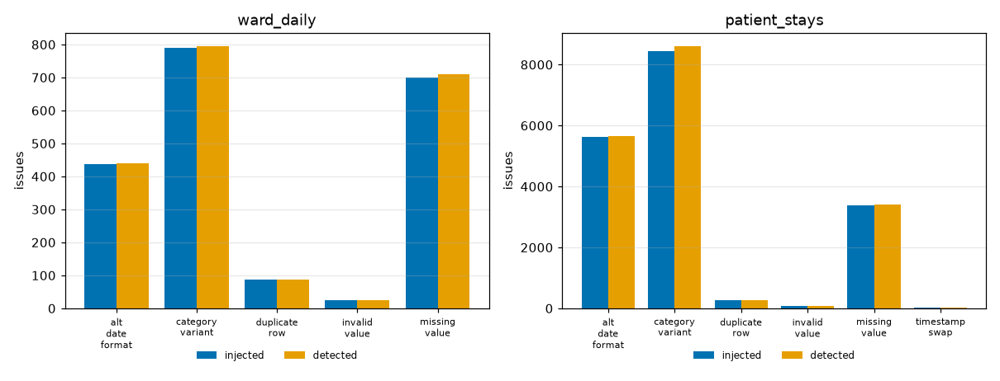
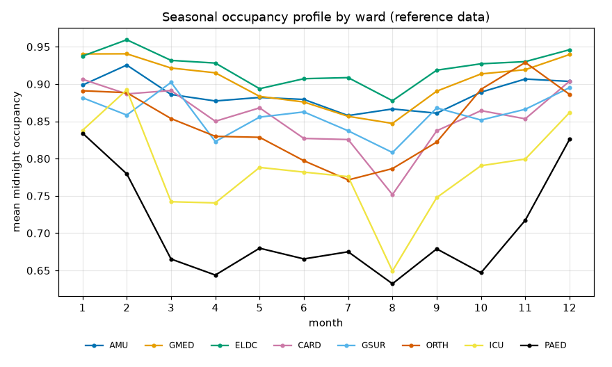
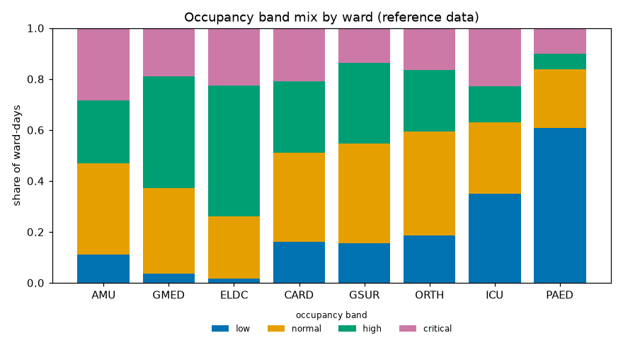
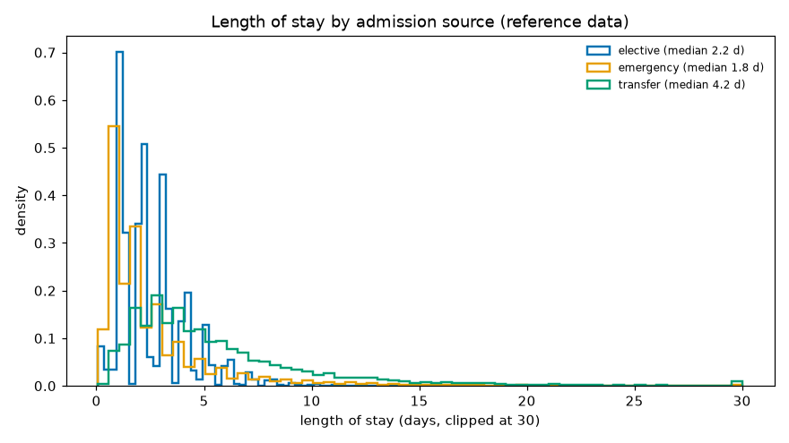

# BedSynth AI - Week 1: data requirements and dataset preparation

Generated 2026-11-15T12:21:25+00:00 from `data_quality_report.json` (pipeline run 2026-11-15T05:00:24+00:00, seed 42, 7.76 s).

## Summary

- **Reference data:** a seeded discrete-event simulation of a 194-bed, 8-ward hospital, 2022-01-01 .. 2024-12-31; 27 of 27 calibration targets met (section 2).
- **ward_daily:** 8,856 raw rows -> 8,768 prepared rows (99.0 % kept); hard-valid rate 91.8 % -> 100.0 % against 15 hard rules; injected issues no longer defective 100.0 %, exactly recovered 82.6 % (sections 3-6).
- **patient_stays:** 56,534 raw rows -> 56,253 prepared rows (99.5 % kept); hard-valid rate 93.9 % -> 100.0 % against 14 hard rules; injected issues no longer defective 100.0 %, exactly recovered 89.2 % (sections 3-6).
- **SDV-ready dataset:** `data/processed/ward_daily_train.csv` (7,016 rows) and `data/processed/patient_stays_train.csv` (45,002 rows), described by the single-table SDV metadata `data/processed/metadata_ward_daily.json` and `data/processed/metadata_patient_stays.json`; the holdout splits (1,752 / 11,251 rows) are never used for training and serve the Week-3 evaluation (sections 9-10).
- **Scenarios:** 26 named scenarios (16 ward_daily, 10 patient_stays) cover 9 of the 9 scenario families of the brief, plus a baseline; the smallest, `elective_cancellations`, has 394 train rows (section 1.2).

## 1. Data requirements

Hospital administrators need realistic operational data to test bed-occupancy and scheduling optimisation models, but real extracts cannot be shared between facilities. BedSynth AI therefore works with two strictly **non-clinical** tables (no diagnoses, procedures, ages or identifiers):

| table | grain | train columns | derived columns | time columns |
|---|---|---|---|---|
| ward_daily | one row per ward per day | 22 | 12 | date |
| patient_stays | one row per inpatient ward stay | 15 | 8 | admission_datetime, discharge_datetime |

Derived columns (flow balance, occupancy rate, ratios, LOS hours...) are recomputed with `schema.derive`, never learned, so identities such as `census_end = census_start + admissions + transfers_in - transfers_out - discharges` always hold. The reference hospital has 194 funded beds:

| ward | name | type | beds | max escalation | day nurses required | admission sources |
|---|---|---|---|---|---|---|
| AMU | Acute Medical Unit | acute | 28 | 6 | 6 | emergency |
| GMED | General Medicine | medical | 32 | 4 | 5 | elective, emergency, transfer |
| ELDC | Elderly Care | medical | 30 | 4 | 5 | emergency, transfer |
| CARD | Cardiology | medical | 20 | 2 | 4 | elective, emergency, transfer |
| GSUR | General Surgery | surgical | 30 | 2 | 5 | elective, emergency, transfer |
| ORTH | Orthopaedics | surgical | 24 | 2 | 4 | elective, emergency, transfer |
| ICU | Intensive Care Unit | critical_care | 12 | 2 | 8 | elective, emergency, transfer |
| PAED | Paediatrics | paediatric | 18 | 2 | 5 | elective, emergency |

### 1.1 Attribute dictionary

Roles: `key` identifier assigned by the pipeline; `time` calendar timestamp (kept in the files, never learned); `train` learned by the SDV synthesizers; `derived` recomputed from the train columns by `schema.derive` (never learned). `sdtype` is the SDV type used in the metadata.

**ward_daily** (36 columns)

| column | role | dtype / sdtype | unit | allowed values | description |
|---|---|---|---|---|---|
| record_id | key | str / id |  |  | Record identifier, e.g. WD-000001. |
| date | time | date / datetime |  |  | Calendar date of the ward-day (YYYY-MM-DD). Source data and calendar-mode output only. |
| ward_id | train | str / categorical |  | AMU, GMED, ELDC, CARD, GSUR, ORTH, ICU, PAED | Ward code. |
| ward_type | derived | str / categorical |  | acute, medical, surgical, critical_care, paediatric | Ward service type (from ward catalogue). |
| month | train | int / categorical |  | 1, 2, 3, 4, 5, 6, 7, 8, ... (12 values) | Calendar month 1-12. |
| season | derived | str / categorical |  | winter, spring, summer, autumn | Meteorological season derived from month. |
| day_of_week | train | str / categorical |  | Mon, Tue, Wed, Thu, Fri, Sat, Sun | Day of week (Mon..Sun). |
| is_weekend | derived | bool / boolean |  | true / false | Saturday or Sunday. |
| bed_capacity | derived | int / numerical | beds | 1 .. | Funded base beds of the ward (catalogue). |
| escalation_beds_open | train | int / numerical | beds | 0 .. | Temporary surge beds opened that day. |
| beds_closed | train | int / numerical | beds | 0 .. | Beds unavailable (staffing, infection control, maintenance); only free beds are closed. |
| available_beds | derived | int / numerical | beds | 1 .. | bed_capacity + escalation_beds_open - beds_closed. |
| staffing_level | train | str / ordinal |  | short, adequate, surplus | Declared nurse staffing status (consistent with nurses_day_shift vs requirement). |
| nurses_day_shift | train | int / numerical | nurses | 1 .. | Registered nurses rostered on the day shift. |
| nurses_night_shift | train | int / numerical | nurses | 1 .. | Registered nurses rostered on the night shift. |
| census_start | train | int / numerical | patients | 0 .. | Inpatients in the ward at 00:00. |
| elective_scheduled | train | int / numerical | patients | 0 .. | Elective (planned) admissions booked for the day. |
| elective_cancelled | train | int / numerical | patients | 0 .. | Booked electives cancelled on the day (bed shortage, staffing, patient). |
| admissions_elective | derived | int / numerical | patients | 0 .. | elective_scheduled - elective_cancelled. |
| admissions_emergency | train | int / numerical | patients | 0 .. | Emergency admissions into the ward. |
| transfers_in | train | int / numerical | patients | 0 .. | Patients transferred in from other wards. |
| transfers_out | train | int / numerical | patients | 0 .. | Patients transferred out to other wards. |
| discharges | train | int / numerical | patients | 0 .. | Patients discharged from hospital. |
| discharges_before_noon | train | int / numerical | patients | 0 .. | Discharges completed before 12:00. |
| census_end | derived | int / numerical | patients | 0 .. | Inpatients at 24:00 (flow balance). |
| delayed_discharges | train | int / numerical | patients | 0 .. | Patients at 00:00 medically fit for discharge but still occupying a bed. |
| emergency_boarders | train | int / numerical | patients | 0 .. | Emergency patients waiting in ED for a bed in this ward at 24:00. |
| avg_bed_wait_hours | train | float / numerical | hours | 0 .. 96 | Mean bed-request-to-admission wait of the day's emergency admissions (0 if none). |
| avg_bed_turnaround_min | train | float / numerical | minutes | 10 .. 1,440 | 7-day rolling mean minutes from patient departure to bed ready. |
| avg_los_days | train | float / numerical | days | 0.0400 .. 90 | 7-day rolling mean length of stay of patients leaving the ward. |
| occupancy_rate | derived | float / numerical | ratio | 0 .. 1 | census_end / available_beds (midnight occupancy). |
| occupancy_level | train | str / ordinal |  | low, normal, high, critical | Occupancy band: low <0.75 <= normal <0.90 <= high <0.97 <= critical. |
| bed_turnover_rate | derived | float / numerical | ratio | 0 .. | (discharges + transfers_out) / available_beds. |
| patients_per_nurse | derived | float / numerical | ratio | 0 .. | census_end / nurses_day_shift. |
| delayed_discharge_rate | derived | float / numerical | ratio | 0 .. 1 | delayed_discharges / census_start (0 if empty). |
| elective_cancellation_rate | derived | float / numerical | ratio | 0 .. 1 | elective_cancelled / elective_scheduled (0 if none booked). |

**patient_stays** (26 columns)

| column | role | dtype / sdtype | unit | allowed values | description |
|---|---|---|---|---|---|
| stay_id | key | str / id |  |  | Stay identifier, e.g. ST-0000001. |
| admission_datetime | time | datetime / datetime |  |  | Admission timestamp (YYYY-MM-DD HH:MM). Source data only. |
| discharge_datetime | time | datetime / datetime |  |  | Ward departure timestamp (YYYY-MM-DD HH:MM). Source data only. |
| ward_id | train | str / categorical |  | AMU, GMED, ELDC, CARD, GSUR, ORTH, ICU, PAED | Ward code. |
| ward_type | derived | str / categorical |  | acute, medical, surgical, critical_care, paediatric | Ward service type. |
| admission_source | train | str / categorical |  | elective, emergency, transfer | elective (planned), emergency (via ED) or internal transfer. |
| admission_month | train | int / categorical |  | 1, 2, 3, 4, 5, 6, 7, 8, ... (12 values) | Admission month 1-12. |
| admission_season | derived | str / categorical |  | winter, spring, summer, autumn | Season of admission. |
| admission_day_of_week | train | str / categorical |  | Mon, Tue, Wed, Thu, Fri, Sat, Sun | Admission day of week. |
| admission_hour | train | int / numerical | hour | 0 .. 23 | Admission hour 0-23. |
| booking_lead_days | train | int / numerical | days | 0 .. 365 | Days between booking and admission (electives, at least 1 + 7 x times_rescheduled; 0 otherwise). |
| times_rescheduled | train | int / numerical | count | 0 .. 10 | Times the elective admission was postponed (0 for non-electives). |
| bed_wait_hours | train | float / numerical | hours | 0 .. 96 | Hours from bed request to bed allocation. |
| los_nights | train | int / numerical | nights | 0 .. 180 | Number of midnights spent in the ward. |
| discharge_day_of_week | derived | str / categorical |  | Mon, Tue, Wed, Thu, Fri, Sat, Sun | Day of week of ward departure. |
| discharge_hour | train | int / numerical | hour | 0 .. 23 | Ward departure hour 0-23. |
| los_hours | derived | int / numerical | hours | 1 .. | Hour-resolution length of stay: los_nights*24 + discharge_hour - admission_hour. |
| los_days | derived | float / numerical | days | 0 .. | los_hours / 24. |
| separation_type | train | str / categorical |  | discharge, transfer_out | Stay ended by hospital discharge or internal transfer out. |
| discharge_destination | train | str / categorical |  | home, home_with_support, care_facility, other_hospital, internal_ward | Destination after leaving the ward. |
| delay_reason | train | str / categorical |  | none, awaiting_transport, awaiting_medication, awaiting_documentation, awaiting_care_package, awaiting_care_facility_bed, awaiting_downstream_bed | Reason the departure was delayed after the patient was ready ('none' if not delayed). |
| discharge_delay_hours | train | float / numerical | hours | 0 .. | Hours between ready-to-leave and actual departure; 0 unless the gap exceeded the 4 h delay threshold (so either 0 or >= 4). |
| is_delayed_discharge | derived | bool / boolean |  | true / false | discharge_delay_hours > 0 (a delay of 4 h or more; see PS-H13). |
| discharged_before_noon | derived | bool / boolean |  | true / false | discharge_hour < 12. |
| is_weekend_discharge | derived | bool / boolean |  | true / false | Departure on Saturday or Sunday. |
| bed_turnaround_minutes | train | int / numerical | minutes | 10 .. 1,440 | Minutes from departure until the bed was cleaned and ready. |

### 1.2 Required scenarios and their reference support

Each scenario family of the brief maps to named scenarios (`bedsynth.scenarios`). *Conditions* (values of categorical training columns) select the matching segment models and are met exactly by pooled rejection from unconditional SDV draws, with SDV's native conditional sampling only for combinations too rare to pool (DESIGN.md §7.3); *filters* (bounds on any column, derived ones included) are enforced by rejection sampling. *Train rows* is the number of reference rows of the train split inside the scenario (what the synthesizers learn it from).

| brief requirement | scenario | table | definition | train rows |
|---|---|---|---|---|
| Normal, high and low occupancy | `normal_occupancy` | ward_daily | occupancy_level in ['normal'] | 2,285 (32.6 %) |
| Normal, high and low occupancy | `high_occupancy` | ward_daily | occupancy_level in ['high', 'critical'] | 3,296 (47.0 %) |
| Normal, high and low occupancy | `low_occupancy` | ward_daily | occupancy_level in ['low'] | 1,435 (20.5 %) |
| Seasonal demand | `winter_demand` | ward_daily | month in [12, 1, 2] | 1,746 (24.9 %) |
| Seasonal demand | `summer_demand` | ward_daily | month in [6, 7, 8] | 1,771 (25.2 %) |
| Seasonal demand | `winter_admissions` | patient_stays | admission_month in [12, 1, 2] | 12,354 (27.5 %) |
| Admission and discharge patterns | `weekend_operations` | ward_daily | day_of_week in ['Sat', 'Sun'] | 2,009 (28.6 %) |
| Admission and discharge patterns | `emergency_admissions` | patient_stays | admission_source in ['emergency'] | 29,049 (64.6 %) |
| Admission and discharge patterns | `weekend_discharges` | patient_stays | discharge_day_of_week in ['Sat', 'Sun'] | 10,089 (22.4 %) |
| Emergency bed requirements | `emergency_pressure` | ward_daily | occupancy_level in ['high', 'critical']; emergency_boarders min 1 | 649 (9.3 %) |
| Emergency bed requirements | `long_bed_waits` | patient_stays | admission_source in ['emergency']; bed_wait_hours min 4 | 3,860 (8.6 %) |
| Ward utilisation | `escalation_capacity` | ward_daily | occupancy_level in ['high', 'critical']; escalation_beds_open min 1 | 1,595 (22.7 %) |
| Ward utilisation | `reduced_capacity` | ward_daily | beds_closed min 1 | 599 (8.5 %) |
| Ward utilisation | `long_stay_patients` | patient_stays | los_nights min 7 | 5,381 (12.0 %) |
| Scheduled procedures | `scheduled_procedures` | ward_daily | ward_id in ['GSUR', 'ORTH', 'CARD']; day_of_week in ['Mon', 'Tue', 'Wed', 'Thu', 'Fri']; elective_scheduled min 2 | 1,518 (21.6 %) |
| Scheduled procedures | `elective_cancellations` | ward_daily | elective_cancelled min 1 | 394 (5.6 %) |
| Scheduled procedures | `elective_admissions` | patient_stays | admission_source in ['elective'] | 6,201 (13.8 %) |
| Scheduled procedures | `rescheduled_electives` | patient_stays | admission_source in ['elective']; times_rescheduled min 1 | 585 (1.3 %) |
| Bed turnover | `high_turnover` | ward_daily | ward_id in ['GMED', 'ELDC', 'CARD', 'GSUR', 'ORTH', 'ICU']; bed_turnover_rate min 0.3 | 803 (11.4 %) |
| Bed turnover | `slow_bed_turnaround` | patient_stays | bed_turnaround_minutes min 180 | 3,853 (8.6 %) |
| Delayed discharge | `delayed_discharge_pressure` | ward_daily | delayed_discharge_rate min 0.15 | 842 (12.0 %) |
| Delayed discharge | `delayed_discharge_stays` | patient_stays | delay_reason in ['awaiting_transport', 'awaiting_medication', 'awaiting_documentation', 'awaiting_care_package', 'awaiting_care_facility_bed', 'awaiting_downstream_bed']; discharge_delay_hours min 4.0 | 9,800 (21.8 %) |
| Varying staffing or scheduling conditions | `scheduled_procedures` | ward_daily | ward_id in ['GSUR', 'ORTH', 'CARD']; day_of_week in ['Mon', 'Tue', 'Wed', 'Thu', 'Fri']; elective_scheduled min 2 | 1,518 (21.6 %) |
| Varying staffing or scheduling conditions | `elective_cancellations` | ward_daily | elective_cancelled min 1 | 394 (5.6 %) |
| Varying staffing or scheduling conditions | `staffing_shortage` | ward_daily | staffing_level in ['short'] | 867 (12.4 %) |
| Varying staffing or scheduling conditions | `staffing_surplus` | ward_daily | staffing_level in ['surplus'] | 472 (6.7 %) |
| Varying staffing or scheduling conditions | `elective_admissions` | patient_stays | admission_source in ['elective'] | 6,201 (13.8 %) |
| Varying staffing or scheduling conditions | `rescheduled_electives` | patient_stays | admission_source in ['elective']; times_rescheduled min 1 | 585 (1.3 %) |
| Representative everyday mix (reference for all comparisons) | `baseline` | ward_daily | unconditional | 7,016 (100.0 %) |
| Representative everyday mix (reference for all comparisons) | `stays_baseline` | patient_stays | unconditional | 45,002 (100.0 %) |

## 2. Reference source data (simulation)

No real extract can be shared, so a seeded discrete-event simulation of the hospital (`bedsynth.data.simulator`) produced the reference extract for 2022-01-01 .. 2024-12-31 (1,096 days, seed 42), with 60 warm-up and 90 cool-down days.

| table | clean rows (ground truth) | raw rows (with injected issues) | injected issues |
|---|---|---|---|
| ward_daily | 8,768 | 8,856 | 2,041 |
| patient_stays | 56,253 | 56,534 | 17,836 |

**Calibration:** 27 of 27 operational targets met (DESIGN.md §6.1).

| target | value | range | met |
|---|---|---|---|
| AMU mean midnight occupancy within ±0.04 of target | 0.8859 | 0.88 - 0.96 | yes |
| GMED mean midnight occupancy within ±0.04 of target | 0.9034 | 0.89 - 0.97 | yes |
| ELDC mean midnight occupancy within ±0.04 of target | 0.9219 | 0.91 - 0.99 | yes |
| CARD mean midnight occupancy within ±0.04 of target | 0.8554 | 0.84 - 0.92 | yes |
| GSUR mean midnight occupancy within ±0.04 of target | 0.8592 | 0.82 - 0.9 | yes |
| ORTH mean midnight occupancy within ±0.04 of target | 0.8478 | 0.81 - 0.89 | yes |
| ICU mean midnight occupancy within ±0.04 of target | 0.7833 | 0.76 - 0.84 | yes |
| PAED mean midnight occupancy within ±0.04 of target | 0.7034 | 0.66 - 0.74 | yes |
| share of ward-days in the 'low' occupancy band | 0.2030 | 0.1 - 0.25 | yes |
| share of ward-days in the 'normal' occupancy band | 0.3250 | 0.25 - 0.45 | yes |
| share of ward-days in the 'high' occupancy band | 0.2799 | 0.25 - 0.45 | yes |
| share of ward-days in the 'critical' occupancy band | 0.1921 | 0.05 - 0.2 | yes |
| share of AMU/GMED/ELDC winter ward-days with ED boarders at midnight | 0.1599 | 0.05 - 0.2 | yes |
| mean daily delayed-discharge rate, ELDC | 0.1186 | 0.1 - 0.25 | yes |
| mean daily delayed-discharge rate, GMED | 0.0910 | 0.05 - 0.15 | yes |
| mean daily delayed-discharge rate, surgical | 0.0470 | 0.02 - 0.08 | yes |
| mean daily delayed-discharge rate, paediatrics (children rarely wait for social care) | 0.0302 | 0.0 - 0.06 | yes |
| share of discharges completed before 12:00 | 0.2807 | 0.15 - 0.3 | yes |
| mean daily discharges on Sat/Sun relative to Mon-Fri | 0.6666 | 0.5 - 0.7 | yes |
| mean Monday discharges relative to Tue-Fri (no artificial weekend-backlog spike) | 1.1760 | 0.85 - 1.25 | yes |
| mean Sunday discharges relative to Saturday (Sunday is the quietest day) | 0.7970 | 0.6 - 1.0 | yes |
| cancelled / scheduled elective bookings | 0.0905 | 0.03 - 0.1 | yes |
| winter cancellation rate exceeds the rest of the year | 0.1070 | > non-winter rate | yes |
| share of ward-days staffed below requirement | 0.1202 | 0.1 - 0.2 | yes |
| median emergency bed wait (hours) | 1.6300 | 1.0 - 3.0 | yes |
| 90th percentile emergency bed wait in winter (hours) | 9.4700 | 4.0 - 12.0 | yes |
| largest share of one bed-wait value within a ward x admission source (groups of 200+ stays; no artificial spike) | 0.0343 | 0.0 - 0.05 | yes |

## 3. Cleaning pipeline results

`bedsynth.data.preprocessing.prepare_datasets` profiles the raw extract, standardises categories, parses ISO and day-first dates, removes duplicates, flags physically impossible values, repairs and imputes (most principled method first), derives, validates against the hard operational rules, checks dataset consistency and writes stratified train / holdout splits.

| metric | ward_daily | patient_stays |
|---|---|---|
| raw rows | 8,856 | 56,534 |
| final rows | 8,768 | 56,253 |
| rows kept | 99.0 % | 99.5 % |
| issues detected | 2,061 | 18,061 |
| cells repaired | 726 | 3,461 |
| rows dropped | 88 | 281 |
| hard-valid rate, raw -> final | 91.8 % -> 100.0 % | 93.9 % -> 100.0 % |
| cell agreement with ground truth | 99.82 % | 99.72 % |
| injected issues no longer defective | 100.0 % | 100.0 % |
| injected issues exactly recovered | 82.6 % | 89.2 % |
| train / holdout rows | 7,016 / 1,752 | 45,002 / 11,251 |

*Hard-valid raw* counts every raw row after spellings and date formats were normalised but before any repair, so it measures operational defects rather than parsing gaps. An injected issue is *no longer defective* when the cleaned value is present, valid and differs from the injected one (it may be an imputed estimate); *exactly recovered* counts only cells restored to their true value - the stricter measure for imputed gaps.

## 4. Data-quality issues: detected vs injected

**ward_daily**

| issue type | column | detected | injected |
|---|---|---|---|
| alt_date_format | date | 440 | 438 |
| category_variant | occupancy_level | 267 | 263 |
| category_variant | staffing_level | 264 | 263 |
| category_variant | ward_id | 265 | 263 |
| duplicate_row | * | 88 | 88 |
| invalid_value | avg_bed_turnaround_min | 5 | 5 |
| invalid_value | beds_closed | 5 | 5 |
| invalid_value | census_start | 6 | 6 |
| invalid_value | discharges | 5 | 5 |
| invalid_value | nurses_day_shift | 5 | 5 |
| missing_value | avg_bed_turnaround_min | 176 | 175 |
| missing_value | avg_los_days | 177 | 175 |
| missing_value | nurses_night_shift | 179 | 175 |
| missing_value | staffing_level | 179 | 175 |

**patient_stays**

| issue type | column | detected | injected |
|---|---|---|---|
| alt_date_format | admission_datetime | 2,831 | 2,813 |
| alt_date_format | discharge_datetime | 2,824 | 2,813 |
| category_variant | admission_source | 1,715 | 1,688 |
| category_variant | delay_reason | 1,724 | 1,688 |
| category_variant | discharge_destination | 1,724 | 1,688 |
| category_variant | separation_type | 1,731 | 1,688 |
| category_variant | ward_id | 1,722 | 1,688 |
| duplicate_row | * | 281 | 281 |
| invalid_value | bed_turnaround_minutes | 28 | 28 |
| invalid_value | bed_wait_hours | 29 | 29 |
| invalid_value | booking_lead_days | 28 | 28 |
| missing_value | bed_turnaround_minutes | 850 | 844 |
| missing_value | bed_wait_hours | 847 | 844 |
| missing_value | delay_reason | 850 | 844 |
| missing_value | discharge_destination | 849 | 844 |
| timestamp_swap | admission_datetime\|discharge_datetime | 28 | 28 |

Duplicates are counted per removed copy (`*` = whole row; exact and key duplicates combined). Detected counts can exceed injected ones because a duplicated row repeats the defects of its original until the copy is removed.

*Issues injected by the simulator vs detected by the cleaning pipeline*

## 5. Repairs and imputation

**ward_daily**: 726 cells repaired (186 exactly recoverable, 540 imputed)

| column | method | kind | cells |
|---|---|---|---|
| avg_bed_turnaround_min | within ward interpolation | approximate | 180 |
| avg_los_days | within ward interpolation | approximate | 175 |
| beds_closed | temporal neighbour | approximate | 5 |
| census_start | temporal continuity | exact | 6 |
| discharges | flow identity | exact | 5 |
| nurses_day_shift | ward staffing band median | approximate | 5 |
| nurses_night_shift | ward staffing band median | approximate | 175 |
| staffing_level | recomputed from counts | exact | 175 |

**patient_stays**: 3,461 cells repaired (859 exactly recoverable, 2,602 imputed)

| column | method | kind | cells |
|---|---|---|---|
| bed_turnaround_minutes | ward departure period hot deck | approximate | 872 |
| bed_wait_hours | ward source hot deck | approximate | 873 |
| booking_lead_days | non elective zero | exact | 24 |
| booking_lead_days | ward elective median | approximate | 4 |
| delay_reason | definitional none | exact | 651 |
| delay_reason | destination mode | approximate | 193 |
| discharge_destination | ward mode | approximate | 660 |
| discharge_destination | separation rule | exact | 184 |

## 6. Operational rule validation

Hard rules (DESIGN.md §6.4) must hold on every row of the prepared data; soft rules are plausibility warnings and are only reported.

**ward_daily** - final hard-valid rate 100.0 % (8,768 of 8,768 rows)

| hard rule | violations in raw extract (formats normalised, before repair) | violations after cleaning |
|---|---|---|
| WD-H01 | 179 | 0 |
| WD-H02 | 195 | 0 |
| WD-H03 | 0 | 0 |
| WD-H04 | 0 | 0 |
| WD-H05 | 6 | 0 |
| WD-H06 | 9 | 0 |
| WD-H07 | 0 | 0 |
| WD-H08 | 5 | 0 |
| WD-H09 | 184 | 0 |
| WD-H10 | 12 | 0 |
| WD-H11 | 183 | 0 |
| WD-H12 | 0 | 0 |
| WD-H13 | 357 | 0 |
| WD-H14 | 0 | 0 |
| WD-H15 | 0 | 0 |

Soft-rule flags after cleaning: WD-S01 0, WD-S02 4, WD-S03 0, WD-S04 494, WD-S05 2, WD-S06 28

**patient_stays** - final hard-valid rate 100.0 % (56,253 of 56,253 rows)

| hard rule | violations in raw extract (formats normalised, before repair) | violations after cleaning |
|---|---|---|
| PS-H01 | 1,682 | 0 |
| PS-H02 | 0 | 0 |
| PS-H03 | 1,771 | 0 |
| PS-H04 | 28 | 0 |
| PS-H05 | 4 | 0 |
| PS-H06 | 24 | 0 |
| PS-H07 | 850 | 0 |
| PS-H08 | 28 | 0 |
| PS-H09 | 849 | 0 |
| PS-H10 | 1,682 | 0 |
| PS-H11 | 0 | 0 |
| PS-H12 | 1,716 | 0 |
| PS-H13 | 0 | 0 |
| PS-H14 | 4 | 0 |

Soft-rule flags after cleaning: PS-S01 0, PS-S02 539, PS-S03 1,164, PS-S04 0, PS-S05 36

### Rule catalogue

Hard rules reject a generated row (rejection sampling) and drop a raw row the cleaning cannot repair; soft rules are plausibility flags.

**ward_daily**

| rule | severity | name | description |
|---|---|---|---|
| WD-H01 | hard | valid categories | ward_id, month, day_of_week, staffing_level and occupancy_level take values from their vocabularies. |
| WD-H02 | hard | non negative integer counts | Every bed, nurse and patient count (learned and derived) is present, a whole number and not negative. |
| WD-H03 | hard | cancellations within bookings | A ward cannot cancel more elective admissions than were booked for the day. |
| WD-H04 | hard | noon discharges within discharges | Discharges completed before noon cannot exceed the day's discharges. |
| WD-H05 | hard | delayed within census | Patients medically fit but awaiting discharge at midnight cannot exceed the midnight census. |
| WD-H06 | hard | census within available beds | The end-of-day census is non-negative and fits within the beds available that day. |
| WD-H07 | hard | census start within physical beds | The start-of-day census fits within the base beds plus the escalation beds open. |
| WD-H08 | hard | capacity limits | Escalation beds respect the ward's surge limit, closed beds are not negative and at least one bed is available. |
| WD-H09 | hard | staffing present | At least one registered nurse is rostered on both the day and the night shift. |
| WD-H10 | hard | occupancy level consistent | The occupancy band matches the midnight occupancy census_end / available_beds. |
| WD-H11 | hard | staffing level consistent | The staffing band matches the day-shift nurses against the ward's nurse requirement. |
| WD-H12 | hard | ward admission profile | Wards that take no elective admissions book none, and wards that take no transfers receive none. |
| WD-H13 | hard | metric ranges | Average bed wait (0-96 h), bed turnaround (10-1440 min) and length of stay (0.04-90 days) are physically plausible. |
| WD-H14 | hard | wait definition | With no emergency admissions the day's average bed wait is defined as zero. |
| WD-H15 | hard | closures only free beds | Only free beds are closed, so the start-of-day census fits within the beds available that day. |
| WD-S01 | soft | night staffing within day | Night-shift nurses do not outnumber day-shift nurses. |
| WD-S02 | soft | nurse workload plausible | Patients per day-shift nurse stay within twice the ward's target nurse ratio. |
| WD-S03 | soft | boarding under pressure | Emergency patients board in ED overnight only when the ward is at least 90% occupied. |
| WD-S04 | soft | escalation under pressure | Escalation beds are open only when the ward is at least 80% occupied. |
| WD-S05 | soft | few weekend electives | At most two elective admissions are booked on a Saturday or Sunday. |
| WD-S06 | soft | noon discharge share plausible | On days with four or more discharges, at most 80% are completed before noon. |

**patient_stays**

| rule | severity | name | description |
|---|---|---|---|
| PS-H01 | hard | valid categories | All categorical stay attributes take values from their vocabularies. |
| PS-H02 | hard | hours in range | Admission and departure hours are whole hours between 0 and 23. |
| PS-H03 | hard | non negative values | Counts are whole and not negative, bed wait and discharge delay hours are not negative, and none is missing. |
| PS-H04 | hard | positive length of stay | Every stay lasts at least one hour. |
| PS-H05 | hard | elective booking lead | Elective admissions are booked at least one day in advance. |
| PS-H06 | hard | non elective unbooked | Emergency and transfer admissions have no booking lead time and were never rescheduled. |
| PS-H07 | hard | delay reason consistent | A delay reason is recorded exactly when the departure was delayed ('none' if and only if zero delay hours). |
| PS-H08 | hard | delay within stay | The discharge delay cannot be longer than the stay itself. |
| PS-H09 | hard | separation destination consistent | Stays that end in an internal transfer go to another ward, and only those do. |
| PS-H10 | hard | delay reason allowed | The delay reason is operationally meaningful for the discharge destination. |
| PS-H11 | hard | ward admission profile | The admission source is one the ward accepts. |
| PS-H12 | hard | metric ranges | Bed turnaround is 10-1440 min, bed wait at most 96 h, stays at most 180 nights, booking lead at most 365 days and reschedules at most 10. |
| PS-H13 | hard | delay threshold | A departure counts as delayed only when it is more than 4 hours after the patient was ready, so recorded delays are either zero or at least 4 hours. |
| PS-H14 | hard | rebooking lead | Postponed electives are rebooked at least seven days later, so the booking lead is at least 1 + 7 x times_rescheduled days. |
| PS-S01 | soft | elective admission hours | Elective patients are admitted between 06:00 and 14:59. |
| PS-S02 | soft | daytime departures | Patients leave the ward between 07:00 and 22:59. |
| PS-S03 | soft | short elective wait | Elective patients wait at most four hours for their bed. |
| PS-S04 | soft | no paediatric transfers out | Paediatric stays do not end in an internal transfer. |
| PS-S05 | soft | long delays for complex discharges | Discharge delays beyond 72 hours occur only for care-facility or supported-home discharges. |

## 7. Dataset consistency

- Census continuity (`census_start(d) = census_end(d-1)` per ward): 100.0 % of 8,760 consecutive ward-day pairs, 0 missing ward-days.
- Cross-table admissions (stays admitted per ward/day/source vs ward_daily counts): 100.0 % of ward-days match on every source.

## 8. Reference data patterns

These operational patterns are what the synthesizers must reproduce (Week 3 evaluation).

*Mean midnight occupancy by month and ward*

*Occupancy band mix by ward*

*Length-of-stay distribution by admission source*

## 9. SDV readiness: metadata and constraints

`metadata.json` describes both prepared CSV files exactly (key, timestamps, train and derived columns) and validates against them with `Metadata.validate_data`. `metadata_<table>.json` is the single-table metadata of the train columns - what every synthesizer fits: select `schema.training_columns(table)` from a CSV, then e.g. `GaussianCopulaSynthesizer(Metadata.load_from_json(...))`.

| table | training metadata | learned columns | sdtypes | key / time (not learned) | derived (recomputed) |
|---|---|---|---|---|---|
| ward_daily | `data/processed/metadata_ward_daily.json` | 22 | categorical 3, numerical 17, ordinal 2 | record_id, date | 12 |
| patient_stays | `data/processed/metadata_patient_stays.json` | 15 | categorical 7, numerical 8 | stay_id, admission_datetime, discharge_datetime | 8 |

**ward_daily** - 12 SDV constraints declared for this table (each experiment applies the groups it enables; per-model coverage is in the Week-2 report)

| constraint | implementation | expression / columns | enforces rules |
|---|---|---|---|
| regime_labels | bedsynth.synthesis.constraints.BandLabelConstraint | occupancy_level = occupancy_levels(census_end, available_beds) | WD-H10 |
| regime_labels | bedsynth.synthesis.constraints.BandLabelConstraint | staffing_level = staffing_levels(nurses_day_shift, ward_id) | WD-H11 |
| conditional_marginals | bedsynth.synthesis.constraints.ConditionalQuantileConstraint | emergency_boarders, avg_bed_wait_hours ~ empirical marginal per ward_id x occupancy band (recomputed) (distributional transform) | - |
| capacity | bedsynth.synthesis.constraints.EscalationCoverConstraint | escalation_beds_open = min(max(0, max(census_start, census_end) - bed_capacity + beds_closed) + learned extra, ward maximum) | WD-H06, WD-H07, WD-H15 |
| structural_zeros | bedsynth.synthesis.constraints.StructuralZerosConstraint | ward_id in learned zero set => elective_scheduled = elective_cancelled = transfers_in = 0 | WD-H12 |
| structural_zeros | bedsynth.synthesis.constraints.StructuralZerosConstraint | day_of_week in learned zero set => elective_scheduled = elective_cancelled = 0 | - |
| conditional_marginals | bedsynth.synthesis.constraints.ConditionalQuantileConstraint | elective_scheduled, elective_cancelled ~ empirical marginal per ward_id x day_of_week (distributional transform); elective_cancelled <= elective_scheduled | WD-H03 |
| conditional_marginals | bedsynth.synthesis.constraints.ConditionalQuantileConstraint | beds_closed ~ empirical marginal per ward_id x staffing band (recomputed) (distributional transform) | - |
| conditional_marginals | bedsynth.synthesis.constraints.ConditionalQuantileConstraint | escalation_beds_open ~ empirical marginal per ward_id (distributional transform) | - |
| conditional_marginals | bedsynth.synthesis.constraints.ConditionalQuantileConstraint | nurses_day_shift ~ empirical marginal per ward_id x month (distributional transform) | - |
| inequality | sdv.cag.Inequality | discharges_before_noon <= discharges | WD-H04 |
| inequality | sdv.cag.Inequality | delayed_discharges <= census_start | WD-H05 |

All 15 hard rules (WD-H01, WD-H02, WD-H03, WD-H04, WD-H05, WD-H06, WD-H07, WD-H08, WD-H09, WD-H10, WD-H11, WD-H12, WD-H13, WD-H14, WD-H15) are additionally enforced at generation time by rejection sampling.

**patient_stays** - 6 SDV constraints declared for this table (each experiment applies the groups it enables; per-model coverage is in the Week-2 report)

| constraint | implementation | expression / columns | enforces rules |
|---|---|---|---|
| structural_zeros | bedsynth.synthesis.constraints.StructuralZerosConstraint | admission_source in learned zero set => booking_lead_days = times_rescheduled = 0 | PS-H06 |
| conditional_marginals | bedsynth.synthesis.constraints.ConditionalQuantileConstraint | discharge_delay_hours ~ empirical marginal per delay_reason (distributional transform) | PS-H07, PS-H13 |
| conditional_marginals | bedsynth.synthesis.constraints.ConditionalQuantileConstraint | los_nights ~ empirical marginal per admission_day_of_week (distributional transform) | - |
| conditional_marginals | bedsynth.synthesis.constraints.ConditionalQuantileConstraint | admission_hour, bed_wait_hours, discharge_hour, bed_turnaround_minutes ~ empirical marginal per ward_id x admission_source (distributional transform) | - |
| fixed_combinations | sdv.cag.FixedCombinations | (separation_type, discharge_destination, delay_reason) in observed combinations | PS-H09, PS-H10 |
| fixed_combinations | sdv.cag.FixedCombinations | (ward_id, admission_source) in observed combinations | PS-H11 |

All 14 hard rules (PS-H01, PS-H02, PS-H03, PS-H04, PS-H05, PS-H06, PS-H07, PS-H08, PS-H09, PS-H10, PS-H11, PS-H12, PS-H13, PS-H14) are additionally enforced at generation time by rejection sampling.

## 10. Output files

`prepare_datasets` reads the raw extract and writes the SDV-ready dataset to `data/processed/`, paths relative to the project root:

| file | role | content |
|---|---|---|
| `data/raw/ward_daily_raw.csv` | input | raw ward_daily extract (8,856 rows) |
| `data/raw/patient_stays_raw.csv` | input | raw patient_stays extract (56,534 rows) |
| `data/raw/simulation_manifest.json` | input | simulation manifest: seed, period, row counts, injected issues, calibration |
| `data/processed/ward_daily_train.csv` | output | SDV-ready train split (7,016 rows): what the synthesizers fit |
| `data/processed/ward_daily_holdout.csv` | output | holdout split (1,752 rows), never used for training (Week-3 evaluation) |
| `data/processed/ward_daily_clean.csv` | output | every prepared row (8,768) before the split |
| `data/processed/patient_stays_train.csv` | output | SDV-ready train split (45,002 rows): what the synthesizers fit |
| `data/processed/patient_stays_holdout.csv` | output | holdout split (11,251 rows), never used for training (Week-3 evaluation) |
| `data/processed/patient_stays_clean.csv` | output | every prepared row (56,253) before the split |
| `data/processed/metadata_ward_daily.json` | output | SDV single-table metadata of the 22 learned columns |
| `data/processed/metadata_patient_stays.json` | output | SDV single-table metadata of the 15 learned columns |
| `data/processed/metadata.json` | output | SDV metadata of both CSV files (keys, timestamps, train and derived columns) |
| `data/processed/schema_catalog.json` | output | schema catalogue: columns, SDV constraints and rules per table |
| `data/processed/data_quality_report.json` | output | profiling, cleaning, validation and split results (the input of this report) |
