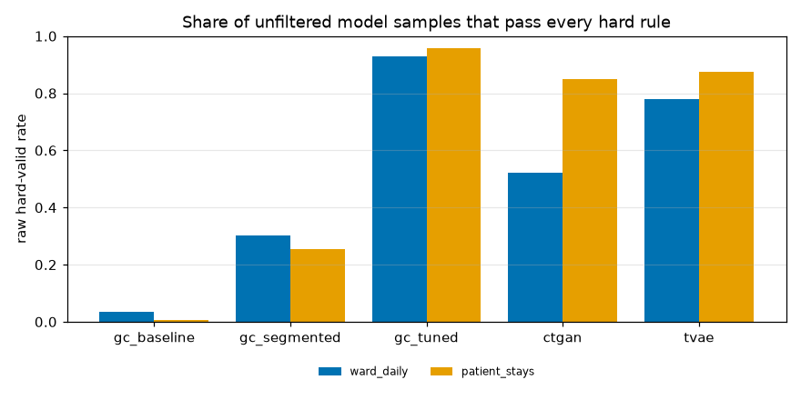

# BedSynth AI - Week 2: SDV synthesis pipeline

Generated 2026-11-15T05:15:38+00:00. Models are fitted by `scripts/02_train_synthesizers.py` (`bedsynth.synthesis.training`) on the processed train splits and registered in `models/registry.json`.

## Summary

- 10 models trained (5 experiments x 2 tables); total fit time 15.0 min (section 4).
- **ward_daily**: raw hard-valid rate of unfiltered samples gc_baseline 3.4 % -> gc_segmented 30.1 % -> gc_tuned 93.0 % (section 5); registry default when this report was rendered: `gc_tuned`, applying inequality, regime_labels, structural_zeros, capacity, conditional_marginals inside SDV.
- **patient_stays**: raw hard-valid rate of unfiltered samples gc_baseline 0.5 % -> gc_segmented 25.5 % -> gc_tuned 95.8 % (section 5); registry default when this report was rendered: `gc_tuned`, applying fixed_combinations, conditional_marginals inside SDV.
- Delivered data is 100 % hard-valid whatever a model's raw rate: the generator rejects every row that breaks a hard rule.

## 1. Pipeline

1. **Metadata** (`synthesis/metadata.py`): SDV 2.x `Metadata` built from `bedsynth.schema` (train columns only; occupancy and staffing levels as `ordinal`).
2. **Constraints** (`synthesis/constraints.py`): constraint groups applied inside the SDV synthesizer - SDV built-ins (`Inequality`, `FixedCombinations`) and BedSynth programmable constraints (band labels recomputed from counts, learned structural zeros, escalation beds that cover the census, exact per-group marginals by the distributional transform).
3. **Model wrapper** (`synthesis/models.py`): global or segmented SDV synthesizers (one per ward, or per ward x admission source), constant columns dropped and re-inserted per segment, demand-ordered `OrderedUniformEncoder`s (including the merged patient_stays outcome combinations, ordered by mean length of stay), marginal selection by KS per segment and per column with a post-fit check for degenerate fits, seeded reproducible sampling, pooled rejection for conditional requests.
4. **Registry** (`synthesis/registry.py`): model cards, default model per table.
5. **Generation engine** (`synthesis/generator.py`): scenario conditions and filters, derivation, rule-based rejection sampling with allocation strata (filtered requests take their strata from a synthetic pilot draw, never from the real rows that match the filters), calendar mode, per-request time budget with per-round row caps.

## 2. Experiments (settings.yaml)

| experiment | model | segments | constraint groups | ordinal metadata | ordered encodings | params |
|---|---|---|---|---|---|---|
| gc_baseline | gaussian_copula | global | none | no | no | default_distribution=beta |
| gc_segmented | gaussian_copula | ward_id | inequality, fixed_combinations | yes | yes | default_distribution=truncnorm, tune_distributions=True, distribution_candidates=['truncnorm', 'beta', 'gamma', 'norm'] |
| gc_tuned | gaussian_copula | ward_daily: ward_id; patient_stays: ward_id x admission_source | all (inequality, fixed_combinations, regime_labels, structural_zeros, capacity, conditional_marginals) | yes | yes | default_distribution=truncnorm, tune_distributions=True, distribution_candidates=['truncnorm', 'beta', 'gamma', 'norm'] |
| ctgan | ctgan | global | all (inequality, fixed_combinations, regime_labels, structural_zeros, capacity, conditional_marginals) | yes | no | epochs=200, batch_size=500, enable_gpu=False, verbose=False |
| tvae | tvae | global | all (inequality, fixed_combinations, regime_labels, structural_zeros, capacity, conditional_marginals) | yes | no | epochs=200, batch_size=500, enable_gpu=False, verbose=False |

- `gc_baseline`: GaussianCopula, single global model, default encodings, no SDV constraints (Week 2 baseline).
- `gc_segmented`: Ablation step: GaussianCopula segmented per ward, SDV built-in constraints only (Inequality, FixedCombinations), ordinal metadata + demand-ordered encodings, tuned marginals (the pre-Week-3 gc_tuned recipe, without programmable constraints).
- `gc_tuned`: GaussianCopula segmented per ward (ward_daily) and per ward x admission source (patient_stays), every constraint group incl. programmable band labels, learned structural zeros, the escalation cover and exact per-group marginals (delay hours per reason, elective lists per weekday, ED boarders and bed waits per recomputed occupancy band, closed beds per recomputed staffing band, day-shift nurses per month, escalation beds beyond the census need, length of stay per admission weekday, admission/discharge hours and waits per ward x source), ordinal metadata + demand-ordered encodings, tuned per-column marginals (Week 3 improvement).
- `ctgan`: CTGAN (conditional GAN), global model with every constraint group (SDV built-ins + programmable).
- `tvae`: TVAE (variational autoencoder), global model with every constraint group (SDV built-ins + programmable).

## 3. Constraints and enforcement

Constraints inside the SDV synthesizer (groups: inequality, fixed_combinations, regime_labels, structural_zeros, capacity, conditional_marginals) enforce ordering inequalities, observed category combinations, band labels recomputed from their counts, learned structural zeros, escalation beds that cover the census and exact per-group marginals (delay hours per delay reason, elective lists per ward and weekday, ED boarders and bed waits per ward and occupancy band, closed beds per ward and staffing band, day-shift nurses per ward and month, escalation beds beyond the census need per ward, length of stay per admission weekday, hour, wait and turnaround marginals per ward x admission source) by construction; derived columns are recomputed by schema.derive (flow balance and ratios); the remaining hard-rule failures (a census beyond the ward's observed escalation range, same-day stay hours, delays longer than the stay, rebooking leads) are removed by the generator's rejection sampling with bedsynth.validation.

Programmable constraints are `sdv.cag.SingleTableProgrammableConstraint` subclasses in `bedsynth/synthesis/constraints.py`. They are listed before the SDV built-ins when added to a synthesizer, so their `reverse_transform` runs last on fully restored columns; per segment they receive the segment's constants (e.g. `elective_scheduled = 0` on AMU) and skip columns that are constant there.

`conditional_marginals` (`ConditionalQuantileConstraint`) applies the distributional transform within groups: each declared column is replaced by a standard-normal score of its randomised empirical CDF in its group and mapped back with the group's empirical quantile function, so each group's marginal is reproduced exactly (point masses included) while the copula models the dependence of the scores on the other columns. It addresses limits of a linear Gaussian copula: delay hours per delay reason (exactly 0 without a reason, the reason's own range otherwise); elective lists per ward and weekday (ordering weekdays by mean electives imposed a false weekday gradient); mostly-zero counts, which smooth marginals made non-zero far too often - ED boarders and the mean bed wait per ward and occupancy band, closed beds per ward and staffing band (both bands recomputed from the counts, so boarders appear on full ward-days and closures follow short staffing) and escalation beds beyond the census need per ward; day-shift nurses per ward and month (the winter short staffing sits in the lower tail of a few-valued roster); length of stay per admission weekday (the discharge weekday is admission weekday + nights mod 7, which a linear copula cannot learn); and exact admission/discharge-hour, bed-wait and turnaround marginals per ward x admission source (smoothed parametric hour profiles and waits failed the operational checks). An earlier repair that forced delay hours to 0 when no reason was sampled raised raw validity but kept the length of stay drawn with the discarded delay, inflating the stays of non-delayed patients; it was replaced by this group. Repairs are only kept when they re-parameterise the data instead of overwriting a jointly sampled value. The development A/B measurements behind these choices are in DESIGN.md §7.2-7.3.

| table | group | implementation | expression | rules enforced | description |
|---|---|---|---|---|---|
| ward_daily | regime_labels | BandLabelConstraint (programmable) | occupancy_level = occupancy_levels(census_end, available_beds) | WD-H10 | The occupancy band is recomputed from the flow-balance census_end and the beds available that day (schema.occupancy_levels), so it always matches the counts. |
| ward_daily | regime_labels | BandLabelConstraint (programmable) | staffing_level = staffing_levels(nurses_day_shift, ward_id) | WD-H11 | The staffing band is recomputed from the day-shift nurses against the ward's nurse requirement (schema.staffing_levels). |
| ward_daily | conditional_marginals | ConditionalQuantileConstraint (programmable) | emergency_boarders, avg_bed_wait_hours ~ empirical marginal per ward_id x occupancy band (recomputed) (distributional transform) | - | ED boarders at midnight and the day's mean bed wait follow their empirical distribution per ward and occupancy band, the band recomputed from the final counts like the occupancy label: boarders and long waits appear on the full ward-days that have them in the reference data (no boarders on low or normal days, so WD-S03 holds there). |
| ward_daily | capacity | EscalationCoverConstraint (programmable) | escalation_beds_open = min(max(0, max(census_start, census_end) - bed_capacity + beds_closed) + learned extra, ward maximum) | WD-H06, WD-H07, WD-H15 | Escalation beds are modelled as the cover the start and end census need above the base beds net of closed beds, plus a learned extra >= 0, so the census fits the beds available at both ends of the day (WD-H06, WD-H15, hence WD-H07) whenever that cover is within the ward's observed escalation range. |
| ward_daily | structural_zeros | StructuralZerosConstraint (programmable) | ward_id in learned zero set => elective_scheduled = elective_cancelled = transfers_in = 0 | WD-H12 | Wards that never book electives or receive transfers in the reference data produce exact zeros (learned per ward). |
| ward_daily | structural_zeros | StructuralZerosConstraint (programmable) | day_of_week in learned zero set => elective_scheduled = elective_cancelled = 0 | - | Days of the week without elective lists in the reference data (Sunday) produce exact zeros (learned). |
| ward_daily | conditional_marginals | ConditionalQuantileConstraint (programmable) | elective_scheduled, elective_cancelled ~ empirical marginal per ward_id x day_of_week (distributional transform); elective_cancelled <= elective_scheduled | WD-H03 | Elective lists follow the empirical distribution of their day of the week (and ward): flat Monday-Friday lists, rare Saturday lists and none on Sundays are reproduced exactly instead of the false weekday gradient a linear copula imposes along the weekday encoding; cancellations never exceed the list. |
| ward_daily | conditional_marginals | ConditionalQuantileConstraint (programmable) | beds_closed ~ empirical marginal per ward_id x staffing band (recomputed) (distributional transform) | - | Closed beds follow their empirical distribution per ward and staffing band, the band recomputed from the day-shift nurses: beds are closed mainly on short-staffed days, and zero days keep their real share instead of a smeared parametric marginal. |
| ward_daily | conditional_marginals | ConditionalQuantileConstraint (programmable) | escalation_beds_open ~ empirical marginal per ward_id (distributional transform) | - | The escalation beds opened beyond the census need (mostly zero) follow their empirical distribution per ward, so zero days keep their real share. |
| ward_daily | conditional_marginals | ConditionalQuantileConstraint (programmable) | nurses_day_shift ~ empirical marginal per ward_id x month (distributional transform) | - | Day-shift nurses follow their empirical distribution per ward and month: the winter short staffing sits in the lower tail of a few-valued roster, which neither a smooth parametric marginal nor a linear link to the month encoding reproduces. |
| ward_daily | inequality | sdv.cag.Inequality | discharges_before_noon <= discharges | WD-H04 | Discharges before noon are a subset of the day's discharges. |
| ward_daily | inequality | sdv.cag.Inequality | delayed_discharges <= census_start | WD-H05 | Delayed (medically fit) patients are a subset of the midnight census. |
| patient_stays | structural_zeros | StructuralZerosConstraint (programmable) | admission_source in learned zero set => booking_lead_days = times_rescheduled = 0 | PS-H06 | Emergency and transfer admissions are never booked ahead or rescheduled: exact zeros (learned per admission source). |
| patient_stays | conditional_marginals | ConditionalQuantileConstraint (programmable) | discharge_delay_hours ~ empirical marginal per delay_reason (distributional transform) | PS-H07, PS-H13 | Delay hours follow the empirical distribution of their delay reason: exactly 0 without a reason, the reason's own range otherwise (e.g. days for a care-facility bed, hours for transport), so the reason keeps predicting the delay length. |
| patient_stays | conditional_marginals | ConditionalQuantileConstraint (programmable) | los_nights ~ empirical marginal per admission_day_of_week (distributional transform) | - | Length of stay follows the empirical distribution of its admission weekday (and ward x source): the discharge weekday is admission weekday + nights (mod 7), a modular relation a linear copula cannot learn, so without it discharges spread evenly over the week and there are too many weekend discharges. |
| patient_stays | conditional_marginals | ConditionalQuantileConstraint (programmable) | admission_hour, bed_wait_hours, discharge_hour, bed_turnaround_minutes ~ empirical marginal per ward_id x admission_source (distributional transform) | - | Admission and discharge hours, bed waits and bed turnaround follow their empirical distribution per ward x admission source: hour-of-day profiles and right-skewed waits are reproduced exactly instead of a smoothed parametric marginal. |
| patient_stays | fixed_combinations | sdv.cag.FixedCombinations | (separation_type, discharge_destination, delay_reason) in observed combinations | PS-H09, PS-H10 | Separation type, destination and delay reason only appear in combinations seen in the reference data (transfer out <=> internal ward; reasons allowed per destination). |
| patient_stays | fixed_combinations | sdv.cag.FixedCombinations | (ward_id, admission_source) in observed combinations | PS-H11 | Each ward only admits through the sources it accepts (e.g. AMU: emergencies only). |

## 4. Trained models

| table | experiment | synthesizer | training rows | segments | marginals | fit s | quick | raw hard-valid | most violated hard rules (raw samples) |
|---|---|---|---|---|---|---|---|---|---|
| ward_daily | gc_baseline | GaussianCopulaSynthesizer | 7,016 | 1 | beta | 1.9 | no | 3.4 % | WD-H10 75.8 %, WD-H11 58.4 %, WD-H06 42.6 % |
| ward_daily | gc_segmented | GaussianCopulaSynthesizer | 7,016 | 8 | norm x8 (64 column overrides, 5 fallbacks) | 22.7 | no | 30.1 % | WD-H10 48.6 %, WD-H11 29.1 %, WD-H06 11.7 % |
| ward_daily | gc_tuned (registry default) | GaussianCopulaSynthesizer | 7,016 | 8 | norm x5, truncnorm x3 (68 column overrides, 4 fallbacks) | 33.9 | no | 93.0 % | WD-H06 6.6 %, WD-H15 1.1 % |
| ward_daily | ctgan | CTGANSynthesizer | 7,016 | 1 | - | 217.9 | no | 52.1 % | WD-H15 40.8 %, WD-H07 40.0 %, WD-H06 37.2 % |
| ward_daily | tvae | TVAESynthesizer | 7,016 | 1 | - | 75.8 | no | 78.0 % | WD-H06 19.6 %, WD-H15 16.2 %, WD-H07 15.3 % |
| patient_stays | gc_baseline | GaussianCopulaSynthesizer | 45,002 | 1 | beta | 6.3 | no | 0.5 % | PS-H06 84.9 %, PS-H07 78.8 %, PS-H09 34.4 % |
| patient_stays | gc_segmented | GaussianCopulaSynthesizer | 45,002 | 8 | gamma x1, norm x7 (43 column overrides, 7 fallbacks) | 15.6 | no | 25.5 % | PS-H07 61.5 %, PS-H06 19.6 %, PS-H13 14.9 % |
| patient_stays | gc_tuned (registry default) | GaussianCopulaSynthesizer | 45,002 | 20 | beta x3, gamma x4, norm x4, truncnorm x9 (84 column overrides, 2 fallbacks) | 28.8 | no | 95.8 % | PS-H08 3.8 %, PS-H04 1.9 % |
| patient_stays | ctgan | CTGANSynthesizer | 20,000 | 1 | - | 338.3 | no | 84.8 % | PS-H05 11.0 %, PS-H14 11.0 %, PS-H08 4.8 % |
| patient_stays | tvae | TVAESynthesizer | 20,000 | 1 | - | 160.4 | no | 87.5 % | PS-H05 7.6 %, PS-H14 7.6 %, PS-H08 4.8 % |

'(registry default)' marks the default when this report was rendered; `scripts/03_evaluate.py` re-selects it from the Week-3 composite.

*Raw (unfiltered) hard-rule validity per model*

Raw validity is measured on 2,000 unfiltered model samples drawn right after training (`training.sample_diagnostics`); the Week-3 evaluation re-measures it on its own sample (size in its section 1), so the two reports can differ by sampling noise. The generator rejects rows that violate a hard rule, so generated data is always 100 % hard-valid. Low raw validity costs more than sampling time: rejection accepts some strata more easily than others, which would skew the output mix without the generator's allocation strata (rebalancing remains a bounded bias), and rows rejected for one rule shift other columns (rejecting short delayed stays raises the mean length of stay). Raising raw validity only helps when it does not bias other columns, which is why repairs that overwrite sampled values are avoided (section 3).

## 5. Constraint ablation (raw validity of unfiltered samples)

`gc_baseline` is one global GaussianCopula with default encodings and no constraints. `gc_segmented` adds one model per ward, ordinal metadata, demand-ordered encodings (ward_daily: months by mean occupancy, weekdays by mean discharges; patient_stays: admission months by mean length of stay, weekdays in calendar order; the ward order by bed capacity only applies to global models) and marginals selected by KS (a default per segment plus per-column overrides, with a post-fit check that replaces fits that degenerated on the full segment), with SDV's built-in constraints only. `gc_tuned` adds the programmable groups (band labels, structural zeros, escalation cover, conditional marginals), orders the patient_stays outcome combinations (separation, destination, delay reason) by mean length of stay and segments patient_stays per ward x admission source. 'applied' lists the groups the segments actually use when it differs from the enabled ones (in a ward x source model the segment columns already reproduce PS-H06 and PS-H11).

The rate is measured on unfiltered samples right after training (`training.sample_diagnostics`). The generator rejects the remaining invalid rows, so a higher rate means fewer rejection rounds and less rebalancing of allocation strata - but raw validity is a diagnostic, not a goal: a constraint that raises it by overwriting sampled values can bias other columns (section 3).

| table | experiment | segments | constraint groups | applied | raw hard-valid | most violated hard rules | most violated soft rules |
|---|---|---|---|---|---|---|---|
| ward_daily | gc_baseline | global | none | same | 3.4 % | WD-H10 75.8 %, WD-H11 58.4 %, WD-H06 42.6 % | WD-S04 21.1 %, WD-S03 17.0 % |
| ward_daily | gc_segmented | ward_id | inequality, fixed_combinations | inequality | 30.1 % | WD-H10 48.6 %, WD-H11 29.1 %, WD-H06 11.7 % | WD-S03 12.4 %, WD-S04 9.2 % |
| ward_daily | gc_tuned | ward_id | all (inequality, fixed_combinations, regime_labels, structural_zeros, capacity, conditional_marginals) | inequality, regime_labels, structural_zeros, capacity, conditional_marginals | 93.0 % | WD-H06 6.6 %, WD-H15 1.1 % | WD-S04 9.3 %, WD-S01 0.7 % |
| ward_daily | ctgan | global | all (inequality, fixed_combinations, regime_labels, structural_zeros, capacity, conditional_marginals) | inequality, regime_labels, structural_zeros, capacity, conditional_marginals | 52.1 % | WD-H15 40.8 %, WD-H07 40.0 %, WD-H06 37.2 % | WD-S04 24.4 %, WD-S01 13.8 % |
| ward_daily | tvae | global | all (inequality, fixed_combinations, regime_labels, structural_zeros, capacity, conditional_marginals) | inequality, regime_labels, structural_zeros, capacity, conditional_marginals | 78.0 % | WD-H06 19.6 %, WD-H15 16.2 %, WD-H07 15.3 % | WD-S04 12.3 %, WD-S01 4.5 % |
| patient_stays | gc_baseline | global | none | same | 0.5 % | PS-H06 84.9 %, PS-H07 78.8 %, PS-H09 34.4 % | PS-S05 8.0 %, PS-S01 6.7 % |
| patient_stays | gc_segmented | ward_id | inequality, fixed_combinations | fixed_combinations | 25.5 % | PS-H07 61.5 %, PS-H06 19.6 %, PS-H13 14.9 % | PS-S01 4.5 %, PS-S03 2.1 % |
| patient_stays | gc_tuned | ward_id x admission_source | all (inequality, fixed_combinations, regime_labels, structural_zeros, capacity, conditional_marginals) | fixed_combinations, conditional_marginals | 95.8 % | PS-H08 3.8 %, PS-H04 1.9 % | PS-S03 2.1 %, PS-S02 0.9 % |
| patient_stays | ctgan | global | all (inequality, fixed_combinations, regime_labels, structural_zeros, capacity, conditional_marginals) | fixed_combinations, structural_zeros, conditional_marginals | 84.8 % | PS-H05 11.0 %, PS-H14 11.0 %, PS-H08 4.8 % | PS-S04 2.1 %, PS-S03 1.6 % |
| patient_stays | tvae | global | all (inequality, fixed_combinations, regime_labels, structural_zeros, capacity, conditional_marginals) | fixed_combinations, structural_zeros, conditional_marginals | 87.5 % | PS-H05 7.6 %, PS-H14 7.6 %, PS-H08 4.8 % | PS-S04 3.6 %, PS-S03 0.4 % |

**Constraint coverage of gc_tuned** - segments that apply a constraint inside SDV, and segments where the segment columns or constant columns reproduce it exactly; elsewhere it is not needed or the generator's rejection step enforces the rule:

| table | group | columns | rules | applied in SDV | by segment constants |
|---|---|---|---|---|---|
| ward_daily | regime_labels | occupancy_level | WD-H10 | 8 / 8 | 0 / 8 |
| ward_daily | regime_labels | staffing_level | WD-H11 | 8 / 8 | 0 / 8 |
| ward_daily | conditional_marginals | emergency_boarders, avg_bed_wait_hours | - | 8 / 8 | 0 / 8 |
| ward_daily | capacity | escalation_beds_open | WD-H06, WD-H07, WD-H15 | 8 / 8 | 0 / 8 |
| ward_daily | structural_zeros | ward_id, elective_scheduled, elective_cancelled, transfers_in | WD-H12 | 0 / 8 | 1 / 8 |
| ward_daily | structural_zeros | day_of_week, elective_scheduled, elective_cancelled | - | 6 / 8 | 0 / 8 |
| ward_daily | conditional_marginals | elective_scheduled, elective_cancelled | WD-H03 | 6 / 8 | 2 / 8 |
| ward_daily | conditional_marginals | beds_closed | - | 8 / 8 | 0 / 8 |
| ward_daily | conditional_marginals | escalation_beds_open | - | 8 / 8 | 0 / 8 |
| ward_daily | conditional_marginals | nurses_day_shift | - | 8 / 8 | 0 / 8 |
| ward_daily | inequality | elective_cancelled, elective_scheduled | WD-H03 | 0 / 8 | 2 / 8 |
| ward_daily | inequality | discharges_before_noon, discharges | WD-H04 | 8 / 8 | 0 / 8 |
| ward_daily | inequality | delayed_discharges, census_start | WD-H05 | 8 / 8 | 0 / 8 |
| patient_stays | structural_zeros | admission_source, booking_lead_days, times_rescheduled | PS-H06 | 0 / 20 | 14 / 20 |
| patient_stays | conditional_marginals | discharge_delay_hours | PS-H07, PS-H13 | 20 / 20 | 0 / 20 |
| patient_stays | conditional_marginals | los_nights | - | 20 / 20 | 0 / 20 |
| patient_stays | conditional_marginals | admission_hour, bed_wait_hours, discharge_hour, bed_turnaround_minutes | - | 20 / 20 | 0 / 20 |
| patient_stays | fixed_combinations | separation_type, discharge_destination, delay_reason | PS-H09, PS-H10 | 20 / 20 | 0 / 20 |
| patient_stays | fixed_combinations | ward_id, admission_source | PS-H11 | 0 / 20 | 20 / 20 |

## 6. Segments of the segmented models

Per segment (at most 24 listed per model): training rows, marginal family, modelled columns, constraints applied inside SDV, constant columns dropped before fitting and re-inserted when sampling, and the learned structural zeros and conditional-marginal groups.

**ward_daily / gc_segmented** segments (ward_id):

| segment | rows | marginal | modelled columns | constraints | constant columns (re-inserted) | structural zeros / conditional marginals |
|---|---|---|---|---|---|---|
| AMU | 877 | norm | 18 | 2 | elective_scheduled=0, elective_cancelled=0, transfers_in=0 | - |
| GMED | 877 | norm | 21 | 3 | - | - |
| ELDC | 877 | norm | 19 | 2 | elective_scheduled=0, elective_cancelled=0 | - |
| CARD | 877 | norm | 21 | 3 | - | - |
| GSUR | 877 | norm | 21 | 3 | - | - |
| ORTH | 877 | norm | 21 | 3 | - | - |
| ICU | 877 | norm | 21 | 3 | - | - |
| PAED | 877 | norm | 19 | 3 | transfers_in=0, transfers_out=0 | - |

**ward_daily / gc_tuned** segments (ward_id):

| segment | rows | marginal | modelled columns | constraints | constant columns (re-inserted) | structural zeros / conditional marginals |
|---|---|---|---|---|---|---|
| AMU | 877 | truncnorm | 18 | 9 | elective_scheduled=0, elective_cancelled=0, transfers_in=0 | emergency_boarders, avg_bed_wait_hours per occupancy band (recomputed); beds_closed per staffing band (recomputed); escalation_beds_open per segment; nurses_day_shift per month |
| GMED | 877 | norm | 21 | 11 | - | emergency_boarders, avg_bed_wait_hours per occupancy band (recomputed); elective_scheduled=0 if day_of_week in {Sun}; elective_cancelled=0 if day_of_week in {Sun}; elective_scheduled, elective_cancelled per day_of_week; beds_closed per staffing band (recomputed); escalation_beds_open per segment; nurses_day_shift per month |
| ELDC | 877 | norm | 19 | 9 | elective_scheduled=0, elective_cancelled=0 | emergency_boarders, avg_bed_wait_hours per occupancy band (recomputed); beds_closed per staffing band (recomputed); escalation_beds_open per segment; nurses_day_shift per month |
| CARD | 877 | truncnorm | 21 | 11 | - | emergency_boarders, avg_bed_wait_hours per occupancy band (recomputed); elective_scheduled=0 if day_of_week in {Sun}; elective_cancelled=0 if day_of_week in {Sat, Sun}; elective_scheduled, elective_cancelled per day_of_week; beds_closed per staffing band (recomputed); escalation_beds_open per segment; nurses_day_shift per month |
| GSUR | 877 | truncnorm | 21 | 11 | - | emergency_boarders, avg_bed_wait_hours per occupancy band (recomputed); elective_scheduled=0 if day_of_week in {Sun}; elective_cancelled=0 if day_of_week in {Sun}; elective_scheduled, elective_cancelled per day_of_week; beds_closed per staffing band (recomputed); escalation_beds_open per segment; nurses_day_shift per month |
| ORTH | 877 | norm | 21 | 11 | - | emergency_boarders, avg_bed_wait_hours per occupancy band (recomputed); elective_scheduled=0 if day_of_week in {Sun}; elective_cancelled=0 if day_of_week in {Sat, Sun}; elective_scheduled, elective_cancelled per day_of_week; beds_closed per staffing band (recomputed); escalation_beds_open per segment; nurses_day_shift per month |
| ICU | 877 | norm | 21 | 11 | - | emergency_boarders, avg_bed_wait_hours per occupancy band (recomputed); elective_scheduled=0 if day_of_week in {Sun}; elective_cancelled=0 if day_of_week in {Sat, Sun}; elective_scheduled, elective_cancelled per day_of_week; beds_closed per staffing band (recomputed); escalation_beds_open per segment; nurses_day_shift per month |
| PAED | 877 | norm | 19 | 11 | transfers_in=0, transfers_out=0 | emergency_boarders, avg_bed_wait_hours per occupancy band (recomputed); elective_scheduled=0 if day_of_week in {Sun}; elective_cancelled=0 if day_of_week in {Sat, Sun}; elective_scheduled, elective_cancelled per day_of_week; beds_closed per staffing band (recomputed); escalation_beds_open per segment; nurses_day_shift per month |

**patient_stays / gc_segmented** segments (ward_id):

| segment | rows | marginal | modelled columns | constraints | constant columns (re-inserted) | structural zeros / conditional marginals |
|---|---|---|---|---|---|---|
| AMU | 15,321 | norm | 11 | 1 | admission_source=emergency, booking_lead_days=0, times_rescheduled=0 | - |
| GMED | 5,031 | norm | 14 | 1 | - | - |
| ELDC | 2,949 | gamma | 12 | 1 | booking_lead_days=0, times_rescheduled=0 | - |
| CARD | 4,234 | norm | 14 | 1 | - | - |
| GSUR | 5,531 | norm | 14 | 1 | - | - |
| ORTH | 3,568 | norm | 14 | 1 | - | - |
| ICU | 2,471 | norm | 14 | 1 | - | - |
| PAED | 5,897 | norm | 13 | 1 | separation_type=discharge | - |

**patient_stays / gc_tuned** segments (ward_id x admission_source):

| segment | rows | marginal | modelled columns | constraints | constant columns (re-inserted) | structural zeros / conditional marginals |
|---|---|---|---|---|---|---|
| AMU/emergency | 15,321 | gamma | 11 | 4 | booking_lead_days=0, times_rescheduled=0 | discharge_delay_hours per delay_reason; los_nights per admission_day_of_week; admission_hour, bed_wait_hours, discharge_hour, bed_turnaround_minutes per segment |
| GMED/elective | 328 | truncnorm | 13 | 4 | - | discharge_delay_hours per delay_reason; los_nights per admission_day_of_week; admission_hour, bed_wait_hours, discharge_hour, bed_turnaround_minutes per segment |
| GMED/emergency | 1,047 | beta | 11 | 4 | booking_lead_days=0, times_rescheduled=0 | discharge_delay_hours per delay_reason; los_nights per admission_day_of_week; admission_hour, bed_wait_hours, discharge_hour, bed_turnaround_minutes per segment |
| GMED/transfer | 3,656 | truncnorm | 11 | 4 | booking_lead_days=0, times_rescheduled=0 | discharge_delay_hours per delay_reason; los_nights per admission_day_of_week; admission_hour, bed_wait_hours, discharge_hour, bed_turnaround_minutes per segment |
| ELDC/emergency | 477 | norm | 11 | 4 | booking_lead_days=0, times_rescheduled=0 | discharge_delay_hours per delay_reason; los_nights per admission_day_of_week; admission_hour, bed_wait_hours, discharge_hour, bed_turnaround_minutes per segment |
| ELDC/transfer | 2,472 | beta | 11 | 4 | booking_lead_days=0, times_rescheduled=0 | discharge_delay_hours per delay_reason; los_nights per admission_day_of_week; admission_hour, bed_wait_hours, discharge_hour, bed_turnaround_minutes per segment |
| CARD/elective | 1,030 | truncnorm | 13 | 4 | - | discharge_delay_hours per delay_reason; los_nights per admission_day_of_week; admission_hour, bed_wait_hours, discharge_hour, bed_turnaround_minutes per segment |
| CARD/emergency | 1,918 | truncnorm | 11 | 4 | booking_lead_days=0, times_rescheduled=0 | discharge_delay_hours per delay_reason; los_nights per admission_day_of_week; admission_hour, bed_wait_hours, discharge_hour, bed_turnaround_minutes per segment |
| CARD/transfer | 1,286 | truncnorm | 11 | 4 | booking_lead_days=0, times_rescheduled=0 | discharge_delay_hours per delay_reason; los_nights per admission_day_of_week; admission_hour, bed_wait_hours, discharge_hour, bed_turnaround_minutes per segment |
| GSUR/elective | 2,066 | truncnorm | 13 | 4 | - | discharge_delay_hours per delay_reason; los_nights per admission_day_of_week; admission_hour, bed_wait_hours, discharge_hour, bed_turnaround_minutes per segment |
| GSUR/emergency | 2,167 | norm | 11 | 4 | booking_lead_days=0, times_rescheduled=0 | discharge_delay_hours per delay_reason; los_nights per admission_day_of_week; admission_hour, bed_wait_hours, discharge_hour, bed_turnaround_minutes per segment |
| GSUR/transfer | 1,298 | norm | 11 | 4 | booking_lead_days=0, times_rescheduled=0 | discharge_delay_hours per delay_reason; los_nights per admission_day_of_week; admission_hour, bed_wait_hours, discharge_hour, bed_turnaround_minutes per segment |
| ORTH/elective | 1,742 | gamma | 13 | 4 | - | discharge_delay_hours per delay_reason; los_nights per admission_day_of_week; admission_hour, bed_wait_hours, discharge_hour, bed_turnaround_minutes per segment |
| ORTH/emergency | 1,670 | norm | 11 | 4 | booking_lead_days=0, times_rescheduled=0 | discharge_delay_hours per delay_reason; los_nights per admission_day_of_week; admission_hour, bed_wait_hours, discharge_hour, bed_turnaround_minutes per segment |
| ORTH/transfer | 156 | truncnorm | 11 | 4 | booking_lead_days=0, times_rescheduled=0 | discharge_delay_hours per delay_reason; los_nights per admission_day_of_week; admission_hour, bed_wait_hours, discharge_hour, bed_turnaround_minutes per segment |
| ICU/elective | 348 | truncnorm | 13 | 4 | - | discharge_delay_hours per delay_reason; los_nights per admission_day_of_week; admission_hour, bed_wait_hours, discharge_hour, bed_turnaround_minutes per segment |
| ICU/emergency | 1,239 | gamma | 11 | 4 | booking_lead_days=0, times_rescheduled=0 | discharge_delay_hours per delay_reason; los_nights per admission_day_of_week; admission_hour, bed_wait_hours, discharge_hour, bed_turnaround_minutes per segment |
| ICU/transfer | 884 | truncnorm | 11 | 4 | booking_lead_days=0, times_rescheduled=0 | discharge_delay_hours per delay_reason; los_nights per admission_day_of_week; admission_hour, bed_wait_hours, discharge_hour, bed_turnaround_minutes per segment |
| PAED/elective | 687 | gamma | 12 | 4 | separation_type=discharge | discharge_delay_hours per delay_reason; los_nights per admission_day_of_week; admission_hour, bed_wait_hours, discharge_hour, bed_turnaround_minutes per segment |
| PAED/emergency | 5,210 | beta | 10 | 4 | booking_lead_days=0, times_rescheduled=0, separation_type=discharge | discharge_delay_hours per delay_reason; los_nights per admission_day_of_week; admission_hour, bed_wait_hours, discharge_hour, bed_turnaround_minutes per segment |
