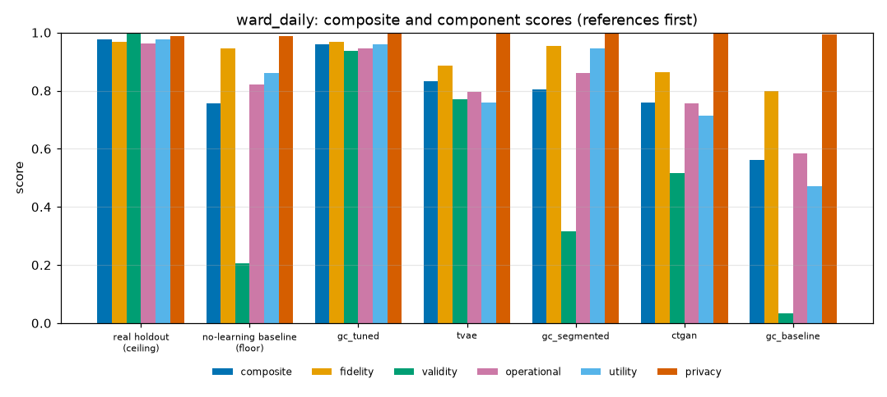
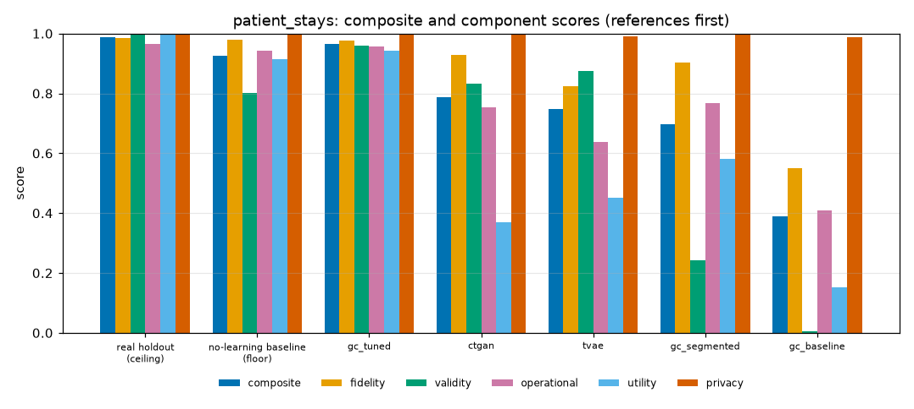
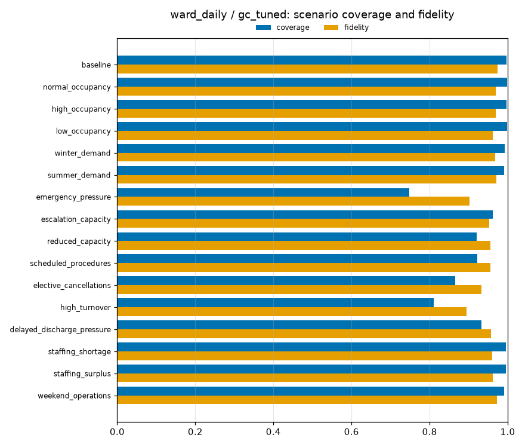
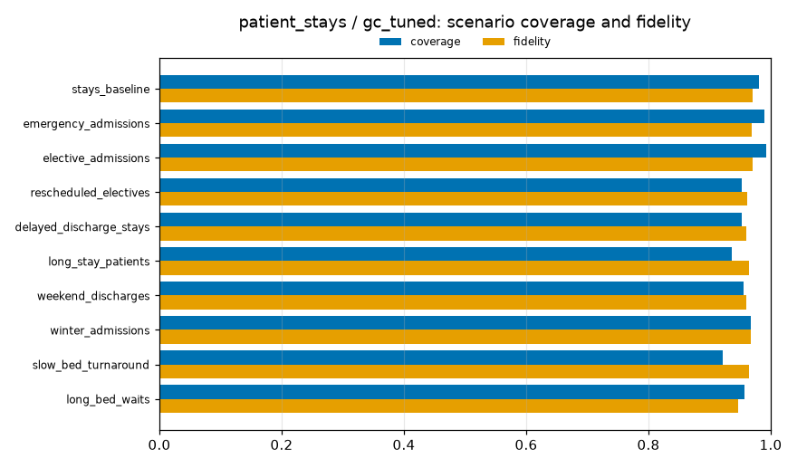

# BedSynth AI - Week 3: quality and scheduling evaluation

Generated 2026-11-15T12:21:25+00:00 from `scripts/03_evaluate.py` results (comparison of 2026-11-15T05:31:06+00:00).

## Summary

- **ward_daily** (7,016 rows per model, full evaluation): selected `gc_tuned`, composite 0.958 (no-learning floor 0.758, real-holdout ceiling 0.976); raw hard-valid 93.8 % before rejection, 100 % delivered; 17 of 17 scored operational checks passed (16-17 of 17 on evaluation seeds 42, 7, 11 and 2024 of the A/B test, section 3); 16 of 16 scenarios generated (coverage score 0.949); optimisation utility 0.955 (floor 0.921, ceiling 0.953).
- **patient_stays** (20,000 rows per model, full evaluation): selected `gc_tuned`, composite 0.965 (no-learning floor 0.927, real-holdout ceiling 0.987); raw hard-valid 96.0 % before rejection, 100 % delivered; 16 of 16 scored operational checks passed; 10 of 10 scenarios generated (coverage score 0.962).
- **Improvements made to SDV generation** (section 3): composite ward_daily gc_baseline 0.563 -> gc_segmented 0.805 -> gc_tuned 0.958; patient_stays gc_baseline 0.390 -> gc_segmented 0.698 -> gc_tuned 0.965.
- Sections 4-6 compare validity, the occupancy, patient-flow and scheduling patterns and the optimisation decisions of every model; section 7 lists the remaining gaps of the selected models.

## 1. Run configuration

Every trained model generates validated data through the scenario engine and is scored on statistical fidelity (SDV QualityReport), operational validity (raw samples), operational patterns, utility (ML TSTR and optimisation decisions) and privacy. The composite is a weighted sum (fidelity 0.30, validity 0.20, operational 0.25, utility 0.15, privacy 0.10); per table, the registry default used by the API is the model with the highest composite among entries with status ok, complete composite (no failed family), the same run configuration as the latest run and the current model version. Two reference pseudo-models scored with the same families anchor the scale: real holdout rows (ceiling) and a no-learning baseline that keeps only per-stratum marginals (floor).

- **ward_daily**: 7,016 generated rows per model (full evaluation), 400 rows per scenario, sdmetrics cross-check on, seed 42; time budgets: 90 s per sample request, 20 s per scenario request (at most 8 rejection rounds), 150 s for all scenarios of a model.
  Operational thresholds calibrated on 50 random re-splits of the real data at n = 7,016; cross-validated share of real samples that pass every check: 98 %.
- **patient_stays**: 20,000 generated rows per model (full evaluation), 400 rows per scenario, sdmetrics cross-check on, seed 42; time budgets: 90 s per sample request, 20 s per scenario request (at most 8 rejection rounds), 150 s for all scenarios of a model.
  Operational thresholds calibrated on 50 random re-splits of the real data at n = 20,000; cross-validated share of real samples that pass every check: 100 %.
- Wall time of the evaluation run: 15.3 min.

## 2. Model comparison

### ward_daily

| model | composite | fidelity | validity | operational | utility | privacy | scenario coverage | generator acceptance | eval s |
|---|---|---|---|---|---|---|---|---|---|
| _real holdout (ceiling)_ | 0.976 | 0.968 | 1.000 | 0.962 | 0.977 | 0.989 | 0.977 | - | - |
| _no-learning baseline (floor)_ | 0.758 | 0.944 | 0.205 | 0.821 | 0.861 | 0.988 | 0.961 | - | - |
| gc_tuned **(best)** | 0.958 | 0.968 | 0.938 | 0.946 | 0.960 | 0.997 | 0.949 | 94.6 % | 60.4 |
| tvae | 0.832 | 0.886 | 0.770 | 0.796 | 0.760 | 0.998 | 0.895 | 68.8 % | 80.2 |
| gc_segmented | 0.805 | 0.953 | 0.315 | 0.860 | 0.945 | 0.996 | 0.943 | 25.4 % | 58.3 |
| ctgan | 0.758 | 0.864 | 0.515 | 0.757 | 0.714 | 1.000 | 0.892 | 37.3 % | 115.0 |
| gc_baseline | 0.563 | 0.799 | 0.034 | 0.583 | 0.471 | 0.995 | 0.806 | 1.9 % | 168.5 |

Normalised scores, (model - floor) / (ceiling - floor): 0 = no better than the no-learning baseline, 1 = as good as real holdout data; `-` where the two references are less than 0.05 apart (the family cannot tell real data from the no-learning baseline), `< -1` far below the floor.

| model | composite | fidelity | validity | operational | utility | privacy |
|---|---|---|---|---|---|---|
| gc_tuned | 0.918 | - | 0.922 | 0.886 | 0.859 | - |
| tvae | 0.342 | - | 0.710 | -0.184 | -0.881 | - |
| gc_segmented | 0.217 | - | 0.138 | 0.272 | 0.725 | - |
| ctgan | 0.004 | - | 0.390 | -0.463 | < -1 | - |
| gc_baseline | -0.892 | - | -0.215 | < -1 | < -1 | - |

*ward_daily: model comparison*

### patient_stays

| model | composite | fidelity | validity | operational | utility | privacy | scenario coverage | generator acceptance | eval s |
|---|---|---|---|---|---|---|---|---|---|
| _real holdout (ceiling)_ | 0.987 | 0.986 | 1.000 | 0.966 | 0.996 | 1.000 | 0.977 | - | - |
| _no-learning baseline (floor)_ | 0.927 | 0.981 | 0.800 | 0.942 | 0.914 | 1.000 | 0.976 | - | - |
| gc_tuned **(best)** | 0.965 | 0.977 | 0.960 | 0.955 | 0.943 | 0.997 | 0.962 | 95.0 % | 38.7 |
| ctgan | 0.789 | 0.930 | 0.833 | 0.752 | 0.368 | 1.000 | 0.918 | 61.5 % | 60.4 |
| tvae | 0.749 | 0.825 | 0.873 | 0.639 | 0.452 | 0.991 | 0.763 | 86.4 % | 43.7 |
| gc_segmented | 0.698 | 0.903 | 0.243 | 0.767 | 0.582 | 0.996 | 0.896 | 4.4 % | 45.2 |
| gc_baseline | 0.390 | 0.551 | 0.006 | 0.409 | 0.153 | 0.988 | 0.478 | 0.3 % | 97.4 |

Normalised scores, (model - floor) / (ceiling - floor): 0 = no better than the no-learning baseline, 1 = as good as real holdout data; `-` where the two references are less than 0.05 apart (the family cannot tell real data from the no-learning baseline), `< -1` far below the floor.

| model | composite | fidelity | validity | operational | utility | privacy |
|---|---|---|---|---|---|---|
| gc_tuned | 0.643 | - | 0.801 | - | 0.361 | - |
| ctgan | < -1 | - | 0.162 | - | < -1 | - |
| tvae | < -1 | - | 0.367 | - | < -1 | - |
| gc_segmented | < -1 | - | < -1 | - | < -1 | - |
| gc_baseline | < -1 | - | < -1 | - | < -1 | - |

Components where the floor beats gc_tuned: fidelity (0.981 vs 0.977).

*patient_stays: model comparison*

## 3. Improvements made to SDV generation

The ablation trains the same GaussianCopula family with one improvement block added per step (settings `synthesis.experiments`), so the deltas below are the measured effect of each block on the same evaluation:

- `gc_baseline` - Week-2 baseline: one global GaussianCopula, default encodings, no constraints.
- `gc_segmented` - + per-ward segments, SDV built-in constraints, ordinal metadata / ordered encodings, tuned marginals.
- `gc_tuned` - + programmable constraints (band labels, learned structural zeros, escalation cover, exact per-group marginals) and ward x source segments for patient_stays.

*Raw hard-valid after training* is the Week-2 diagnostic (unfiltered samples drawn right after training); *raw hard-valid (this evaluation)* re-measures it on this evaluation's own unfiltered sample (size in section 1), so the two differ by sampling noise.

### ward_daily

| model | segmentation | constraint groups applied in SDV | raw hard-valid after training | raw hard-valid (this evaluation) | composite | fidelity | operational | utility | delta composite |
|---|---|---|---|---|---|---|---|---|---|
| gc_baseline | global | none | 3.4 % | 3.4 % | 0.563 | 0.799 | 0.583 | 0.471 | - |
| gc_segmented | ward_id | inequality | 30.1 % | 31.5 % | 0.805 | 0.953 | 0.860 | 0.945 | +0.243 |
| gc_tuned | ward_id | inequality, regime_labels, structural_zeros, capacity, conditional_marginals | 93.0 % | 93.8 % | 0.958 | 0.968 | 0.946 | 0.960 | +0.153 |

- **gc_baseline -> gc_segmented** (+ per-ward segments, SDV built-in constraints, ordinal metadata / ordered encodings, tuned marginals): composite 0.563 -> 0.805; fidelity 0.799 -> 0.953, validity 0.034 -> 0.315, operational 0.583 -> 0.860, utility 0.471 -> 0.945.
- **gc_segmented -> gc_tuned** (+ programmable constraints (band labels, learned structural zeros, escalation cover, exact per-group marginals) and ward x source segments for patient_stays): composite 0.805 -> 0.958; validity 0.315 -> 0.938, operational 0.860 -> 0.946.

### patient_stays

| model | segmentation | constraint groups applied in SDV | raw hard-valid after training | raw hard-valid (this evaluation) | composite | fidelity | operational | utility | delta composite |
|---|---|---|---|---|---|---|---|---|---|
| gc_baseline | global | none | 0.5 % | 0.6 % | 0.390 | 0.551 | 0.409 | 0.153 | - |
| gc_segmented | ward_id | fixed_combinations | 25.5 % | 24.3 % | 0.698 | 0.903 | 0.767 | 0.582 | +0.308 |
| gc_tuned | ward_id x admission_source | fixed_combinations, conditional_marginals | 95.8 % | 96.0 % | 0.965 | 0.977 | 0.955 | 0.943 | +0.267 |

- **gc_baseline -> gc_segmented** (+ per-ward segments, SDV built-in constraints, ordinal metadata / ordered encodings, tuned marginals): composite 0.390 -> 0.698; fidelity 0.551 -> 0.903, validity 0.006 -> 0.243, operational 0.409 -> 0.767, utility 0.153 -> 0.582.
- **gc_segmented -> gc_tuned** (+ programmable constraints (band labels, learned structural zeros, escalation cover, exact per-group marginals) and ward x source segments for patient_stays): composite 0.698 -> 0.965; fidelity 0.903 -> 0.977, validity 0.243 -> 0.960, operational 0.767 -> 0.955, utility 0.582 -> 0.943.

Generation-level improvements shared by every model (not part of the ablation): rejection sampling against every hard rule (the delivered data is 100 % hard-valid), allocation strata that keep the ward x band / ward x source x delay mix of the training split despite unequal rejection rates, acceptance-informed batch sizes and per-request time budgets.

### ward_daily: A/B test of the band-grouped specs

The ward_daily `gc_tuned` spec above was adopted after an A/B test (evidence `reports/experiments/ward_daily_band_groups_ab.json`; DESIGN.md §7.2): 7 spec variants and the previous spec (the control) were trained on the same split and scored in one evaluation (seed 42, 7,016 rows per model), and `gc_tuned_x7` was the only variant that met the pre-set adoption bar. The previous and the adopted spec were then re-scored with evaluation seeds 7, 11 and 2024 (the same trained models on new evaluation samples); ranges over the 4 seeds:

| spec | composite | operational checks passed | raw hard-valid |
|---|---|---|---|
| previous (control) | 0.941-0.942 (mean 0.942) | 13-14 of 17 | 93.8-94.4 % |
| adopted (`gc_tuned_x7`) | 0.955-0.959 (mean 0.957) | 16-17 of 17 | 93.2-93.8 % |

- On 2 of the 3 extra seeds the adopted spec fails a check that passes in this evaluation (seed 7: `relationship_bed_pressure_cancellations`; seed 11: `weekend_weekday_discharge_ratio`).
- Its raw hard-valid rate is 0.4-1.0 points lower than the previous spec's on each seed (mean 0.7); rejection sampling still delivers only hard-valid rows.
- `gc_tuned_x1` (rejected in the official run: privacy 0.9949 below the bar (control - 0.005)) was re-scored too and passed every check on 0 of the 3 extra seeds; the adopted spec scored the higher utility on 4 and the higher composite on 4 of the 4 seeds.
- `gc_tuned_x4` (rejected in the official run: privacy 0.990 below the bar; utility below the control) was re-scored too and passed every check on 3 of the 3 extra seeds; the adopted spec scored the higher utility on 4 and the higher composite on 3 of the 4 seeds.
- The specs were compared on this evaluation, whose utility and privacy families use the real holdout, so the adopted spec's utility and privacy figures carry some selection optimism; training-seed variation is not covered.

### Improvement log

What changed on the way to the selected models and where each change is documented (DESIGN.md is the specification; the measured effects are the ablation above and the A/B results in DESIGN.md):

1. **Ablation recipe** - `gc_baseline` -> `gc_segmented` -> `gc_tuned`, one improvement block per step, measured in the tables above (DESIGN.md §7.5; Week-2 report sections 2 and 5).
2. **Constraint specs adopted after A/B tests** - patient_stays: length of stay per admission weekday, and exact admission/discharge-hour, bed-wait and turnaround marginals per ward x admission source (`conditional_marginals`) (DESIGN.md §7.2).
3. **Band-grouped constraint specs adopted after an A/B test** - ward_daily: ED boarders and the mean bed wait per ward x occupancy band and closed beds per ward x staffing band, both bands recomputed from the counts (`band_groups`, never read from the sampled labels), and day-shift nurses per ward x month replace the per-ward marginals of the mostly-zero counts and the parametric nurse marginal (`conditional_marginals`); the variants, the adoption bar and re-scores on three further evaluation seeds are kept as evidence (DESIGN.md §7.2; reports/experiments/ward_daily_band_groups_ab.json).
4. **Constraint spec rejected** - ward_daily: discharges per ward x weekday and nurses per ward; it fixed the weekend/weekday discharge ratio but weakened the seasonal pressure contrast, so it was not adopted (DESIGN.md §7.2).
5. **Overwriting repair removed** - an earlier `structural_zeros` spec forced delay hours to 0 when no delay reason was sampled; it kept the length of stay drawn with the discarded delay and inflated the stays of non-delayed patients, so delay hours are now modelled per delay reason by `conditional_marginals` (DESIGN.md §7.2).
6. **Encodings and marginals** - weekdays ordered by mean discharges instead of mean elective lists (which imposed a false weekday gradient; elective lists are now modelled per ward x weekday); marginals chosen by KS per segment and per column, with a post-fit check that refits degenerate fits (DESIGN.md §7.3).
7. **Rules added after the data review** - WD-H15 (only free beds are closed, so the start-of-day census fits within the beds available that day); PS-H13 (a departure counts as delayed only when it is more than 4 hours after the patient was ready, so recorded delays are either zero or at least 4 hours); PS-H14 (postponed electives are rebooked at least seven days later, so the booking lead is at least 1 + 7 x times_rescheduled days): the simulator guaranteed these invariants but no rule checked them, so earlier "100 % hard-valid" output could break them (DESIGN.md §6.4).
8. **Simulator realism fixes** - weekend discharge model with separate Saturday and Sunday capacities and a Friday push, outlier bedding timing, truncated decision-to-admit lag and ward delay factors, with realism targets added to the calibration; hot-deck imputation instead of group medians in the cleaning step (no artificial modes) (DESIGN.md §6.1, §6.3).
9. **Allocation strata and the synthetic pilot draw** - rejection accepts some strata more easily than others; quotas per ward x band (ward-days) and ward x source x delay reason (stays) keep the training mix, and filtered requests take their strata from a seeded synthetic pilot draw, never from the real rows that match the filters (DESIGN.md §8.3; strata TVD and rebalanced rows in section 4).
10. **Evaluation improvements** - operational thresholds calibrated to real-data noise at the evaluated size; size-matched train-on-real baselines and skill ratios for ML utility; booking-quota regret scored out of sample on the real holdout; the real-holdout ceiling and the no-learning floor scored with the same families (DESIGN.md §9 items 4, 6, 7 and 10; sections 1-2 and 6).

## 4. Validity: raw model samples vs delivered output

- **Raw hard-valid rate** (composite component `validity`): share of *unfiltered* model samples that pass every hard operational rule - what the model produces on its own.
- **Output hard-valid rate**: share of the *delivered* generator output passing every hard rule; 100 % by construction, because rejection sampling discards every invalid row.
- **Generator acceptance**: accepted / sampled rows during generation. It is measured on the generator's conditional per-stratum requests, not on the unconditional raw sample, and also counts rows rejected only for leaving the requested stratum, so it can sit above or below the raw rate.
- **Strata TVD**: distance between the output's allocation-strata mix and the training split's; more than 0.05 above the **rounding floor** (the TVD of the best possible allocation of that many rows) the generator had to move quota to strata the model produces more easily (flagged). **Rebalanced rows** is the generator's count of delivered rows that sit in a stratum beyond its reference quota (without a shortfall, rebalanced rows / rows is the TVD from the allocation; the TVD column also includes rounding and the chunking of large samples).

### ward_daily

| model | raw hard-valid | output hard-valid | generator acceptance | strata TVD | rounding floor | rebalanced rows | most violated hard rules (raw) |
|---|---|---|---|---|---|---|---|
| gc_tuned | 93.8 % | 100.0 % | 94.6 % | 0.000 | 0.000 | 0 | WD-H06 5.6 %, WD-H15 1.1 % |
| tvae | 77.0 % | 100.0 % | 68.8 % | 0.000 | 0.000 | 1 | WD-H06 20.9 %, WD-H15 16.5 %, WD-H07 15.5 % |
| gc_segmented | 31.5 % | 100.0 % | 25.4 % | 0.000 | 0.000 | 0 | WD-H10 48.2 %, WD-H11 27.0 %, WD-H06 11.5 % |
| ctgan | 51.5 % | 100.0 % | 37.3 % | 0.000 | 0.000 | 2 | WD-H15 41.6 %, WD-H07 40.7 %, WD-H06 37.2 % |
| gc_baseline | 3.4 % | 100.0 % | 1.9 % | 0.319 (flagged) | 0.000 | 2,235 | WD-H10 75.5 %, WD-H11 60.2 %, WD-H06 42.8 % |

Soft (plausibility) rules - violation rate of the delivered output vs real holdout data:

| rule | description | real holdout | gc_tuned output | tvae output | gc_segmented output | ctgan output | gc_baseline output |
|---|---|---|---|---|---|---|---|
| WD-S01 | Night-shift nurses do not outnumber day-shift nurses. | 0.0 % | 1.0 % | 2.9 % | 0.1 % | 18.4 % | 0.3 % |
| WD-S02 | Patients per day-shift nurse stay within twice the ward's target nurse ratio. | 0.1 % | 0.0 % | 0.0 % | 0.0 % | 0.2 % | 0.1 % |
| WD-S03 | Emergency patients board in ED overnight only when the ward is at least 90% occupied. | 0.0 % | 0.0 % | 0.0 % | 9.4 % | 0.0 % | 22.3 % |
| WD-S04 | Escalation beds are open only when the ward is at least 80% occupied. | 5.8 % | 7.7 % | 7.7 % | 7.9 % | 15.2 % | 18.2 % |
| WD-S05 | At most two elective admissions are booked on a Saturday or Sunday. | 0.1 % | 0.0 % | 0.0 % | 0.5 % | 0.0 % | 1.2 % |
| WD-S06 | On days with four or more discharges, at most 80% are completed before noon. | 0.2 % | 0.2 % | 0.0 % | 0.2 % | 1.8 % | 0.0 % |

### patient_stays

| model | raw hard-valid | output hard-valid | generator acceptance | strata TVD | rounding floor | rebalanced rows | most violated hard rules (raw) |
|---|---|---|---|---|---|---|---|
| gc_tuned | 96.0 % | 100.0 % | 95.0 % | 0.001 | 0.001 | 8 | PS-H08 3.8 %, PS-H04 1.7 % |
| ctgan | 83.3 % | 100.0 % | 61.5 % | 0.021 | 0.001 | 400 | PS-H05 11.5 %, PS-H14 11.5 %, PS-H08 5.6 % |
| tvae | 87.3 % | 100.0 % | 86.4 % | 0.011 | 0.001 | 202 | PS-H05 7.6 %, PS-H14 7.6 %, PS-H08 5.1 % |
| gc_segmented | 24.3 % | 100.0 % | 4.4 % | 0.284 (flagged) | 0.001 | 5,672 | PS-H07 62.0 %, PS-H06 21.3 %, PS-H13 15.1 % |
| gc_baseline | 0.6 % | 100.0 % | 0.3 % | 0.966 (flagged) | 0.009 | 1,610 | PS-H06 86.6 %, PS-H07 77.6 %, PS-H09 32.4 % |

Soft (plausibility) rules - violation rate of the delivered output vs real holdout data:

| rule | description | real holdout | gc_tuned output | ctgan output | tvae output | gc_segmented output | gc_baseline output |
|---|---|---|---|---|---|---|---|
| PS-S01 | Elective patients are admitted between 06:00 and 14:59. | 0.0 % | 0.0 % | 0.0 % | 0.0 % | 6.6 % | 47.5 % |
| PS-S02 | Patients leave the ward between 07:00 and 22:59. | 0.9 % | 0.9 % | 0.3 % | 0.0 % | 1.4 % | 1.3 % |
| PS-S03 | Elective patients wait at most four hours for their bed. | 2.1 % | 2.1 % | 1.9 % | 0.2 % | 3.7 % | 16.0 % |
| PS-S04 | Paediatric stays do not end in an internal transfer. | 0.0 % | 0.0 % | 2.2 % | 5.7 % | 0.0 % | 0.1 % |
| PS-S05 | Discharge delays beyond 72 hours occur only for care-facility or supported-home discharges. | 0.1 % | 0.2 % | 0.1 % | 0.0 % | 0.1 % | 19.6 % |

## 5. Scheduling relationships and occupancy patterns

Operational checks per model (lower values are better) with pass/FAIL against the pass threshold, which is calibrated to real-data noise at the evaluated size (the larger of the design threshold and the real-data noise limit), next to the noise limit and both references. System checks forced by the allocation strata are left out (section 9); `n/a` marks a statistic that could not be computed on the model's output, with the reason.

### ward_daily

**Occupancy, capacity and patient-flow checks**

| check | metric | pass threshold | real noise limit | real holdout | floor | gc_tuned | tvae | gc_segmented | ctgan | gc_baseline |
|---|---|---|---|---|---|---|---|---|---|---|
| occupancy_mean_by_ward | mean_abs_diff | 0.030 | 0.015 | 0.003 | 0.030 | 0.003 pass | 0.009 pass | 0.007 pass | 0.033 FAIL | 0.035 FAIL |
| occupancy_distribution_by_ward | mean_ks | 0.150 | 0.086 | 0.036 | 0.094 | 0.035 pass | 0.053 pass | 0.058 pass | 0.097 pass | 0.128 FAIL |
| monthly_emergency_profile | wape | 0.100 | 0.065 | 0.045 | 0.062 | 0.037 pass | 0.170 FAIL | 0.021 pass | 0.286 FAIL | 0.314 FAIL |
| seasonal_pressure_contrast | abs_diff | 0.074 | 0.074 | 0.019 | 0.035 | 0.063 pass | 0.137 FAIL | 0.002 pass | 0.193 FAIL | 0.185 FAIL |
| zero_inflated_count_shares | mean_abs_diff | 0.050 | 0.022 | 0.016 | 0.021 | 0.010 pass | 0.033 pass | 0.117 FAIL | 0.016 pass | 0.163 FAIL |
| weekly_discharge_profile | wape | 0.100 | 0.053 | 0.016 | 0.150 | 0.035 pass | 0.159 FAIL | 0.050 pass | 0.302 FAIL | 0.310 FAIL |
| weekend_weekday_discharge_ratio | relative_error | 0.136 | 0.136 | 0.068 | 0.509 | 0.131 pass | 0.353 FAIL | 0.116 pass | 0.371 FAIL | 0.269 FAIL |
| before_noon_discharge_share | abs_diff | 0.030 | 0.021 | 0.004 | 0.027 | 0.012 pass | 0.068 FAIL | 0.014 pass | 0.056 FAIL | 0.234 FAIL |
| relationship_census_discharges | abs_diff_spearman | 0.150 | 0.068 | 0.003 | 0.108 | 0.010 pass | 0.005 pass | 0.030 pass | 0.132 pass | 0.052 pass |
| relationship_occupancy_boarders | abs_diff_spearman | 0.150 | 0.052 | 0.001 | 0.011 | 0.001 pass | 0.063 pass | 0.194 FAIL | 0.026 pass | 0.462 FAIL |
| relationship_delays_occupancy | abs_diff_spearman | 0.150 | 0.071 | 0.052 | 0.047 | 0.024 pass | 0.251 FAIL | 0.019 pass | 0.128 pass | 0.042 pass |
| relationship_escalation_occupancy | abs_diff_spearman | 0.150 | 0.058 | 0.007 | 0.000 | 0.017 pass | 0.126 pass | 0.025 pass | 0.006 pass | 0.164 FAIL |
| short_staffing_share_by_season | mean_abs_diff | 0.050 | 0.032 | 0.022 | 0.105 | 0.010 pass | 0.109 FAIL | 0.059 FAIL | 0.085 FAIL | 0.048 pass |
| boarding_prevalence_by_occupancy_band | mean_abs_diff | 0.050 | 0.024 | 0.002 | 0.003 | 0.007 pass | 0.033 pass | 0.142 FAIL | 0.008 pass | 0.258 FAIL |

- `occupancy_mean_by_ward`: Mean midnight occupancy rate per ward (absolute difference; a 0.10 difference scores 0).
- `occupancy_distribution_by_ward`: Distribution of midnight occupancy rate per ward (two-sample KS statistic).
- `monthly_emergency_profile`: Monthly profile of mean emergency admissions per ward-day, ward-mix adjusted (seasonal demand shape and level).
- `seasonal_pressure_contrast`: Winter minus summer share of critical-occupancy ward-days (absolute difference of the contrast).
- `zero_inflated_count_shares`: Share of ward-days with closed beds, with ED boarders and (on booked days) with cancellations (mean |Δ share|).
- `weekly_discharge_profile`: Day-of-week profile of mean discharges per ward-day (ward-mix adjusted).
- `weekend_weekday_discharge_ratio`: Mean weekend discharges divided by mean weekday discharges (relative error).
- `before_noon_discharge_share`: Share of discharges completed before noon (absolute difference).
- `relationship_census_discharges`: Spearman correlation of start-of-day census with discharges (sign agreement and |Δρ|).
- `relationship_occupancy_boarders`: Spearman correlation of occupancy rate with emergency patients boarding at midnight.
- `relationship_delays_occupancy`: Spearman correlation of delayed-discharge rate with occupancy rate.
- `relationship_escalation_occupancy`: Spearman correlation of escalation beds open with occupancy rate.
- `short_staffing_share_by_season`: Share of short-staffed ward-days per season (absolute difference).
- `boarding_prevalence_by_occupancy_band`: Share of ward-days with emergency patients boarding at midnight, per occupancy band.

**Scheduling checks**

| check | metric | pass threshold | real noise limit | real holdout | floor | gc_tuned | tvae | gc_segmented | ctgan | gc_baseline |
|---|---|---|---|---|---|---|---|---|---|---|
| weekly_elective_profile | wape | 0.104 | 0.104 | 0.046 | 0.500 | 0.016 pass | 0.203 FAIL | 0.373 FAIL | 0.027 pass | 0.408 FAIL |
| relationship_bed_pressure_cancellations | abs_diff_spearman | 0.150 | 0.132 | 0.098 | 0.113 | 0.109 pass | 0.057 pass | 0.052 pass | 0.225 FAIL | 0.227 FAIL |
| relationship_short_staffing_cancellations | abs_diff_spearman | 0.159 | 0.159 | 0.009 | 0.061 | 0.032 pass | 0.065 pass | 0.003 pass | 0.044 pass | 0.042 pass |

- `weekly_elective_profile`: Day-of-week profile of elective bookings on wards that accept electives (ward-mix adjusted).
- `relationship_bed_pressure_cancellations`: Spearman correlation of start-of-day bed pressure (census_start / available beds) with the elective cancellation rate on days with bookings.
- `relationship_short_staffing_cancellations`: Spearman correlation of short staffing (0/1) with elective cancellation rate on days with bookings.

### patient_stays

**Occupancy, capacity and patient-flow checks**

| check | metric | pass threshold | real noise limit | real holdout | floor | gc_tuned | ctgan | tvae | gc_segmented | gc_baseline |
|---|---|---|---|---|---|---|---|---|---|---|
| los_by_source | mean_ks | 0.100 | 0.032 | 0.017 | 0.026 | 0.033 pass | 0.221 FAIL | 0.274 FAIL | 0.109 FAIL | 0.507 FAIL |
| los_by_ward | mean_ks | 0.100 | 0.046 | 0.029 | 0.028 | 0.037 pass | 0.258 FAIL | 0.280 FAIL | 0.129 FAIL | 0.325 FAIL |
| admission_hour_profile_by_source | mean_tvd | 0.100 | 0.046 | 0.034 | 0.018 | 0.016 pass | 0.088 pass | 0.303 FAIL | 0.269 FAIL | 0.552 FAIL |
| discharge_hour_profile | tvd | 0.100 | 0.032 | 0.021 | 0.010 | 0.014 pass | 0.131 FAIL | 0.227 FAIL | 0.083 pass | 0.193 FAIL |
| before_noon_discharge_share | abs_diff | 0.030 | 0.016 | 0.004 | 0.001 | 0.002 pass | 0.045 FAIL | 0.079 FAIL | 0.013 pass | 0.079 FAIL |
| weekend_discharge_share | abs_diff | 0.030 | 0.012 | 0.005 | 0.061 | 0.009 pass | 0.017 pass | 0.031 FAIL | 0.070 FAIL | 0.074 FAIL |
| delay_prevalence_by_destination | mean_abs_diff | 0.050 | 0.036 | 0.019 | 0.016 | 0.037 pass | 0.083 FAIL | 0.150 FAIL | 0.095 FAIL | 0.645 FAIL |
| mean_delay_by_reason | mean_relative_error | 0.200 | 0.066 | 0.040 | 0.070 | 0.088 pass | 0.088 pass | 0.057 pass | 0.205 FAIL | 1.613 FAIL |
| bed_turnaround_distribution | ks | 0.100 | 0.020 | 0.012 | 0.008 | 0.005 pass | 0.038 pass | 0.250 FAIL | 0.055 pass | 0.085 pass |
| emergency_bed_wait_distribution | ks | 0.100 | 0.027 | 0.014 | 0.009 | 0.008 pass | 0.033 pass | 0.211 FAIL | 0.166 FAIL | n/a (fewer than 5 synthetic rows) FAIL |
| transfer_out_share_by_ward | mean_abs_diff | 0.030 | 0.014 | 0.010 | 0.037 | 0.013 pass | 0.170 FAIL | 0.182 FAIL | 0.030 FAIL | 0.128 FAIL |

- `los_by_source`: Length of stay (days) per admission source: median and p90 (relative error) and KS.
- `los_by_ward`: Length of stay (days) per ward: median and p90 (relative error) and KS.
- `admission_hour_profile_by_source`: Admission hour-of-day distribution per admission source (total variation distance).
- `discharge_hour_profile`: Ward departure hour-of-day distribution (total variation distance).
- `before_noon_discharge_share`: Share of ward departures before noon (absolute difference).
- `weekend_discharge_share`: Share of ward departures on Saturday or Sunday (absolute difference).
- `delay_prevalence_by_destination`: Share of delayed departures per discharge destination (absolute difference).
- `mean_delay_by_reason`: Mean discharge delay (hours) per delay reason (relative error).
- `bed_turnaround_distribution`: Bed turnaround minutes after departure: median and p90 (relative error) and KS.
- `emergency_bed_wait_distribution`: Bed wait (hours) of emergency admissions: median and p90 (relative error) and KS.
- `transfer_out_share_by_ward`: Share of stays ending in an internal transfer out, per ward (absolute difference).

**Scheduling checks**

| check | metric | pass threshold | real noise limit | real holdout | floor | gc_tuned | ctgan | tvae | gc_segmented | gc_baseline |
|---|---|---|---|---|---|---|---|---|---|---|
| elective_lead_time_distribution | ks | 0.100 | 0.047 | 0.025 | 0.016 | 0.016 pass | 0.269 FAIL | 0.486 FAIL | 0.154 FAIL | 0.453 FAIL |
| elective_reschedule_share | relative_error | 0.250 | 0.221 | 0.125 | 0.047 | 0.097 pass | 0.213 pass | 1.000 FAIL | 0.529 FAIL | 9.487 FAIL |
| relationship_lead_reschedules | abs_diff_spearman | 0.150 | 0.082 | 0.047 | 0.231 | 0.078 pass | 0.258 FAIL | 0.257 FAIL | 0.081 pass | 0.082 pass |
| elective_admission_weekday_profile | tvd | 0.059 | 0.059 | 0.021 | 0.012 | 0.059 pass | 0.329 FAIL | 0.219 FAIL | 0.104 FAIL | 0.176 FAIL |
| elective_admission_window_share | abs_diff | 0.030 | 0.000 | 0.000 | 0.000 | 0.000 pass | 0.000 pass | 0.000 pass | 0.363 FAIL | 0.475 FAIL |

- `elective_lead_time_distribution`: Booking lead time (days) of elective admissions: median and p90 (relative error) and KS.
- `elective_reschedule_share`: Share of elective admissions rescheduled at least once (relative error).
- `relationship_lead_reschedules`: Spearman correlation of booking lead time with times rescheduled among elective admissions.
- `elective_admission_weekday_profile`: Admission day-of-week mix of elective admissions, weekend electives included (total variation distance).
- `elective_admission_window_share`: Share of elective admissions in the 06:00-14:59 admission window (absolute difference).

## 6. Optimisation-model testing

Three decision problems are solved on synthetic ward-days and compared with the same decisions on real data (DESIGN.md §9.7): elective booking quotas (newsvendor / sample average approximation; the synthetic and the real-trained quotas are both scored **out of sample on the real holdout**), admission-control policy evaluation (can the data predict each policy's objective?) and capacity planning (p95 beds needed per ward).

| data | score | quota score | quota regret (holdout) | real-vs-real regret floor | quota agreement | policy objective accuracy | Kendall tau (diagnostic) | capacity score | capacity error |
|---|---|---|---|---|---|---|---|---|---|
| _real holdout (ceiling)_ | 0.953 | 1.000 | 0.0 % | 3.7 % | 100 % | 0.888 | 1.000 | 0.972 | 2.8 % |
| _no-learning baseline (floor)_ | 0.921 | 0.939 | 6.1 % | 3.7 % | 47 % | 0.838 | 1.000 | 0.986 | 1.4 % |
| gc_tuned | 0.955 | 0.977 | 2.3 % | 3.7 % | 43 % | 0.908 | 1.000 | 0.980 | 2.0 % |
| tvae | 0.850 | 0.723 | 27.7 % | 3.7 % | 37 % | 0.839 | 0.929 | 0.987 | 1.3 % |
| gc_segmented | 0.939 | 0.979 | 2.1 % | 3.7 % | 47 % | 0.863 | 1.000 | 0.975 | 2.5 % |
| ctgan | 0.936 | 0.974 | 2.6 % | 3.7 % | 63 % | 0.858 | 0.857 | 0.975 | 2.5 % |
| gc_baseline | 0.650 | 0.913 | 8.7 % | 3.7 % | 40 % | 0.301 | 1.000 | 0.737 | 26.3 % |

- The real policy ranking is the monotone order of the occupancy targets, so ranking agreement (Kendall tau) is reported as a diagnostic only: even the no-learning floor reaches tau 1.000.
- Regret below the real-vs-real floor means the synthetic decision is as good as one taken on real data of the same size; a negative regret means it did better on the holdout than the real-trained decision (sampling noise).

## 7. Quality gaps

Gaps of each table's selected model (failed checks use the thresholds calibrated to real-data noise; soft-rule gaps are rates more than 2 percentage points above the real holdout's).

### ward_daily / gc_tuned

- Worst column shapes (KS): delayed_discharge_rate, admissions_emergency, delayed_discharges, avg_bed_wait_hours, discharges_before_noon.
- Worst column pairs (SDV): ward_id x census_start 0.767, ward_id x transfers_in 0.774, census_start x occupancy_level 0.846.
- Model vs system view: fidelity 0.951 on raw samples vs 0.968 delivered; operational 0.957 raw vs 0.946 delivered (the difference is what rejection and allocation strata add).
- Scenarios - strata mix off the real scenario subset beyond rounding (quota moved to easier strata, or the model places filtered rows on other strata): emergency_pressure, escalation_capacity, reduced_capacity, scheduled_procedures, elective_cancellations, high_turnover, delayed_discharge_pressure.

Other models: tvae failed 8 of 17 operational checks; gc_segmented failed 5 of 17 operational checks; ctgan failed 8 of 17 operational checks; gc_baseline failed 13 of 17 operational checks.

### patient_stays / gc_tuned

- At or near the no-learning floor on: fidelity (0.977 vs floor 0.981).
- Worst column shapes (KS): los_hours, los_days, los_nights, admission_hour, discharge_delay_hours.
- Worst column pairs (SDV): discharge_hour x is_delayed_discharge 0.911, admission_day_of_week x is_weekend_discharge 0.930, discharge_destination x discharge_delay_hours 0.950.
- Model vs system view: fidelity 0.977 on raw samples vs 0.977 delivered; operational 0.956 raw vs 0.955 delivered (the difference is what rejection and allocation strata add).
- Scenarios - strata mix off the real scenario subset beyond rounding (quota moved to easier strata, or the model places filtered rows on other strata): rescheduled_electives, delayed_discharge_stays, long_stay_patients, weekend_discharges, slow_bed_turnaround, long_bed_waits.

Other models: ctgan failed 9 of 16 operational checks; tvae failed 14 of 16 operational checks; gc_segmented failed 12 of 16 operational checks; gc_baseline failed 14 of 16 operational checks (delivered 1,978 of 20,000 rows within its time budget).

## 8. Model details (appendix)

Every evaluation family per model: the selected default in full (operational checks and per-scenario coverage), the other models in short form.

### ward_daily / gc_tuned (selected default)

Composite 0.958; evaluated on 7,016 generated rows vs 7,016 real training rows (holdout 1,752).

- **Statistical fidelity** 0.968 (sdv_quality_report): column shapes 0.975, pair trends 0.962; mean KS 0.026, mean TVD 0.022, mean |dSpearman| 0.021; worst numeric columns: delayed_discharge_rate, admissions_emergency, delayed_discharges, avg_bed_wait_hours, discharges_before_noon.
- **Validity** (raw model samples, before rejection) 93.8 % hard-valid; most violated: WD-H06 census_within_available_beds (5.6 %), WD-H15 closures_only_free_beds (1.1 %). Generator output is 100 % hard-valid by construction; delivered output soft-clean rate 91.3 %.
- **ML utility (TSTR vs size-matched TRTR)** 0.966:
  - high_pressure_classification: TRTR auc 0.790, average_precision 0.751, f1 0.702; TSTR auc 0.777, average_precision 0.738, f1 0.694; ratios auc_ratio 0.958, ap_lift_ratio 0.951; score 0.954
  - discharges_regression: TRTR r2 0.683, mae 1.572; TSTR r2 0.668, mae 1.611; ratios r2_ratio 0.977; score 0.977
- **Optimisation utility** 0.955: booking quotas 0.977 (quota agreement 43.3 %, relative regret 2.3 % out of sample); policy evaluation 0.908 (Kendall tau 1.000); capacity planning 0.980 (mean relative error 2.0 %).
- **Privacy** 0.997 (exact match protection 1.000, dcr ratio protection 1.000, close record protection 1.000, overfitting protection 0.988); exact copies of training rows 0.00 % (holdout baseline 0.00 %), median DCR ratio synthetic/holdout 1.058. sdmetrics cross-check (not scored, 1,000 rows per side): DCRBaselineProtection 0.245 (median DCR 0.081 vs 0.332 for random rows), DCROverfittingProtection 0.938. Aggregate disclosure (not scored): the ward_id x occupancy_level mix is 0.000 TVD from the training split vs 0.035 for real holdout data - the output mirrors the training frequencies.
- **Operational patterns** 0.946: 17 of 17 checks passed; system checks (forced by the allocation strata, not scored): occupancy_band_mix_by_ward.

| check | group | metric | value | pass threshold | real noise limit | score | passed | note |
|---|---|---|---|---|---|---|---|---|
| occupancy_mean_by_ward | occupancy | mean_abs_diff | 0.003 | 0.030 | 0.015 | 0.971 | yes | within real noise |
| occupancy_distribution_by_ward | occupancy | mean_ks | 0.035 | 0.150 | 0.086 | 0.965 | yes | within real noise |
| occupancy_band_mix_by_ward | occupancy | mean_tvd | 0.000 | 0.100 | 0.083 | 1.000 | yes | system check |
| monthly_emergency_profile | demand | wape | 0.037 | 0.100 | 0.065 | 0.910 | yes | within real noise |
| seasonal_pressure_contrast | demand | abs_diff | 0.063 | 0.074 | 0.074 | 0.685 | yes | within real noise |
| zero_inflated_count_shares | capacity | mean_abs_diff | 0.010 | 0.050 | 0.022 | 0.950 | yes | within real noise |
| weekly_elective_profile | scheduling | wape | 0.016 | 0.104 | 0.104 | 0.992 | yes | within real noise |
| relationship_bed_pressure_cancellations | scheduling | abs_diff_spearman | 0.109 | 0.150 | 0.132 | 0.946 | yes | within real noise |
| weekly_discharge_profile | patient_flow | wape | 0.035 | 0.100 | 0.053 | 0.973 | yes | within real noise |
| weekend_weekday_discharge_ratio | patient_flow | relative_error | 0.131 | 0.136 | 0.136 | 0.869 | yes | within real noise |
| before_noon_discharge_share | patient_flow | abs_diff | 0.012 | 0.030 | 0.021 | 0.942 | yes | within real noise |
| relationship_census_discharges | relationships | abs_diff_spearman | 0.010 | 0.150 | 0.068 | 0.995 | yes | within real noise |
| relationship_occupancy_boarders | relationships | abs_diff_spearman | 0.001 | 0.150 | 0.052 | 0.999 | yes | within real noise |
| relationship_delays_occupancy | relationships | abs_diff_spearman | 0.024 | 0.150 | 0.071 | 0.988 | yes | within real noise |
| relationship_short_staffing_cancellations | relationships | abs_diff_spearman | 0.032 | 0.159 | 0.159 | 0.984 | yes | within real noise |
| relationship_escalation_occupancy | relationships | abs_diff_spearman | 0.017 | 0.150 | 0.058 | 0.991 | yes | within real noise |
| short_staffing_share_by_season | staffing | mean_abs_diff | 0.010 | 0.050 | 0.032 | 0.951 | yes | within real noise |
| boarding_prevalence_by_occupancy_band | emergency | mean_abs_diff | 0.007 | 0.050 | 0.024 | 0.964 | yes | within real noise |

- **Scenario coverage** 0.949: 16 of 16 scenarios generated, mean fulfilment 100.0 %, mean strata fidelity 0.890, mean fidelity 0.954 (400 rows requested per scenario).

| scenario | category | real rows | generated | acceptance | strata TVD | rounding floor | combination coverage | fidelity | score | s |
|---|---|---|---|---|---|---|---|---|---|---|
| baseline | baseline | 7,016 | 400/400 | 95.0 % | 0.007 | 0.007 | 1.000 | 0.973 | 0.985 | 1.4 |
| normal_occupancy | occupancy | 2,285 | 400/400 | 99.7 % | 0.002 | 0.002 | 1.000 | 0.970 | 0.985 | 1.0 |
| high_occupancy | occupancy | 3,296 | 400/400 | 90.1 % | 0.005 | 0.005 | 1.000 | 0.970 | 0.984 | 1.0 |
| low_occupancy | occupancy | 1,435 | 400/400 | 99.8 % | 0.003 | 0.003 | 1.000 | 0.962 | 0.980 | 1.1 |
| winter_demand | seasonal | 1,746 | 400/400 | 84.8 % | 0.017 | 0.009 | 1.000 | 0.968 | 0.980 | 2.7 |
| summer_demand | seasonal | 1,771 | 400/400 | 99.4 % | 0.019 | 0.011 | 1.000 | 0.971 | 0.981 | 1.5 |
| emergency_pressure | emergency | 649 | 400/400 | 9.5 % | 0.506 (flagged) | 0.006 | 1.000 | 0.902 | 0.825 | 5.4 |
| escalation_capacity | utilization | 1,595 | 400/400 | 47.9 % | 0.077 (flagged) | 0.006 | 1.000 | 0.953 | 0.957 | 3.6 |
| reduced_capacity | utilization | 599 | 400/400 | 6.2 % | 0.158 (flagged) | 0.010 | 1.000 | 0.956 | 0.939 | 4.2 |
| scheduled_procedures | scheduling | 1,518 | 400/400 | 68.3 % | 0.156 (flagged) | 0.004 | 1.000 | 0.955 | 0.939 | 2.0 |
| elective_cancellations | scheduling | 394 | 400/400 | 7.9 % | 0.268 (flagged) | 0.006 | 0.944 | 0.932 | 0.899 | 4.2 |
| high_turnover | turnover | 803 | 400/400 | 6.1 % | 0.378 (flagged) | 0.008 | 1.000 | 0.895 | 0.853 | 3.7 |
| delayed_discharge_pressure | delayed_discharge | 842 | 400/400 | 14.6 % | 0.134 (flagged) | 0.011 | 1.000 | 0.956 | 0.945 | 4.8 |
| staffing_shortage | staffing | 867 | 400/400 | 87.3 % | 0.010 | 0.010 | 1.000 | 0.960 | 0.978 | 1.5 |
| staffing_surplus | staffing | 472 | 400/400 | 94.5 % | 0.010 | 0.010 | 1.000 | 0.962 | 0.979 | 1.6 |
| weekend_operations | patient_flow | 2,009 | 400/400 | 94.2 % | 0.017 | 0.008 | 1.000 | 0.972 | 0.982 | 2.1 |

A strata TVD is flagged when it exceeds the rounding floor (the TVD of the best possible allocation of that many rows) by more than 0.05 (section 4).

*ward_daily / gc_tuned: scenario coverage and fidelity*

### ward_daily / ctgan

Composite 0.758; evaluated on 7,016 generated rows vs 7,016 real training rows (holdout 1,752).

- **Statistical fidelity** 0.864 (sdv_quality_report): column shapes 0.905, pair trends 0.823; mean KS 0.105, mean TVD 0.046, mean |dSpearman| 0.109; worst numeric columns: avg_bed_wait_hours, escalation_beds_open, avg_bed_turnaround_min, discharges, transfers_in.
- **Validity** (raw model samples, before rejection) 51.5 % hard-valid; most violated: WD-H15 closures_only_free_beds (41.6 %), WD-H07 census_start_within_physical_beds (40.7 %), WD-H06 census_within_available_beds (37.2 %). Generator output is 100 % hard-valid by construction; delivered output soft-clean rate 67.5 %.
- **ML utility (TSTR vs size-matched TRTR)** 0.492:
  - high_pressure_classification: TRTR auc 0.790, average_precision 0.751, f1 0.702; TSTR auc 0.751, average_precision 0.701, f1 0.685; ratios auc_ratio 0.868, ap_lift_ratio 0.816; score 0.842
  - discharges_regression: TRTR r2 0.683, mae 1.572; TSTR r2 0.097, mae 2.534; ratios r2_ratio 0.143; score 0.143
- **Optimisation utility** 0.936: booking quotas 0.974 (quota agreement 63.3 %, relative regret 2.6 % out of sample); policy evaluation 0.858 (Kendall tau 0.857); capacity planning 0.975 (mean relative error 2.5 %).
- **Privacy** 1.000 (exact match protection 1.000, dcr ratio protection 1.000, close record protection 1.000, overfitting protection 0.999); exact copies of training rows 0.00 % (holdout baseline 0.00 %), median DCR ratio synthetic/holdout 1.798. sdmetrics cross-check (not scored, 1,000 rows per side): DCRBaselineProtection 0.344 (median DCR 0.114 vs 0.332 for random rows), DCROverfittingProtection 1.000. Aggregate disclosure (not scored): the ward_id x occupancy_level mix is 0.000 TVD from the training split vs 0.035 for real holdout data - the output mirrors the training frequencies.
- **Operational patterns** 0.757 (9/17 checks passed); failed: occupancy_mean_by_ward, monthly_emergency_profile, seasonal_pressure_contrast, relationship_bed_pressure_cancellations, weekly_discharge_profile, weekend_weekday_discharge_ratio, before_noon_discharge_share, short_staffing_share_by_season.
- **Scenario coverage** 0.892 (mean fulfilment 100.0 %, mean fidelity 0.896).

### ward_daily / gc_baseline

Composite 0.563; evaluated on 7,016 generated rows vs 7,016 real training rows (holdout 1,752).

- **Statistical fidelity** 0.799 (sdv_quality_report): column shapes 0.811, pair trends 0.788; mean KS 0.207, mean TVD 0.098, mean |dSpearman| 0.082; worst numeric columns: admissions_elective, elective_scheduled, discharges_before_noon, bed_turnover_rate, admissions_emergency.
- **Validity** (raw model samples, before rejection) 3.4 % hard-valid; most violated: WD-H10 occupancy_level_consistent (75.5 %), WD-H11 staffing_level_consistent (60.2 %), WD-H06 census_within_available_beds (42.8 %). Generator output is 100 % hard-valid by construction; delivered output soft-clean rate 66.2 %.
- **ML utility (TSTR vs size-matched TRTR)** 0.292:
  - high_pressure_classification: TRTR auc 0.790, average_precision 0.751, f1 0.702; TSTR auc 0.673, average_precision 0.635, f1 0.679; ratios auc_ratio 0.596, ap_lift_ratio 0.571; score 0.583
  - discharges_regression: TRTR r2 0.683, mae 1.572; TSTR r2 -0.053, mae 2.679; ratios r2_ratio 0.000; score 0.000
- **Optimisation utility** 0.650: booking quotas 0.913 (quota agreement 40.0 %, relative regret 8.7 % out of sample); policy evaluation 0.301 (Kendall tau 1.000); capacity planning 0.737 (mean relative error 26.3 %).
- **Privacy** 0.995 (exact match protection 1.000, dcr ratio protection 1.000, close record protection 1.000, overfitting protection 0.978); exact copies of training rows 0.00 % (holdout baseline 0.00 %), median DCR ratio synthetic/holdout 1.689. sdmetrics cross-check (not scored, 1,000 rows per side): DCRBaselineProtection 0.319 (median DCR 0.106 vs 0.332 for random rows), DCROverfittingProtection 0.944. Aggregate disclosure (not scored): the ward_id x occupancy_level mix is 0.319 TVD from the training split vs 0.035 for real holdout data.
- **Operational patterns** 0.583 (4/17 checks passed); failed: occupancy_mean_by_ward, occupancy_distribution_by_ward, monthly_emergency_profile, seasonal_pressure_contrast, zero_inflated_count_shares, weekly_elective_profile, relationship_bed_pressure_cancellations, weekly_discharge_profile, weekend_weekday_discharge_ratio, before_noon_discharge_share, relationship_occupancy_boarders, relationship_escalation_occupancy, boarding_prevalence_by_occupancy_band.
- **Scenario coverage** 0.806 (mean fulfilment 92.1 %, mean fidelity 0.855).

### ward_daily / gc_segmented

Composite 0.805; evaluated on 7,016 generated rows vs 7,016 real training rows (holdout 1,752).

- **Statistical fidelity** 0.953 (sdv_quality_report): column shapes 0.953, pair trends 0.953; mean KS 0.047, mean TVD 0.047, mean |dSpearman| 0.032; worst numeric columns: emergency_boarders, avg_bed_wait_hours, beds_closed, escalation_beds_open, delayed_discharge_rate.
- **Validity** (raw model samples, before rejection) 31.5 % hard-valid; most violated: WD-H10 occupancy_level_consistent (48.2 %), WD-H11 staffing_level_consistent (27.0 %), WD-H06 census_within_available_beds (11.5 %). Generator output is 100 % hard-valid by construction; delivered output soft-clean rate 83.6 %.
- **ML utility (TSTR vs size-matched TRTR)** 0.951:
  - high_pressure_classification: TRTR auc 0.790, average_precision 0.751, f1 0.702; TSTR auc 0.777, average_precision 0.731, f1 0.711; ratios auc_ratio 0.955, ap_lift_ratio 0.927; score 0.941
  - discharges_regression: TRTR r2 0.683, mae 1.572; TSTR r2 0.657, mae 1.621; ratios r2_ratio 0.961; score 0.961
- **Optimisation utility** 0.939: booking quotas 0.979 (quota agreement 46.7 %, relative regret 2.1 % out of sample); policy evaluation 0.863 (Kendall tau 1.000); capacity planning 0.975 (mean relative error 2.5 %).
- **Privacy** 0.996 (exact match protection 1.000, dcr ratio protection 1.000, close record protection 1.000, overfitting protection 0.984); exact copies of training rows 0.00 % (holdout baseline 0.00 %), median DCR ratio synthetic/holdout 1.061. sdmetrics cross-check (not scored, 1,000 rows per side): DCRBaselineProtection 0.252 (median DCR 0.084 vs 0.332 for random rows), DCROverfittingProtection 0.950. Aggregate disclosure (not scored): the ward_id x occupancy_level mix is 0.000 TVD from the training split vs 0.035 for real holdout data - the output mirrors the training frequencies.
- **Operational patterns** 0.860 (12/17 checks passed); failed: zero_inflated_count_shares, weekly_elective_profile, relationship_occupancy_boarders, short_staffing_share_by_season, boarding_prevalence_by_occupancy_band.
- **Scenario coverage** 0.943 (mean fulfilment 100.0 %, mean fidelity 0.941).

### ward_daily / tvae

Composite 0.832; evaluated on 7,016 generated rows vs 7,016 real training rows (holdout 1,752).

- **Statistical fidelity** 0.886 (sdv_quality_report): column shapes 0.892, pair trends 0.881; mean KS 0.099, mean TVD 0.157, mean |dSpearman| 0.083; worst numeric columns: avg_bed_turnaround_min, delayed_discharge_rate, transfers_out, discharges_before_noon, delayed_discharges.
- **Validity** (raw model samples, before rejection) 77.0 % hard-valid; most violated: WD-H06 census_within_available_beds (20.9 %), WD-H15 closures_only_free_beds (16.5 %), WD-H07 census_start_within_physical_beds (15.5 %). Generator output is 100 % hard-valid by construction; delivered output soft-clean rate 89.7 %.
- **ML utility (TSTR vs size-matched TRTR)** 0.669:
  - high_pressure_classification: TRTR auc 0.790, average_precision 0.751, f1 0.702; TSTR auc 0.739, average_precision 0.681, f1 0.673; ratios auc_ratio 0.826, ap_lift_ratio 0.741; score 0.783
  - discharges_regression: TRTR r2 0.683, mae 1.572; TSTR r2 0.379, mae 2.185; ratios r2_ratio 0.555; score 0.555
- **Optimisation utility** 0.850: booking quotas 0.723 (quota agreement 36.7 %, relative regret 27.7 % out of sample); policy evaluation 0.839 (Kendall tau 0.929); capacity planning 0.987 (mean relative error 1.3 %).
- **Privacy** 0.998 (exact match protection 1.000, dcr ratio protection 1.000, close record protection 1.000, overfitting protection 0.994); exact copies of training rows 0.00 % (holdout baseline 0.00 %), median DCR ratio synthetic/holdout 1.317. sdmetrics cross-check (not scored, 1,000 rows per side): DCRBaselineProtection 0.267 (median DCR 0.088 vs 0.332 for random rows), DCROverfittingProtection 0.960. Aggregate disclosure (not scored): the ward_id x occupancy_level mix is 0.000 TVD from the training split vs 0.035 for real holdout data - the output mirrors the training frequencies.
- **Operational patterns** 0.796 (9/17 checks passed); failed: monthly_emergency_profile, seasonal_pressure_contrast, weekly_elective_profile, weekly_discharge_profile, weekend_weekday_discharge_ratio, before_noon_discharge_share, relationship_delays_occupancy, short_staffing_share_by_season.
- **Scenario coverage** 0.895 (mean fulfilment 99.1 %, mean fidelity 0.887).

### patient_stays / gc_tuned (selected default)

Composite 0.965; evaluated on 20,000 generated rows vs 45,002 real training rows (holdout 11,251).

- **Statistical fidelity** 0.977 (sdv_quality_report): column shapes 0.981, pair trends 0.973; mean KS 0.014, mean TVD 0.018, mean |dSpearman| 0.016; worst numeric columns: los_hours, los_days, los_nights, admission_hour, discharge_delay_hours.
- **Validity** (raw model samples, before rejection) 96.0 % hard-valid; most violated: PS-H08 delay_within_stay (3.8 %), PS-H04 positive_length_of_stay (1.7 %). Generator output is 100 % hard-valid by construction; delivered output soft-clean rate 96.8 %.
- **ML utility (TSTR vs size-matched TRTR)** 0.943:
  - los_regression: TRTR r2 0.458, mae 0.510; TSTR r2 0.443, mae 0.519; ratios r2_ratio 0.967; score 0.967
  - delayed_discharge_classification: TRTR auc 0.704, average_precision 0.425, f1 0.248; TSTR auc 0.683, average_precision 0.414, f1 0.267; ratios auc_ratio 0.896, ap_lift_ratio 0.943; score 0.920
- **Privacy** 0.997 (exact match protection 1.000, dcr ratio protection 1.000, close record protection 1.000, overfitting protection 0.986); exact copies of training rows 0.00 % (holdout baseline 0.00 %), median DCR ratio synthetic/holdout 1.104. sdmetrics cross-check (not scored, 1,000 rows per side): DCRBaselineProtection 0.232 (median DCR 0.082 vs 0.354 for random rows), DCROverfittingProtection 1.000. Aggregate disclosure (not scored): the ward_id x admission_source x delay_reason mix is 0.001 TVD from the training split vs 0.028 for real holdout data - the output mirrors the training frequencies.
- **Operational patterns** 0.955: 16 of 16 checks passed; system checks (forced by the allocation strata, not scored): source_mix_by_ward.

| check | group | metric | value | pass threshold | real noise limit | score | passed | note |
|---|---|---|---|---|---|---|---|---|
| los_by_source | length_of_stay | mean_ks | 0.033 | 0.100 | 0.032 | 0.976 | yes |  |
| los_by_ward | length_of_stay | mean_ks | 0.037 | 0.100 | 0.046 | 0.961 | yes | within real noise |
| admission_hour_profile_by_source | patient_flow | mean_tvd | 0.016 | 0.100 | 0.046 | 0.984 | yes | within real noise |
| discharge_hour_profile | patient_flow | tvd | 0.014 | 0.100 | 0.032 | 0.986 | yes | within real noise |
| before_noon_discharge_share | patient_flow | abs_diff | 0.002 | 0.030 | 0.016 | 0.989 | yes | within real noise |
| weekend_discharge_share | patient_flow | abs_diff | 0.009 | 0.030 | 0.012 | 0.957 | yes | within real noise |
| delay_prevalence_by_destination | delayed_discharge | mean_abs_diff | 0.037 | 0.050 | 0.036 | 0.814 | yes |  |
| mean_delay_by_reason | delayed_discharge | mean_relative_error | 0.088 | 0.200 | 0.066 | 0.912 | yes |  |
| bed_turnaround_distribution | turnover | ks | 0.005 | 0.100 | 0.020 | 0.994 | yes | within real noise |
| elective_lead_time_distribution | scheduling | ks | 0.016 | 0.100 | 0.047 | 0.995 | yes | within real noise |
| elective_reschedule_share | scheduling | relative_error | 0.097 | 0.250 | 0.221 | 0.903 | yes | within real noise |
| relationship_lead_reschedules | scheduling | abs_diff_spearman | 0.078 | 0.150 | 0.082 | 0.961 | yes | within real noise |
| elective_admission_weekday_profile | scheduling | tvd | 0.059 | 0.059 | 0.059 | 0.941 | yes | within real noise |
| elective_admission_window_share | scheduling | abs_diff | 0.000 | 0.030 | 0.000 | 1.000 | yes | within real noise |
| emergency_bed_wait_distribution | emergency | ks | 0.008 | 0.100 | 0.027 | 0.979 | yes | within real noise |
| source_mix_by_ward | admission_mix | mean_tvd | 0.000 | 0.050 | 0.029 | 1.000 | yes | system check |
| transfer_out_share_by_ward | admission_mix | mean_abs_diff | 0.013 | 0.030 | 0.014 | 0.934 | yes | within real noise |

- **Scenario coverage** 0.962: 10 of 10 scenarios generated, mean fulfilment 100.0 %, mean strata fidelity 0.921, mean fidelity 0.964 (400 rows requested per scenario).

| scenario | category | real rows | generated | acceptance | strata TVD | rounding floor | combination coverage | fidelity | score | s |
|---|---|---|---|---|---|---|---|---|---|---|
| stays_baseline | baseline | 45,002 | 400/400 | 96.4 % | 0.039 | 0.036 | 1.000 | 0.971 | 0.976 | 1.6 |
| emergency_admissions | patient_flow | 29,049 | 400/400 | 95.1 % | 0.022 | 0.018 | 1.000 | 0.969 | 0.979 | 0.6 |
| elective_admissions | scheduling | 6,201 | 400/400 | 97.3 % | 0.013 | 0.012 | 1.000 | 0.971 | 0.982 | 0.7 |
| rescheduled_electives | scheduling | 585 | 400/400 | 10.8 % | 0.095 (flagged) | 0.010 | 1.000 | 0.962 | 0.957 | 1.5 |
| delayed_discharge_stays | delayed_discharge | 9,800 | 400/400 | 85.7 % | 0.094 (flagged) | 0.037 | 1.000 | 0.961 | 0.957 | 2.6 |
| long_stay_patients | utilization | 5,381 | 400/400 | 23.3 % | 0.127 (flagged) | 0.034 | 1.000 | 0.965 | 0.951 | 3.2 |
| weekend_discharges | patient_flow | 10,089 | 400/400 | 22.7 % | 0.089 (flagged) | 0.037 | 1.000 | 0.961 | 0.958 | 3.0 |
| winter_admissions | seasonal | 12,354 | 400/400 | 94.2 % | 0.065 | 0.034 | 1.000 | 0.968 | 0.968 | 1.3 |
| slow_bed_turnaround | turnover | 3,853 | 400/400 | 8.3 % | 0.156 (flagged) | 0.037 | 1.000 | 0.965 | 0.943 | 3.3 |
| long_bed_waits | emergency | 3,860 | 400/400 | 12.7 % | 0.086 (flagged) | 0.017 | 1.000 | 0.947 | 0.952 | 1.3 |

A strata TVD is flagged when it exceeds the rounding floor (the TVD of the best possible allocation of that many rows) by more than 0.05 (section 4).

*patient_stays / gc_tuned: scenario coverage and fidelity*

### patient_stays / ctgan

Composite 0.789; evaluated on 20,000 generated rows vs 45,002 real training rows (holdout 11,251).

- **Statistical fidelity** 0.930 (sdv_quality_report): column shapes 0.947, pair trends 0.913; mean KS 0.055, mean TVD 0.050, mean |dSpearman| 0.034; worst numeric columns: discharge_hour, los_hours, los_days, los_nights, booking_lead_days.
- **Validity** (raw model samples, before rejection) 83.3 % hard-valid; most violated: PS-H05 elective_booking_lead (11.5 %), PS-H14 rebooking_lead (11.5 %), PS-H08 delay_within_stay (5.6 %). Generator output is 100 % hard-valid by construction; delivered output soft-clean rate 95.6 %.
- **ML utility (TSTR vs size-matched TRTR)** 0.368:
  - los_regression: TRTR r2 0.458, mae 0.510; TSTR r2 -0.047, mae 0.729; ratios r2_ratio 0.000; score 0.000
  - delayed_discharge_classification: TRTR auc 0.704, average_precision 0.425, f1 0.248; TSTR auc 0.661, average_precision 0.360, f1 0.300; ratios auc_ratio 0.790, ap_lift_ratio 0.684; score 0.737
- **Privacy** 1.000 (exact match protection 1.000, dcr ratio protection 1.000, close record protection 1.000, overfitting protection 1.000); exact copies of training rows 0.00 % (holdout baseline 0.00 %), median DCR ratio synthetic/holdout 1.267. sdmetrics cross-check (not scored, 1,000 rows per side): DCRBaselineProtection 0.243 (median DCR 0.086 vs 0.354 for random rows), DCROverfittingProtection 1.000. Aggregate disclosure (not scored): the ward_id x admission_source x delay_reason mix is 0.021 TVD from the training split vs 0.028 for real holdout data.
- **Operational patterns** 0.752 (7/16 checks passed); failed: los_by_source, los_by_ward, discharge_hour_profile, before_noon_discharge_share, delay_prevalence_by_destination, elective_lead_time_distribution, relationship_lead_reschedules, elective_admission_weekday_profile, transfer_out_share_by_ward.
- **Scenario coverage** 0.918 (mean fulfilment 100.0 %, mean fidelity 0.936).

### patient_stays / gc_baseline

Composite 0.390; evaluated on 1,978 generated rows vs 45,002 real training rows (holdout 11,251).

- **Statistical fidelity** 0.551 (sdv_quality_report): column shapes 0.620, pair trends 0.481; mean KS 0.443, mean TVD 0.322, mean |dSpearman| 0.075; worst numeric columns: times_rescheduled, booking_lead_days, discharge_delay_hours, los_hours, los_days.
- **Validity** (raw model samples, before rejection) 0.6 % hard-valid; most violated: PS-H06 non_elective_unbooked (86.6 %), PS-H07 delay_reason_consistent (77.6 %), PS-H09 separation_destination_consistent (32.4 %). Generator output is 100 % hard-valid by construction; delivered output soft-clean rate 34.6 %.
- **ML utility (TSTR vs size-matched TRTR)** 0.153:
  - los_regression: TRTR r2 0.394, mae 0.539; TSTR r2 -1.292, mae 1.113; ratios r2_ratio 0.000; score 0.000
  - delayed_discharge_classification: TRTR auc 0.637, average_precision 0.352, f1 0.263; TSTR auc 0.553, average_precision 0.248, f1 0.358; ratios auc_ratio 0.387, ap_lift_ratio 0.224; score 0.305
- **Privacy** 0.988 (exact match protection 1.000, dcr ratio protection 1.000, close record protection 1.000, overfitting protection 0.952); exact copies of training rows 0.00 % (holdout baseline 0.00 %), median DCR ratio synthetic/holdout 10.208. sdmetrics cross-check (not scored, 1,000 rows per side): DCRBaselineProtection 0.624 (median DCR 0.221 vs 0.354 for random rows), DCROverfittingProtection 1.000. Aggregate disclosure (not scored): the ward_id x admission_source x delay_reason mix is 0.966 TVD from the training split vs 0.028 for real holdout data.
- **Operational patterns** 0.409 (2/16 checks passed); failed: los_by_source, los_by_ward, admission_hour_profile_by_source, discharge_hour_profile, before_noon_discharge_share, weekend_discharge_share, delay_prevalence_by_destination, mean_delay_by_reason, elective_lead_time_distribution, elective_reschedule_share, elective_admission_weekday_profile, elective_admission_window_share, emergency_bed_wait_distribution, transfer_out_share_by_ward.
- **Scenario coverage** 0.478 (mean fulfilment 70.4 %, mean fidelity 0.826).

### patient_stays / gc_segmented

Composite 0.698; evaluated on 20,000 generated rows vs 45,002 real training rows (holdout 11,251).

- **Statistical fidelity** 0.903 (sdv_quality_report): column shapes 0.929, pair trends 0.877; mean KS 0.062, mean TVD 0.079, mean |dSpearman| 0.063; worst numeric columns: bed_wait_hours, discharge_delay_hours, bed_turnaround_minutes, los_hours, los_days.
- **Validity** (raw model samples, before rejection) 24.3 % hard-valid; most violated: PS-H07 delay_reason_consistent (62.0 %), PS-H06 non_elective_unbooked (21.3 %), PS-H13 delay_threshold (15.1 %). Generator output is 100 % hard-valid by construction; delivered output soft-clean rate 89.6 %.
- **ML utility (TSTR vs size-matched TRTR)** 0.582:
  - los_regression: TRTR r2 0.458, mae 0.510; TSTR r2 0.364, mae 0.560; ratios r2_ratio 0.794; score 0.794
  - delayed_discharge_classification: TRTR auc 0.704, average_precision 0.425, f1 0.248; TSTR auc 0.600, average_precision 0.270, f1 0.370; ratios auc_ratio 0.490, ap_lift_ratio 0.252; score 0.371
- **Privacy** 0.996 (exact match protection 1.000, dcr ratio protection 1.000, close record protection 1.000, overfitting protection 0.982); exact copies of training rows 0.00 % (holdout baseline 0.00 %), median DCR ratio synthetic/holdout 1.579. sdmetrics cross-check (not scored, 1,000 rows per side): DCRBaselineProtection 0.258 (median DCR 0.091 vs 0.354 for random rows), DCROverfittingProtection 1.000. Aggregate disclosure (not scored): the ward_id x admission_source x delay_reason mix is 0.284 TVD from the training split vs 0.028 for real holdout data.
- **Operational patterns** 0.767 (4/16 checks passed); failed: los_by_source, los_by_ward, admission_hour_profile_by_source, weekend_discharge_share, delay_prevalence_by_destination, mean_delay_by_reason, elective_lead_time_distribution, elective_reschedule_share, elective_admission_weekday_profile, elective_admission_window_share, emergency_bed_wait_distribution, transfer_out_share_by_ward.
- **Scenario coverage** 0.896 (mean fulfilment 100.0 %, mean fidelity 0.939).

### patient_stays / tvae

Composite 0.749; evaluated on 20,000 generated rows vs 45,002 real training rows (holdout 11,251).

- **Statistical fidelity** 0.825 (sdv_quality_report): column shapes 0.870, pair trends 0.780; mean KS 0.117, mean TVD 0.140, mean |dSpearman| 0.088; worst numeric columns: bed_turnaround_minutes, admission_hour, bed_wait_hours, discharge_hour, los_hours.
- **Validity** (raw model samples, before rejection) 87.3 % hard-valid; most violated: PS-H05 elective_booking_lead (7.6 %), PS-H14 rebooking_lead (7.6 %), PS-H08 delay_within_stay (5.1 %). Generator output is 100 % hard-valid by construction; delivered output soft-clean rate 94.1 %.
- **ML utility (TSTR vs size-matched TRTR)** 0.452:
  - los_regression: TRTR r2 0.458, mae 0.510; TSTR r2 0.279, mae 0.586; ratios r2_ratio 0.609; score 0.609
  - delayed_discharge_classification: TRTR auc 0.704, average_precision 0.425, f1 0.248; TSTR auc 0.578, average_precision 0.261, f1 0.240; ratios auc_ratio 0.383, ap_lift_ratio 0.208; score 0.295
- **Privacy** 0.991 (exact match protection 1.000, dcr ratio protection 1.000, close record protection 1.000, overfitting protection 0.962); exact copies of training rows 0.00 % (holdout baseline 0.00 %), median DCR ratio synthetic/holdout 1.200. sdmetrics cross-check (not scored, 1,000 rows per side): DCRBaselineProtection 0.245 (median DCR 0.087 vs 0.354 for random rows), DCROverfittingProtection 1.000. Aggregate disclosure (not scored): the ward_id x admission_source x delay_reason mix is 0.011 TVD from the training split vs 0.028 for real holdout data - the output mirrors the training frequencies.
- **Operational patterns** 0.639 (2/16 checks passed); failed: los_by_source, los_by_ward, admission_hour_profile_by_source, discharge_hour_profile, before_noon_discharge_share, weekend_discharge_share, delay_prevalence_by_destination, bed_turnaround_distribution, elective_lead_time_distribution, elective_reschedule_share, relationship_lead_reschedules, elective_admission_weekday_profile, emergency_bed_wait_distribution, transfer_out_share_by_ward.
- **Scenario coverage** 0.763 (mean fulfilment 90.0 %, mean fidelity 0.871).

## 9. Notes

- Validity is measured on raw, unfiltered model samples: it shows how often a model produces operationally consistent rows on its own. The generator rejects every hard-invalid row, so returned data always passes all hard rules.
- Strata-forced checks (occupancy-band mix per ward, admission-source mix per ward) and combination coverage reproduce the generator's allocation quotas, not the model; they are reported as system checks and excluded from the scores. The references are drawn through the same allocation, so model and reference rows compare like with like.
- ML utility compares train-on-synthetic with a train-on-real model fitted on the same number of rows and scores skill (AUC above 0.5, average precision above the positive rate, R²): a classifier without skill scores 0.
- The reference data is simulated, so privacy is assessed methodologically (the same checks apply to a real facility extract). Record-level checks (exact copies, distance to closest record) cannot see aggregate disclosure: the allocation strata reproduce the training split's joint ward x band / ward x source x delay frequencies, which the privacy section reports separately (not scored).
- Calendar-mode rows are conditionally independent draws: day-to-day census continuity is not modelled (DESIGN.md §13).
- CTGAN and TVAE ran in one fixed configuration without hyperparameter tuning (`config/settings.yaml`: 200 epochs, batch size 500, CPU, one global model per table without ordered encodings, patient_stays fitted on 20,000 of 45,002 training rows), while the GaussianCopula recipe was improved step by step and A/B-tested (section 3): the comparison shows which recipe worked best under this budget, not an upper bound for the deep models.
- The sdmetrics privacy cross-check (section 8) is not scored. `DCRBaselineProtection` compares the synthetic rows' median distance to the real rows with that of uniformly random rows, so data that follows the real distribution scores well below 1 even when no row is copied (0.245 for ward_daily `gc_tuned`, 0.232 for patient_stays `gc_tuned`); `DCROverfittingProtection` is 1 when synthetic rows are no closer to the training rows than to holdout rows. The scored distance checks compare synthetic rows with real holdout rows instead.
- Glossary: **KS** = Kolmogorov-Smirnov statistic: the largest gap between two cumulative distributions (0 = identical); **TVD** = total variation distance between two category mixes (0 = identical, 1 = disjoint); **WAPE** = weighted absolute percentage error of a calendar profile; **TSTR / TRTR** = train on synthetic / train on real data, both tested on the real holdout; **DCR** = distance to the closest training record; **AUC / AP** = area under the ROC curve / average precision; **Kendall tau** = rank agreement of two orderings (1 = same order); **allocation strata** = the ward x occupancy band (ward-days) or ward x admission source x delay reason (stays) cells whose quotas the generator fills; **system check** = an operational check fully determined by those quotas (reported, not scored).
