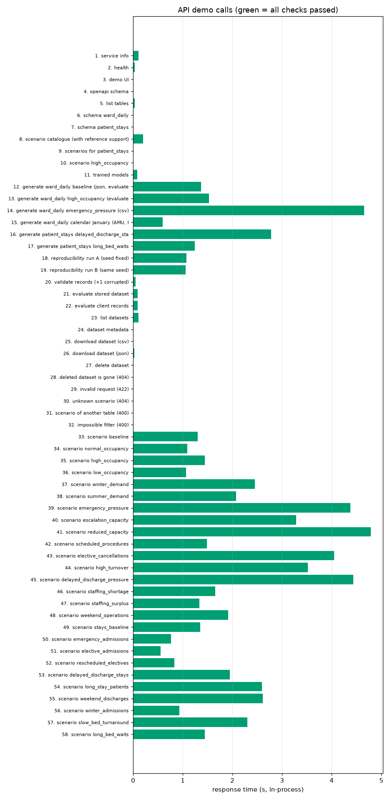

# BedSynth AI - Week 4: API and system evaluation

Generated 2026-11-15T12:21:26+00:00.

## Summary

- FastAPI generator with 15 endpoints on 14 paths (section 1): parameterised generation (scenario, conditions, filters, wards, seed, sample or calendar mode, JSON or CSV), validation of every record against the operational rules, metadata with every response, persisted datasets and an offline demo UI; how to run it, the request parameters, the response fields and an example are in sections 1.1-1.4.
- End-to-end demo: 58 of 58 API calls passed their checks; 26 of 26 scenarios returned validated datasets (sections 2-3).
- Default models behind the API: ward_daily `gc_tuned` (composite 0.958); patient_stays `gc_tuned` (composite 0.965) (section 4).
- Tests: 633 of 633 fast tests passed; 7 of 7 slow tests passed (section 5).

## 1. Service

The FastAPI service (`bedsynth.api`, `python scripts/04_serve_api.py`) exposes the generation engine: scenario-aware generation (JSON or CSV with `X-BedSynth-*` headers), record validation against the operational rules, quick quality evaluation against the reference data, persisted datasets and an offline demo UI at `/ui` (OpenAPI docs at `/docs`).

| method | path | purpose |
|---|---|---|
| GET | / | service info and links |
| GET | /health | status, versions, trained models, reference data |
| GET | /ui | single-page demo UI (no CDN) |
| GET | /api/v1/tables | tables, column counts, default model |
| GET | /api/v1/tables/{table}/schema | schema and rule catalogue |
| GET | /api/v1/scenarios[/{name}] | scenario catalogue (26 scenarios) |
| GET | /api/v1/models | trained models, metrics, defaults |
| POST | /api/v1/generate | generate validated synthetic data (sample or calendar mode) |
| POST | /api/v1/validate | validate client records |
| POST | /api/v1/evaluate | quick quality + validity |
| GET/DELETE | /api/v1/datasets[/{id}[/download]] | persisted generations |

### 1.1 Running the generator

From the project root, `python scripts/04_serve_api.py` starts the service with uvicorn (binds 127.0.0.1:8000 by default); `--port <port>` serves it on another port when 8000 is already in use, `--host 0.0.0.0` listens on every interface and `--reload` restarts it when the code changes. `uvicorn bedsynth.api.main:app --port <port>` runs the same application.
Then open http://127.0.0.1:8000/ui for the offline demo UI and http://127.0.0.1:8000/docs for the interactive OpenAPI documentation (Swagger UI, loaded from a CDN); /health reports the status, the trained models and the reference data.
Without trained models the service still starts: /health reports `degraded` and generation answers 503 with the command to run.

### 1.2 Generation request (`POST /api/v1/generate`)

JSON body with 18 fields, all optional (read from the request model `bedsynth.api.schemas.GenerateRequest`; unknown fields are rejected with 422). `-` = no default: omit the field or send null.

| field | type | default | meaning |
|---|---|---|---|
| `table` | 'ward_daily' / 'patient_stays' | `ward_daily` | Table to synthesise. |
| `num_rows` | integer, 1..10000 | `100` | Rows to generate in sample mode (1..10000, a JSON integer). Ignored in calendar mode, where the output has one row per ward per day. |
| `scenario` | string, at most 64 characters | - | Scenario name from GET /api/v1/scenarios; it must belong to `table`. Omit for an unconditional (baseline) sample. |
| `model_id` | string | - | Trained experiment id (GET /api/v1/models). Omit to use the registry default. |
| `wards` | list of string (1-8 items) | - | Restrict generation to these wards. Codes or common aliases are accepted (e.g. 'icu', 'General Medicine'). Known wards: AMU, GMED, ELDC, CARD, GSUR, ORTH, ICU, PAED. |
| `conditions` | object | - | Extra conditions on categorical training columns, intersected with the scenario's conditions: {column: value \| [values]}. Aliases are normalised (e.g. 'monday' -> 'Mon'). A column listing every value is dropped (same as no condition); after merging with the scenario and `wards`, the product of the value counts may not exceed settings.api.max_condition_combinations (default 1000; 400 too_many_combinations). |
| `filters` | object | - | Extra acceptance filters on training or derived columns, merged with the scenario's filters (bounds are tightened, value lists intersected). min/max apply to numeric columns only and must overlap the column's range; in/not_in values are coerced to the column type. Filters no row can satisfy are rejected with 400 invalid_filters. |
| `seed` | integer, 0..4294967295 | - | Random seed (a JSON integer). The same seed, model and request reproduce the same records when the request finishes within its time budget; when omitted a seed is drawn and reported in `generation.seed`. |
| `max_attempts` | integer, 1..100 | - | Maximum rejection-sampling rounds (1..100); omit for the engine default (settings.generation.max_attempts). Raise it for rare scenarios. |
| `time_budget_seconds` | number, > 0 and <= 120.0 | - | Time budget of the request in seconds (default 60, maximum 120). Sampling stops when it runs out and the shortfall is reported. |
| `mode` | 'sample' / 'calendar' | `sample` | 'sample' draws `num_rows` rows; 'calendar' (ward_daily only) produces one row per ward per date between `start_date` and `end_date`. |
| `start_date` | string (date) | - | First date (ISO) of the calendar (calendar mode). |
| `end_date` | string (date) | - | Last date (ISO, inclusive) of the calendar (calendar mode). |
| `include_derived` | boolean | `true` | Include derived columns (occupancy_rate, census_end, los_hours, ...) in the output. |
| `validate` | boolean | `true` | Run the operational rule checks (hard + soft) on the output and report them. |
| `evaluate` | boolean | `false` | Compute a quick quality score against the reference data (matching scenario subset when large enough). Adds roughly a second. |
| `format` | 'json' / 'csv' | `json` | 'json' returns records and reports; 'csv' returns text/csv with X-BedSynth-* headers (reports are stored with the dataset when persisted). |
| `persist` | boolean | `true` | Store the dataset (CSV + metadata) for later download via /api/v1/datasets. |

`validate` only switches the validation report on or off: rejection sampling against every hard rule always runs.

### 1.3 Generation response

With `format: "json"` the response carries the records together with their metadata (from the response model `bedsynth.api.schemas.GenerateResponse`):

| field | content |
|---|---|
| `dataset_id` | Dataset identifier ('ds-' + 12 hex characters). |
| `persisted` | True when the dataset was stored and can be downloaded later. |
| `created_at` | UTC creation timestamp (ISO 8601). |
| `table` | Table generated. |
| `n_rows` | Number of generated records. |
| `model` | The trained model that produced a dataset - fields id, synthesizer, sdv_version, fitted_at. |
| `scenario` | Scenario that shaped a generation - fields name, title, description, category; may be null. |
| `request` | Normalised echo of the request. |
| `generation` | Generation report: seed, attempts, sampled/accepted rows, acceptance_rate, rejections per rule and filter, condition allocation, elapsed_seconds, warnings. |
| `validation` | Rule validation (null when validate=false) - fields n_rows, n_hard_valid, hard_valid_rate, all_hard_rules_passed, hard_rules, soft_rules, rules. |
| `quality` | Quick quality (only when evaluate=true) - fields score, reference, metrics; may be null. |
| `columns` | List of: description of one output column (from the schema catalogue) - fields name, dtype, role, unit, description. |
| `warnings` | Warnings of the generation and validation steps. |
| `links` | Related endpoints for persisted datasets. |
| `records` | Generated rows (NaN encoded as null). |

With `format: "csv"` the body is `text/csv` and the dataset is described by response headers (as recorded by the demo): `X-BedSynth-Dataset-Id`, `X-BedSynth-Table`, `X-BedSynth-Rows`, `X-BedSynth-Model`, `X-BedSynth-Scenario`, `X-BedSynth-Seed`, `X-BedSynth-Persisted`, `X-BedSynth-Hard-Rules-Passed`; the full report is stored with the dataset (`GET /api/v1/datasets/{id}`) when it is persisted.

### 1.4 Example request and response

Demo step 12 (generate ward_daily baseline (json, evaluate); evidence `reports/api_demo/12_generate_ward_daily_baseline_json_evaluate.json`) sent `POST /api/v1/generate` with this body:

```json
{
  "table": "ward_daily",
  "num_rows": 300,
  "scenario": "baseline",
  "seed": 42,
  "evaluate": true
}
```

The response (status 200) carried 300 records (seed 42, acceptance 95.3 %, all hard rules passed: yes); trimmed below (nested objects shortened, first record only):

```json
{
  "dataset_id": "ds-dbd35a8375b2",
  "persisted": true,
  "created_at": "2026-11-15T05:36:30+00:00",
  "table": "ward_daily",
  "n_rows": 300,
  "model": {
    "id": "gc_tuned",
    "synthesizer": "GaussianCopulaSynthesizer",
    "sdv_version": "2.2.0",
    "fitted_at": "2026-11-15T05:01:30+00:00"
  },
  "scenario": {
    "name": "baseline",
    "title": "Baseline operations",
    "description": "Unconditional sample reproducing the real mix of wards, seasons and pressures.",
    "category": "baseline"
  },
  "request": {
    "table": "ward_daily",
    "num_rows": 300,
    "scenario": "baseline",
    "model_id": null,
    "wards": null,
    "conditions": null,
    "filters": null,
    "seed": 42,
    "...": "10 more fields"
  },
  "generation": {
    "seed": 42,
    "num_rows_requested": 300,
    "num_rows_generated": 300,
    "shortfall": 0,
    "attempts": 1,
    "sampled_rows": 486,
    "accepted_rows": 463,
    "acceptance_rate": 0.952675,
    "rejected_by_rule": {
      "WD-H06": 22,
      "WD-H15": 2
    },
    "...": "22 more fields"
  },
  "validation": {
    "n_rows": 300,
    "n_hard_valid": 300,
    "hard_valid_rate": 1.0,
    "all_hard_rules_passed": true,
    "hard_rules": {
      "checked": 15,
      "passed": 15,
      "failed": 0,
      "violations": 0
    },
    "soft_rules": {
      "checked": 6,
      "passed": 2,
      "failed": 4,
      "violations": 23
    },
    "rules": "[... 21 items]"
  },
  "quality": {
    "score": 0.9793,
    "reference": {
      "split": "train",
      "subset": "full",
      "reference_rows": 7016,
      "rows_compared": 5000,
      "synthetic_rows_compared": 300
    },
    "metrics": "{... 13 fields}"
  },
  "columns": [
    {
      "name": "record_id",
      "dtype": "str",
      "role": "key",
      "unit": null,
      "description": "Record identifier, e.g. WD-000001."
    },
    "... 34 more"
  ],
  "warnings": [],
  "links": {
    "self": "/api/v1/datasets/ds-dbd35a8375b2",
    "download_csv": "/api/v1/datasets/ds-dbd35a8375b2/download?format=csv",
    "download_json": "/api/v1/datasets/ds-dbd35a8375b2/download?format=json"
  },
  "records": [
    {
      "record_id": "WD-000001",
      "ward_id": "GSUR",
      "ward_type": "surgical",
      "month": 11,
      "season": "autumn",
      "day_of_week": "Tue",
      "is_weekend": false,
      "bed_capacity": 30,
      "...": "27 more fields"
    },
    "... 299 more records"
  ]
}
```

### 1.5 Documentation and demo materials

- [`docs/API.md`](../docs/API.md): API reference: every endpoint, parameters, responses, errors and limits
- [`docs/DEMO_SCRIPT.md`](../docs/DEMO_SCRIPT.md): live demo runbook with timings, commands and a fallback plan
- [`demo/requests.http`](../demo/requests.http): ready-made requests for the VS Code REST Client
- [`demo/demo_client.py`](../demo/demo_client.py): Python client that walks through every endpoint of a running server
- [`scripts/05_api_demo.py`](../scripts/05_api_demo.py): the in-process demo run behind sections 2-3 (evidence in the demo folder)
- Demo evidence: `reports/api_demo/` (one JSON file per call, `summary.md`) and the offline UI at /ui.

## 2. End-to-end API demo

`scripts/05_api_demo.py` exercised every endpoint in-process against the trained models (2026-11-15T05:37:39+00:00, SDV 2.2.0, 300 rows per generation, base seed 42): **58 passed, 0 failed, 0 skipped** of 58 steps. Evidence: `reports/api_demo/` (one JSON file per call plus `summary.md`).

| table | default model | trained models |
|---|---|---|
| ward_daily | gc_tuned | ctgan, gc_baseline, gc_segmented, gc_tuned, tvae |
| patient_stays | gc_tuned | ctgan, gc_baseline, gc_segmented, gc_tuned, tvae |

**Generation highlights**

- ward_daily primary: 300 rows, acceptance 95.3%, 1.259 s, all hard rules passed, quality 0.979, model gc_tuned
- ward_daily calendar: 62 rows, acceptance 94.1%, 0.569 s, all hard rules passed, model gc_tuned
- patient_stays primary: 300 rows, acceptance 88.8%, 2.724 s, all hard rules passed, quality 0.972, model gc_tuned

| # | step | request | status | ms | checks | outcome |
|---|---|---|---|---|---|---|
| 1 | service info | `GET /` | 200 | 105.3 | 1/1 | ok |
| 2 | health | `GET /health` | 200 | 32.3 | 1/1 | ok |
| 3 | demo UI | `GET /ui` | 200 | 3.7 | 2/2 | ok |
| 4 | openapi schema | `GET /openapi.json` | 200 | 2.5 | 1/1 | ok |
| 5 | list tables | `GET /api/v1/tables` | 200 | 30.1 | 1/1 | ok |
| 6 | schema ward_daily | `GET /api/v1/tables/ward_daily/schema` | 200 | 3.4 | 2/2 | ok |
| 7 | schema patient_stays | `GET /api/v1/tables/patient_stays/schema` | 200 | 2.8 | 2/2 | ok |
| 8 | scenario catalogue (with reference support) | `GET /api/v1/scenarios` | 200 | 199.8 | 1/1 | ok |
| 9 | scenarios for patient_stays | `GET /api/v1/scenarios` | 200 | 2.8 | 1/1 | ok |
| 10 | scenario high_occupancy | `GET /api/v1/scenarios/high_occupancy` | 200 | 3.6 | 1/1 | ok |
| 11 | trained models | `GET /api/v1/models` | 200 | 84.5 | 1/1 | ok |
| 12 | generate ward_daily baseline (json, evaluate) | `POST /api/v1/generate` | 200 | 1,368.2 | 4/4 | ok |
| 13 | generate ward_daily high_occupancy (evaluate) | `POST /api/v1/generate` | 200 | 1,523.1 | 4/4 | ok |
| 14 | generate ward_daily emergency_pressure (csv) | `POST /api/v1/generate` | 200 | 4,649.4 | 4/4 | ok |
| 15 | generate ward_daily calendar January (AMU, ICU) | `POST /api/v1/generate` | 200 | 590.2 | 3/3 | ok |
| 16 | generate patient_stays delayed_discharge_stays (evaluate) | `POST /api/v1/generate` | 200 | 2,781.4 | 4/4 | ok |
| 17 | generate patient_stays long_bed_waits | `POST /api/v1/generate` | 200 | 1,240.0 | 3/3 | ok |
| 18 | reproducibility run A (seed fixed) | `POST /api/v1/generate` | 200 | 1,071.6 | - | ok |
| 19 | reproducibility run B (same seed) | `POST /api/v1/generate` | 200 | 1,055.3 | 1/1 | ok |
| 20 | validate records (+1 corrupted) | `POST /api/v1/validate` | 200 | 46.9 | 2/2 | ok |
| 21 | evaluate stored dataset | `POST /api/v1/evaluate` | 200 | 87.7 | 1/1 | ok |
| 22 | evaluate client records | `POST /api/v1/evaluate` | 200 | 88.1 | 1/1 | ok |
| 23 | list datasets | `GET /api/v1/datasets` | 200 | 105.8 | 1/1 | ok |
| 24 | dataset metadata | `GET /api/v1/datasets/ds-dbd35a8375b2` | 200 | 7.4 | 1/1 | ok |
| 25 | download dataset (csv) | `GET /api/v1/datasets/ds-dbd35a8375b2/download` | 200 | 4.8 | 2/2 | ok |
| 26 | download dataset (json) | `GET /api/v1/datasets/ds-dbd35a8375b2/download` | 200 | 20.0 | 1/1 | ok |
| 27 | delete dataset | `DELETE /api/v1/datasets/ds-dbd35a8375b2` | 200 | 5.0 | 1/1 | ok |
| 28 | deleted dataset is gone (404) | `GET /api/v1/datasets/ds-dbd35a8375b2` | 404 | 2.9 | 1/1 | ok |
| 29 | invalid request (422) | `POST /api/v1/generate` | 422 | 2.5 | 1/1 | ok |
| 30 | unknown scenario (404) | `POST /api/v1/generate` | 404 | 2.6 | 1/1 | ok |
| 31 | scenario of another table (400) | `POST /api/v1/generate` | 400 | 2.5 | 1/1 | ok |
| 32 | impossible filter (400) | `POST /api/v1/generate` | 400 | 2.4 | 1/1 | ok |
| 33 | scenario baseline | `POST /api/v1/generate` | 200 | 1,301.4 | 3/3 | ok |
| 34 | scenario normal_occupancy | `POST /api/v1/generate` | 200 | 1,090.3 | 3/3 | ok |
| 35 | scenario high_occupancy | `POST /api/v1/generate` | 200 | 1,439.3 | 3/3 | ok |
| 36 | scenario low_occupancy | `POST /api/v1/generate` | 200 | 1,067.7 | 3/3 | ok |
| 37 | scenario winter_demand | `POST /api/v1/generate` | 200 | 2,447.6 | 3/3 | ok |
| 38 | scenario summer_demand | `POST /api/v1/generate` | 200 | 2,071.7 | 3/3 | ok |
| 39 | scenario emergency_pressure | `POST /api/v1/generate` | 200 | 4,371.9 | 3/3 | ok |
| 40 | scenario escalation_capacity | `POST /api/v1/generate` | 200 | 3,283.4 | 3/3 | ok |
| 41 | scenario reduced_capacity | `POST /api/v1/generate` | 200 | 4,791.6 | 3/3 | ok |
| 42 | scenario scheduled_procedures | `POST /api/v1/generate` | 200 | 1,487.4 | 3/3 | ok |
| 43 | scenario elective_cancellations | `POST /api/v1/generate` | 200 | 4,044.1 | 3/3 | ok |
| 44 | scenario high_turnover | `POST /api/v1/generate` | 200 | 3,518.0 | 3/3 | ok |
| 45 | scenario delayed_discharge_pressure | `POST /api/v1/generate` | 200 | 4,435.5 | 3/3 | ok |
| 46 | scenario staffing_shortage | `POST /api/v1/generate` | 200 | 1,649.6 | 3/3 | ok |
| 47 | scenario staffing_surplus | `POST /api/v1/generate` | 200 | 1,337.4 | 3/3 | ok |
| 48 | scenario weekend_operations | `POST /api/v1/generate` | 200 | 1,915.6 | 3/3 | ok |
| 49 | scenario stays_baseline | `POST /api/v1/generate` | 200 | 1,347.0 | 3/3 | ok |
| 50 | scenario emergency_admissions | `POST /api/v1/generate` | 200 | 759.5 | 3/3 | ok |
| 51 | scenario elective_admissions | `POST /api/v1/generate` | 200 | 552.7 | 3/3 | ok |
| 52 | scenario rescheduled_electives | `POST /api/v1/generate` | 200 | 831.9 | 3/3 | ok |
| 53 | scenario delayed_discharge_stays | `POST /api/v1/generate` | 200 | 1,946.6 | 3/3 | ok |
| 54 | scenario long_stay_patients | `POST /api/v1/generate` | 200 | 2,593.9 | 3/3 | ok |
| 55 | scenario weekend_discharges | `POST /api/v1/generate` | 200 | 2,606.9 | 3/3 | ok |
| 56 | scenario winter_admissions | `POST /api/v1/generate` | 200 | 930.5 | 3/3 | ok |
| 57 | scenario slow_bed_turnaround | `POST /api/v1/generate` | 200 | 2,300.2 | 3/3 | ok |
| 58 | scenario long_bed_waits | `POST /api/v1/generate` | 200 | 1,441.2 | 3/3 | ok |



*Response times of the API demo calls*

## 3. Scenario coverage through the API

The demo generated one dataset per scenario (100 rows each): 26 of 26 met every check (requested rows, all hard rules, every row inside the scenario) and 26 were stored in `data/synthetic/api_demo` as `data.csv` + `metadata.json` (request, generation report, validation, quality). The same folder also keeps the datasets that the other generation steps of section 2 persisted and the demo did not delete.

*acceptance* = accepted / sampled rows of that request; *hard rules* = every delivered row passed all hard rules; *quality* = the API's quick quality score (column shapes, pair trends and validity) against the reference data (the matching real scenario subset when it is large enough).

| scenario | table | category | rows | acceptance | hard rules | quality | dataset | outcome |
|---|---|---|---|---|---|---|---|---|
| baseline | ward_daily | baseline | 100 | 94.7 % | yes | 0.971 | ds-dc8e9f37d3f6 | ok |
| normal_occupancy | ward_daily | occupancy | 100 | 98.7 % | yes | 0.969 | ds-b98194437b9d | ok |
| high_occupancy | ward_daily | occupancy | 100 | 86.5 % | yes | 0.967 | ds-42c61363bab8 | ok |
| low_occupancy | ward_daily | occupancy | 100 | 100.0 % | yes | 0.966 | ds-43a0a2d3e834 | ok |
| winter_demand | ward_daily | seasonal | 100 | 88.6 % | yes | 0.971 | ds-6771654a6af5 | ok |
| summer_demand | ward_daily | seasonal | 100 | 98.9 % | yes | 0.972 | ds-c314554720d1 | ok |
| emergency_pressure | ward_daily | emergency | 100 | 8.2 % | yes | 0.925 | ds-11be79af12c9 | ok |
| escalation_capacity | ward_daily | utilization | 100 | 49.4 % | yes | 0.959 | ds-32d6b158943d | ok |
| reduced_capacity | ward_daily | utilization | 100 | 7.1 % | yes | 0.958 | ds-08b234a568b0 | ok |
| scheduled_procedures | ward_daily | scheduling | 100 | 76.1 % | yes | 0.958 | ds-d35d2686155d | ok |
| elective_cancellations | ward_daily | scheduling | 100 | 6.4 % | yes | 0.937 | ds-a17cb83ecdb8 | ok |
| high_turnover | ward_daily | turnover | 100 | 7.2 % | yes | 0.920 | ds-284af7ca3936 | ok |
| delayed_discharge_pressure | ward_daily | delayed_discharge | 100 | 15.4 % | yes | 0.964 | ds-732f9fed47b0 | ok |
| staffing_shortage | ward_daily | staffing | 100 | 83.8 % | yes | 0.964 | ds-d24532bf1c02 | ok |
| staffing_surplus | ward_daily | staffing | 100 | 96.5 % | yes | 0.971 | ds-f3ea90f07ab4 | ok |
| weekend_operations | ward_daily | patient_flow | 100 | 93.4 % | yes | 0.973 | ds-af7d27070015 | ok |
| stays_baseline | patient_stays | baseline | 100 | 96.0 % | yes | 0.968 | ds-042ba72ab2bf | ok |
| emergency_admissions | patient_stays | patient_flow | 100 | 92.3 % | yes | 0.963 | ds-7c4b5dcad70e | ok |
| elective_admissions | patient_stays | scheduling | 100 | 97.6 % | yes | 0.966 | ds-e18368273d4b | ok |
| rescheduled_electives | patient_stays | scheduling | 100 | 13.0 % | yes | 0.957 | ds-71c8d26f99f9 | ok |
| delayed_discharge_stays | patient_stays | delayed_discharge | 100 | 91.3 % | yes | 0.965 | ds-28e42f678d13 | ok |
| long_stay_patients | patient_stays | utilization | 100 | 23.6 % | yes | 0.961 | ds-c0fa6e536439 | ok |
| weekend_discharges | patient_stays | patient_flow | 100 | 22.9 % | yes | 0.969 | ds-b097bcb39fda | ok |
| winter_admissions | patient_stays | seasonal | 100 | 94.9 % | yes | 0.965 | ds-e413fc95cd59 | ok |
| slow_bed_turnaround | patient_stays | turnover | 100 | 8.0 % | yes | 0.968 | ds-5082b934adda | ok |
| long_bed_waits | patient_stays | emergency | 100 | 13.3 % | yes | 0.964 | ds-29fd764f5bff | ok |

## 4. Models behind the API

| table | model | composite | fidelity | validity | operational | utility | privacy |
|---|---|---|---|---|---|---|---|
| ward_daily | gc_tuned (default) | 0.958 | 0.968 | 0.938 | 0.946 | 0.960 | 0.997 |
| ward_daily | tvae | 0.832 | 0.886 | 0.770 | 0.796 | 0.760 | 0.998 |
| ward_daily | gc_segmented | 0.805 | 0.953 | 0.315 | 0.860 | 0.945 | 0.996 |
| ward_daily | ctgan | 0.758 | 0.864 | 0.515 | 0.757 | 0.714 | 1.000 |
| ward_daily | gc_baseline | 0.563 | 0.799 | 0.034 | 0.583 | 0.471 | 0.995 |
| patient_stays | gc_tuned (default) | 0.965 | 0.977 | 0.960 | 0.955 | 0.943 | 0.997 |
| patient_stays | ctgan | 0.789 | 0.930 | 0.833 | 0.752 | 0.368 | 1.000 |
| patient_stays | tvae | 0.749 | 0.825 | 0.873 | 0.639 | 0.452 | 0.991 |
| patient_stays | gc_segmented | 0.698 | 0.903 | 0.243 | 0.767 | 0.582 | 0.996 |
| patient_stays | gc_baseline | 0.390 | 0.551 | 0.006 | 0.409 | 0.153 | 0.988 |

Details: [`reports/week3_evaluation.md`](week3_evaluation.md).

## 5. Testing evidence

Fast test suite (`pytest -m "not slow"`, 2026-11-15T05:31:16+00:00): **633 passed, 0 failed, 0 errors, 0 skipped** of 633 tests in 161.9 s.

| test file | passed | failed | skipped |
|---|---|---|---|
| test_api.py | 144 | 0 | 0 |
| test_evaluation.py | 67 | 0 | 0 |
| test_generator.py | 62 | 0 | 0 |
| test_packaging.py | 8 | 0 | 0 |
| test_preprocessing.py | 52 | 0 | 0 |
| test_reporting.py | 20 | 0 | 0 |
| test_schema.py | 24 | 0 | 0 |
| test_simulator.py | 65 | 0 | 0 |
| test_synthesis.py | 97 | 0 | 0 |
| test_validation.py | 94 | 0 | 0 |

The API tests drive every endpoint through `fastapi.testclient` (contract, limits, error envelope, concurrency and security regressions).

Slow test suite (`pytest -m slow`, 2026-11-15T05:34:01+00:00): **7 passed, 0 failed, 0 errors, 0 skipped** of 7 tests in 145.8 s.

| test file | passed | failed | skipped |
|---|---|---|---|
| test_api.py | 1 | 0 | 0 |
| test_evaluation.py | 2 | 0 | 0 |
| test_simulator.py | 1 | 0 | 0 |
| test_synthesis.py | 3 | 0 | 0 |

The slow tests fit real SDV models (CTGAN and TVAE included) and run the simulator calibration, the API and the evaluation on real engines end to end.

## 6. Guarantees and limitations

- Every generated record passes all hard operational rules (rejection sampling); the response reports the acceptance rate, rejected rows per rule, the seed and any shortfall. A request no row can satisfy returns 422 `no_rows_generated` and stores nothing.
- The same request with the same seed returns identical records (seeded SDV sampling) when it finishes within its time budget (`time_budget_seconds`, default 60 s, at most 120 s).
- Requests are bounded: at most 1,000 condition combinations (400 `too_many_combinations`), a per-request time budget, and at most 4 generations running or queued (503 `server_busy` with `Retry-After` when full).
- `/validate` recomputes every derived column: provided derived values that contradict their definition make the row hard-invalid (`WD-D01` / `PS-D01`).
- CORS admits pages served from this machine only (`settings.api.cors_origin_regex`); the API has no authentication and is meant for local or trusted networks.
- Calendar-mode rows are conditionally independent draws: day-to-day census continuity is not modelled.
- Tables are synthesised independently (no linkage of stays to ward-days); the reference data is simulated.
- `/docs` and `/redoc` load Swagger UI / ReDoc assets from a CDN; `/ui` works fully offline.
